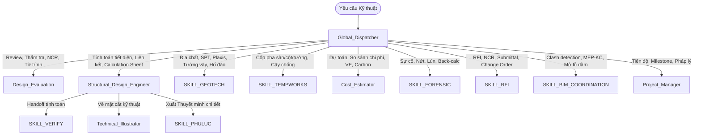

# HỒ SƠ KIỂM TOÁN TOÀN DIỆN HỆ SINH THÁI AGENTIC (v7.0)
## ECOSYSTEM AUDIT DOSSIER — DÀNH CHO CHUYÊN GIA / AUDITOR ARGON
> **Thời điểm xuất:** 2026-10-18T07:40:00+07:00  
> **Phiên bản hệ thống:** v7.0 (Sprint 2 Complete + Hotfix TCVN 5574:2018 & Keywords Sync)  
> **Cơ sở hạ tầng:** `.agents/` (Google AI Studio / Antigravity IDE)  
> **Mục đích:** Cung cấp toàn bộ bức tranh kiến trúc, tiêu chuẩn, mã nguồn, bộ kiểm thử và các hotfix mới nhất để kiểm tra chéo độc lập (Third-Party / Cross-Agent Verification).

---

## 1. TỔNG QUAN HỆ THỐNG (EXECUTIVE SUMMARY)

| Chỉ số | Số lượng / Trạng thái | Ghi chú |
| :--- | :--- | :--- |
| **Tổng số Skills** | **13 Skills** | 10 Production + 3 Hoàn thiện nâng cấp |
| **Tổng số Calculator Scripts** | **95 Scripts** | Bao gồm BTCT, Kết cấu thép, Địa kỹ thuật, Tải trọng, Móng, Cốp pha |
| **Tiêu chuẩn Version Locked** | **15 Tiêu chuẩn & Quy chuẩn** | Nguồn sự thật duy nhất tại `STANDARDS_LOCK.md` |
| **Keyword Database (Intent)** | **378 Keywords** | 170 Primary, 151 Secondary, 57 Regex, 13 Anti-keywords |
| **Pipeline Templates** | **7 Templates** | Tự động chaining đa kỹ năng qua handoff JSON |
| **Test Suites** | **6 Suites (139/139 PASS)** | 100% Pass rate trong 1.06s — 0 Warning, 0 Fail |
| **Policy Engine** | **Phase C (Full Suite)** | 36 rules thực thi: Utilization η, 15 triggers, 18 red flags |
| **Confidence Scoring** | **v2.0 (Veto Multiplier)** | Standard method missing / Compliance = 0 -> Veto 0.0 |

---

## 2. 7 NGUYÊN TẮC CỐT LÕI (CORE ENGINEERING RULES - AGENTS.md)

1. **Deterministic Math (Cấm nhẩm tay):** Mọi tính toán kỹ thuật bắt buộc phải gọi script Python xác định trong `calculators/` hoặc `scripts/`, đọc output JSON từ `stdout`.
2. **Hệ số Sử dụng $\eta$ (Utilization Ratio):** $\eta = \text{Tác động} / \text{Khả năng chịu lực}$. Phân cấp mã màu:
   - $\eta \le 0.70$ (Xanh 🟢): An toàn, có dư $\rightarrow$ kích hoạt Value Engineering (VE).
   - $0.70 < \eta \le 0.90$ (Vàng 🟡): Đạt, thiết kế tối ưu.
   - $0.90 < \eta \le 1.00$ (Cam 🟠): Đạt nhưng sát ngưỡng $\rightarrow$ cảnh báo lưu ý.
   - $\eta > 1.00$ (Đỏ 🔴): KHÔNG ĐẠT $\rightarrow$ yêu cầu tăng tiết diện / gia cố.
3. **Standards Citation Lock:** Trích dẫn chính xác 4 thành phần: `[Mã]:[Năm] — Điều/Bảng [số] — Trang [số] — [Trích yếu]`. Cấm dùng lẫn lộn 2 phiên bản của cùng 1 tiêu chuẩn.
4. **Review Gate & Định nghĩa xác nhận:** Bắt buộc in tóm tắt chỉ số $\eta$, thông số chốt, danh sách `UNVERIFIED` ra chat và nhận xác nhận rõ ràng của User trước khi xuất file `.docx`/`.pdf`.
5. **No Hallucination:** Thiếu dữ kiện phải ghi rõ `Data Missing: [Tên thông số]`, tuyệt đối không tự bịa số liệu vật liệu hay tải trọng.
6. **Minimum Narrative Depth:** Tờ trình / báo cáo chính thức phải đạt $\ge 800$ từ diễn giải kỹ thuật (không tính bảng, heading).
7. **Mandatory Illustration Integration:** Bắt buộc tối thiểu 2 hình ảnh minh họa (Mặt cắt kỹ thuật 2D Python + Phối cảnh 3D/biểu đồ).

---

## 3. DANH MỤC 13 SKILLS & VAI TRÒ ĐIỀU PHỐI



| # | Skill Name | Version | Role & Entry Point | Tiêu chuẩn chủ đạo |
|---|---|---|---|---|
| 1 | **Global_Dispatcher** | 1.0.0 | Bộ điều phối trung tâm, phân loại prompt qua `intent_classifier.py` (378 keywords). | Toàn bộ hệ sinh thái |
| 2 | **Structural_Design_Engineer** | 1.3.0 | Thiết kế chịu lực BTCT, Thép, Móng, Chi tiết liên kết, xuất Thuyết minh tính toán. | TCVN 5574:2018, TCVN 5575:2024, TCVN 10304:2025 |
| 3 | **Design_Evaluation** | 2.2.0 | Đại diện QLTK / Chủ đầu tư: thẩm tra, review, nghiệm thu, xử lý NCR, lập tờ trình. | TCVN 2737:2023, TCVN 5574:2018, Eurocode, ACI |
| 4 | **SKILL_GEOTECH** | 3.0.0 | Phân tích ĐCCT, thông số Plaxis, Base Heave, Cừ larsen JIS A 5528, Strut, Waling. | TCVN 9351:2012, TCVN 10304:2025 |
| 5 | **SKILL_TEMPWORKS** | 0.2.0 | Thiết kế ván khuôn sàn/cột/vách, đà giáo, cây chống shoring/bracing. | ACI 347-04, TCVN 4453:1995 |
| 6 | **Cost_Estimator** | 1.2.0 | Bóc tách BOQ, định giá vật tư, phân tích Value Engineering, Embodied Carbon, ROI. | Suất vốn đầu tư BXD |
| 7 | **SKILL_FORENSIC** | 1.2.0 | Điều tra sự cố công trình, tính toán ngược (back-calculation), phân tích cơ chế phá hủy. | TCVN 5574:2018, Forensic Protocol |
| 8 | **SKILL_VERIFY** | 1.2.0 | Kiểm chứng chéo độc lập giữa các module và phần mềm (ETABS, SAP2000), sai lệch > 5%. | Tolerance Matrix (3%/5%/12%) |
| 9 | **SKILL_PHULUC** | 1.1.0 | Lập phụ lục tính toán chi tiết (Calculation Sheet) chuyên sâu cho tư vấn thiết kế. | TMTT_FULL, PARTIAL Templates |
| 10 | **SKILL_RFI** | 1.2.0 | Quản lý giao dịch kỹ thuật: RFI, NCR, Shop Drawing, Submittal, Change Order. | Document Lifecycle |
| 11 | **Technical_Illustrator** | 1.3.0 | Vẽ kỹ thuật 2D chính xác (Python/matplotlib) và tạo ảnh minh họa 3D (AI Render). | Hướng dẫn Mode 2D/3D |
| 12 | **Project_Manager** | 0.5.0 | Quản lý tiến độ, milestone, lộ trình pháp lý, ma trận rủi ro (Risk Register). | Project Grading, Roadmap |
| 13 | **SKILL_BIM_COORDINATION** | 0.5.0 | Phối hợp không gian BIM, kiểm tra xung đột MEP - Kết cấu, xuyên sàn/dầm. | IFC Clash Detection Engine |

---

## 4. TIÊU CHUẨN ĐƯỢC KHÓA PHIÊN BẢN (STANDARDS LOCK v2.3.0)

| STT | Lĩnh vực chuyên môn | Phiên bản chuẩn hiện hành | Phiên bản cũ thay thế |
| :---: | :--- | :--- | :--- |
| 1 | Tải trọng và tác động | **TCVN 2737:2023** | TCVN 2737:1995 |
| 2 | Thiết kế kháng chấn | **TCVN 9386:2025** | TCVN 9386:2012 |
| 3 | Kết cấu bê tông cốt thép | **TCVN 5574:2018** | TCVN 5574:2012 |
| 4 | Kết cấu thép | **TCVN 5575:2024** | TCVN 5575:2012 |
| 5 | Kết cấu gạch đá & khối xây | **TCVN 5573:2025** | TCVN 5573:2011 |
| 6 | Móng cọc | **TCVN 10304:2025** | TCVN 10304:2014 |
| 7 | Nền nhà và công trình | **TCVN 9362:2012** | — |
| 8 | Thi công & nghiệm thu BTCT | **TCVN 4453:1995** | — |
| 9 | Phân cấp công trình | **QCVN 03:2022/BXD** | TT 06/2021/BXD |
| 10 | Số liệu điều kiện tự nhiên | **QCVN 02:2022/BXD** | QCVN 02:2009/BXD |
| 11 | An toàn cháy cho nhà & công trình | **QCVN 06:2022/BXD** | QCVN 06:2021/BXD |

---

## 5. CHI TIẾT BẢN VÁ KỸ THUẬT MỚI NHẤT (HOTFIX LOG)

### 5.1 Hotfix `calc_anchorage_lap.py` (TCVN 5574:2018)
* **Vị trí file:** `.agents/skills/Structural_Design_Engineer/scripts/calc_anchorage_lap.py`
* **Vấn đề đã khắc phục:** Loại bỏ hoàn toàn các trích dẫn sai cũ (CT 8.3, Bảng 8.5, 8.6, Điều 8.3.20–8.3.31) và sửa lỗi nhầm lẫn chia 4 trong công thức cơ sở.
* **Công thức chuẩn hóa:**
  1. **Cường độ bám dính (Mục 10.3.5.2 - CT 191):**
     $$R_{bond} = \eta_1 \cdot \eta_2 \cdot R_{bt}$$
     - $\eta_1 = 2.5$ (thép gân CB300-V, CB400-V, CB500-V), $\eta_1 = 1.5$ (thép trơn CB240-T).
     - $\eta_2 = 1.0$ ($d_s \le 32\text{ mm}$), $\eta_2 = 0.9$ ($d_s \in \{36, 40\}\text{ mm}$).
  2. **Chiều dài neo cơ sở (Mục 10.3.5.2 - CT 192):**
     $$L_{0,an} = \frac{R_s \cdot A_s}{R_{bond} \cdot u_s} = \frac{R_s \cdot d_s}{4 \cdot R_{bond}}$$
     *(Chứng minh: $A_s/u_s = (\pi d_s^2 / 4) / (\pi d_s) = d_s / 4$).*
  3. **Chiều dài neo tính toán (Mục 10.3.5.3 - CT 193):**
     $$L_{an} = \alpha_{an} \cdot L_{0,an} \cdot \left(\frac{A_{s,req}}{A_{s,prov}}\right) \ge \max(0.3 \cdot L_{0,an}, 15 \cdot d_s, 200\text{ mm})$$
     - $\alpha_{an} = 1.0$ (kéo), $\alpha_{an} = 0.75$ (nén).
  4. **Chiều dài nối chồng tính toán (Mục 10.3.6.3 - CT 194):**
     $$L_{lap} = \alpha_{lap} \cdot L_{0,an} \cdot \left(\frac{A_{s,req}}{A_{s,prov}}\right) \ge \max(0.4 \cdot \alpha_{lap} \cdot L_{0,an}, 20 \cdot d_s, 250\text{ mm})$$
     - $\alpha_{lap} = 1.2$ (kéo), $\alpha_{lap} = 0.9$ (nén).
* **Kết quả Sample mặc định ($\Phi 16$, CB400-V, B25, kéo):**
  - $R_{bond} = 2.625\text{ MPa}$
  - $L_{0,an} = 533.3\text{ mm}$ ($33.3 d_s$)
  - $L_{an} = 533.3\text{ mm}$ ($\approx 533\text{ mm}$)
  - $L_{lap} = 640.0\text{ mm}$ ($40.0 d_s$)

### 5.2 Đồng bộ Keyword Database
* **Vị trí file:** `.agents/skills/Global_Dispatcher/scripts/keyword_database.json`
* **Nội dung:** Cập nhật `_meta.total_keywords` từ `280` lên `378` để khớp chính xác với thực tế 170 primary + 151 secondary + 57 regex.

---

## 6. KẾT QUẢ KIỂM THỬ TỔNG HỢP (TEST SUITE RESULTS)

Chạy thực tế qua lệnh: `python .agents/tests/run_all_tests.py`

```text
================================================================================
  TỔNG KẾT BỘ KIỂM TRA TOÀN DIỆN HỆ SINH THÁI .AGENTS
================================================================================
  ✅ PASS | 1. Integration Test (67 checks)                    (0.29s)
  ✅ PASS | 2. Regression Calculator Test (13 calculators)     (0.20s)
  ✅ PASS | 3. Pre-Execution Approval Gate (32 tests)          (0.18s)
  ✅ PASS | 4. Intent Classifier Benchmark (17 tests)          (0.11s)
  ✅ PASS | 5. E2E Pipeline Workflow                           (0.15s)
  ✅ PASS | 6. DE Calculators Unit Tests (10 tests)            (0.14s)
--------------------------------------------------------------------------------
  🎉 TẤT CẢ TEST SUITES ĐỀU VƯỢT QUA! (Tổng: 139 passed / 0 failed trong 1.06s)
```

---

## 7. CÂU LỆNH KIỂM TOÁN MẪU DÀNH CHO ARGON (PROMPT FOR ARGON)

> **Hướng dẫn cho User:** Copy toàn bộ đoạn dưới đây và gửi kèm hồ sơ này vào Argon:

```text
Chào bạn Argon, đây là toàn bộ Hồ sơ Kiến trúc và Kiểm toán Kỹ thuật (v7.0) của Hệ sinh thái AI Kỹ thuật Kết cấu (.agents).
Tôi cần bạn đóng vai trò là Chuyên gia Độc lập (Independent Lead Auditor) để thực hiện rà soát toàn diện:

1. Rà soát Tính Đúng đắn Cơ học & Tiêu chuẩn:
   - Kiểm tra các công thức neo và nối chồng cốt thép trong TCVN 5574:2018 (Mục 10.3.5 & Mục 10.3.6: CT 191, 192, 193, 194) xem có bất kỳ thiếu sót hoặc ngoại lệ nào chưa được bao phủ không (ví dụ: cốt thép trong vùng chịu động đất, neo uốn móc, hệ số nhóm thép).
   - Kiểm tra danh mục Tiêu chuẩn Locked có còn tiêu chuẩn nào bị xung đột năm ban hành không.

2. Rà soát Cơ chế Điều phối (Global Dispatcher & Pipeline):
   - Đánh giá bảng phân xử (Tie-breaker logic) và ma trận trọng số 378 từ khóa. Liệu có trường hợp nào gây deadlock hoặc nhận diện sai Intent giữa Quản lý Thiết kế (Design_Evaluation) và Kỹ sư Thiết kế (Structural_Design_Engineer) không?

3. Rà soát Chính sách An toàn Kỹ thuật (Policy Engine & Review Gate):
   - Đánh giá phân vùng ngưỡng sử dụng eta: eta <= 0.70 (VE), 0.70 - 0.90 (tối ưu), 0.90 - 1.00 (cảnh báo), > 1.00 (block).
   - Đánh giá cơ chế Veto Multiplier (trả điểm tin cậy 0.0 nếu thiếu Standard Method).

Hãy đưa ra:
- Danh sách Điểm Mạnh (Strengths)
- Các Lỗ hổng Kỹ thuật Tiềm ẩn (Potential Gaps/Risks)
- Khuyến nghị Nâng cấp Cụ thể (Actionable Recommendations) cho phiên bản tiếp theo.
```
