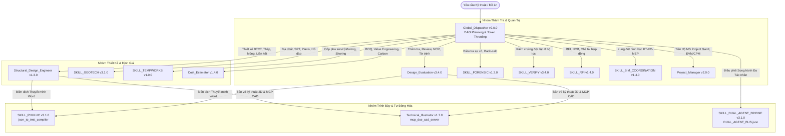
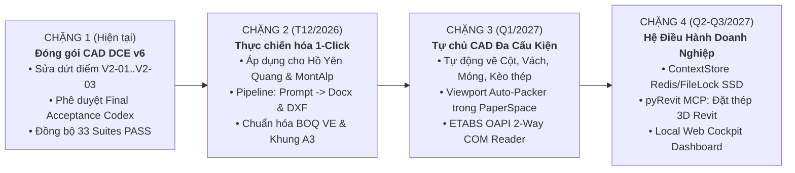

# HỒ SƠ KIỂM TOÁN HỆ SINH THÁI AGENTIC & CHUYÊN ĐỀ CAD DCE PRO (v7.5)
## COMPREHENSIVE ECOSYSTEM AUDIT DOSSIER & CAD SPECIAL REPORT — DÀNH CHO CHUYÊN GIA ARGON

> **Thời điểm xuất:** 2026-11-17T08:35:00+07:00  
> **Đơn vị nhận hồ sơ:** Chuyên gia / Lead Auditor **Argon**  
> **Phiên bản hệ sinh thái:** v7.5 (Unified Master Architecture — Single Canonical Pipeline & CAD Semantics v6)  
> **Cơ sở hạ tầng:** `.agents/` (`g:\My Drive\Google AI Studio\.agents`)  
> **Mục đích:** Báo cáo toàn diện hiện trạng hệ thống Agent, trọng tâm chuyên sâu vào Hệ thống MCP CAD / DCE Pro v6, và xin ý kiến phản biện kỹ thuật độc lập từ chuyên gia Argon.

---

## 1. TỔNG QUAN HỆ THỐNG & DASHBOARD NĂNG LỰC (EXECUTIVE SUMMARY)

Trải qua quá trình nâng cấp từ đợt kiểm toán v7.0/v7.1 của chuyên gia Argon đến nay, hệ sinh thái điều phối kỹ thuật `.agents` đã hoàn thiện toàn diện với các chỉ số định lượng:

| Chỉ số Định lượng | Phiên bản v7.0 (Đợt kiểm toán trước) | Phiên bản v7.5 Hiện tại | Đánh giá & Bước phát triển |
|---|:---:|:---:|---|
| **Production Skills** | 13 Skills | **14 Skills Sản Xuất** | Bổ sung `SKILL_DUAL_AGENT_BRIDGE` (v3.1.0) điều phối liên tác tử chuẩn bus IPC. |
| **Deterministic Calculators** | 95 Scripts | **111 Calculators** | Phủ 100% BTCT, Thép, Móng, ĐCCT, Cốp pha, EVM/CPM, Phân tích phi tuyến sợi 3D. |
| **Hệ thống Kiểm thử (CI/CD)** | 6 Suites (139 checks) | **33 Suites (> 800 checks)** | Full regression đạt 33/33 PASS (154.58s); bổ sung smoke tier `--fast` (< 15s). |
| **Tiêu chuẩn Version Locked** | 15 Tiêu chuẩn | **21 Tiêu chuẩn Hiện hành** | Khóa cứng TCVN 2737:2023, 5575:2024, 5574:2018, 9386:2025, TT 34/2026, QCVN 03/06. |
| **Công cụ Kiểm toán Tiêu chuẩn** | Thủ công tra bảng | **`citation_grounding_auditor.py`** | Đối chiếu trực tiếp trích dẫn với PDF tiêu chuẩn gốc lưu tại `00_Template_&_Standards`. |
| **Hạ tầng MCP CAD** | Chưa có (gọi script rời) | **10 MCP Tools Tiêu chuẩn** | Server `mcp_dce_cad_server.py` bọc quanh engine DCE Pro (stdio JSON-RPC). |
| **Bộ Layer Chuẩn Hợp Nhất** | Phân tán nhiều file | **86 Layers SSOT** | Hợp nhất 46 Form 2 + 16 DCE Steel + 16 Khung mặt bằng + 8 Compat. |
| **Quy tắc Kiểm soát Cốt lõi** | 7 Quy tắc | **20 Hard Rules (AGENTS.md v7.4)** | Ban hành bổ sung Điều 12b (Zero White Text), 12c (Cấp BT), 12d (CAD), 12e (Typography). |

---

## 2. KIẾN TRÚC ĐIỀU PHỐI & DANH MỤC 14 PRODUCTION SKILLS



### Bảng Kiểm Kê Chi Tiết 14 Production Skills:
1. **`Global_Dispatcher` (v2.0.0):** Dynamic conditional DAG planning, runtime dependency readiness, bảo vệ cycle evidence và session token throttling.
2. **`Design_Evaluation` (v3.4.0):** Thẩm tra kết cấu và đa bộ môn cấp Chủ trì, thực thi Quy trình 7 Cổng Kiểm soát (Gate 0–6), tích hợp CAD Deep Reader trích xuất DWG/DXF.
3. **`Structural_Design_Engineer` (v1.3.0):** Kỹ sư thiết kế độc lập, tính toán trạng thái giới hạn ULS/SLS dầm/cột/móng, liên kết bu lông/hàn/neo, xuất Calculation Sheet chi tiết.
4. **`SKILL_PHULUC` (v3.1.0 — Master Engine):** Tự động biên dịch từ JSON sang Markdown và xuất Word (`.docx`) chuẩn BKTECHS và TVTK Đa Hạng mục; tích hợp cổng kiểm toán độc lập 8 tiêu chí `audit_phuluc_docx.py`.
5. **`Technical_Illustrator` (v1.7.0):** Xuất bản vẽ CAD DCE Pro chuẩn thi công, MCP Adapter Server, biểu đồ tiến độ Gantt MS Project 300 DPI Split View A4 Landscape.
6. **`SKILL_VERIFY` (v3.4.0):** Hệ thống kiểm chứng độc lập 8 bộ lọc (EMF Vector, Load Auditor, ETABS Joint Tracer, Rebar Area, Drawing Sync, Formula Checker, CAD Graph Reader & DCE Pro CAD Compliance Auditor).
7. **`SKILL_GEOTECH` (v3.1.0):** Phân tích ĐCCT, tương quan SPT/CPT, thông số đất Plaxis Hardening Soil, Base Heave hố đào sâu, quy đổi DW/Strut sang ETABS.
8. **`Project_Manager` (v2.0.0):** Giám đốc PMO, lập Master Schedule, chuyển đổi 2 chiều XML Microsoft Project (MSPDI Schema), phân tích EVM/CPM và kiểm soát KPI ISO 9001.
9. **`Cost_Estimator` (v1.4.0):** Định giá vật tư từ BOQ, phân tích Value Engineering (VE), tính hàm lượng Carbon (Embodied Carbon), chi phí lãi vay ẩn và CAPEX.
10. **`SKILL_TEMPWORKS` (v1.0.0):** Thiết kế ván khuôn sàn/cột/tường, đà giáo, cây chống shoring, kiểm tra ổn định thi công theo TCVN 4453:1995 & ACI 347.
11. **`SKILL_RFI` (v1.4.0):** Quản lý kỹ thuật và chế tài hợp đồng: RFI, NCR, Submittal, Change Order theo NĐ 175/2024/NĐ-CP, TT 34/2026/TT-BXD & FIDIC White Book.
12. **`SKILL_FORENSIC` (v1.2.0):** Điều tra sự cố sập/nứt/lún, back-calculation xác định tải trọng thực tế, xếp hạng xác suất nguyên nhân và đề xuất phương án xử lý.
13. **`SKILL_BIM_COORDINATION` (v1.4.0):** Rà soát xung đột hình học không gian 3D, lưới trục, cao độ thông thủy và đối chiếu nội bộ bản vẽ KT $\leftrightarrow$ KC $\leftrightarrow$ MEP.
14. **`SKILL_DUAL_AGENT_BRIDGE` (v3.1.0):** Giao thức điều phối song hành hoặc luân phiên giữa Gemini và Claude qua bus nguyên tử `DUAL_AGENT_BUS.json`, cơ chế Mutex chống xung đột Google Drive.

---

## 3. CHUYÊN ĐỀ SÂU: HỆ THỐNG MCP CAD & ĐỘT PHÁ DCE PRO V6

Đây là nâng cấp kỹ thuật lớn nhất của hệ thống trong tháng 11/2026, chuyển hóa năng lực đồ họa từ việc vẽ các hình học minh họa đơn lẻ sang **Hệ thống Xuất Bản vẽ Kỹ thuật Thi công Chuẩn Công nghiệp**.

```text
Structural Model JSON / build_structural_model()
        │
        ├──► cad_element_registry.CadElementRegistry (Element ID bất biến)
        ├──► sheet_scale_fitter.SheetScaleSolver (Chọn khổ A2/A1/A0 & TCVN 1:S)
        ▼
cad_plan_engine.export_dce_plan(..., v6=True)  [DcePlanEngine + DCE_Master_Seed_Template.dxf]
        │  ├── dce_block_binding.py / dce_block_catalog.py  (Binding thuộc tính & catalog block)
        │  ├── cad_tag_placement.py / cad_collision_solver.py (Né chữ hình học + chống đè)
        │  └── dce_steel_adapter.py                         (Cấu kiện thép I/H/Box/Pipe/Bản mã)
        ▼
Output DXF + .dce_audit.json sidecar (OK_V6)
        │
        ├──► Single-sheet MCP CAD: tools/mcp_dce_cad_server.py -> render_cad_plan(v6=True)
        └──► Multi-sheet CAD Set: cad_sheet_set.export_project_a3_sheets()
                   └── KC-02_DinhViCotVach.dxf + KC-03_KetCauDamSan.dxf + project_element_registry.json
                   └── (PNG / PDF A3 chỉ xuất khi ghi rõ render_previews=True / export_pdf=True)
```

### 3.1. Triết Lý Thiết Kế MCP CAD
1. **"MCP làm giao diện, engine DCE làm thực chất":** Server MCP (`mcp_dce_cad_server.py`) bọc mỏng quanh lõi `cad_plan_engine.py`, giao tiếp qua stdio JSON-RPC. Toàn bộ thực thể CAD được tạo ra bởi thư viện `ezdxf` dựa trên seed template nguyên bản của phần mềm thương phẩm DCE Pro (`DCE_Master_Seed_Template.dxf` AC1021). Không phụ thuộc việc AutoCAD có đang chạy hay không.
2. **Khóa Luồng CAD-first (Không Mặc Định Xuất PDF):** Khắc phục triệt để sai lầm trước đây khi tự động xuất hàng loạt file PDF/PNG dư thừa. Mặc định chỉ xuất CAD (`.dxf`/`.dwg`). PDF chỉ được sinh khi người dùng yêu cầu rõ ràng (`export_pdf=True`).
3. **Perception Loop & Visual Gate:** Khép kín vòng lặp cảm nhận trực quan. Sau khi xuất DXF, hệ thống có khả năng render ảnh PNG 300 DPI vào thư mục tạm được bảo vệ (`dce_virtual_drive_guard.py`) để Vision AI trực tiếp kiểm tra va chạm nhãn, đè nét trước khi phát hành.
4. **Single Canonical Engine:** Xóa bỏ hoàn toàn việc viết các generator vẽ khung/layer song song từ đầu trên fixture hộp giả lập. Toàn bộ bản vẽ phải đi qua `DcePlanEngine` chính quy.

---

### 3.2. Danh Mục 10 Công Cụ MCP CAD Tiêu Chuẩn (`tools/mcp_dce_cad_server.py`)

| STT | Tool MCP | Tham số Đầu vào | Hành vi Kỹ thuật & Ràng buộc Hợp đồng |
|:---:|---|---|---|
| 1 | `render_cad_plan` | `sheet_type`, `model_json_path`, `v6=True`, `dry_run` | Xuất bản vẽ mặt bằng KC-01, KC-02, KC-03, `CUSTOM_MULTIVIEW` A3. Trả về `output_dxf`, hash SHA256 và sidecar `.dce_audit.json`. |
| 2 | `render_preview` | `dxf_path`, `dpi=300`, `view_box` | Render DXF sang PNG 300 DPI cục bộ trong local scratch (Virtual Drive Guard), trả về `preview_id`. |
| 3 | `consume_preview` | `preview_id` | Nạp ảnh trả về `ImageContent` cho Vision AI kiểm tra; **tự hủy file PNG** ngay sau khi đọc (Token 1 lần). |
| 4 | `release_preview` | `preview_id` | Giải phóng file PNG khi client không xem ảnh hoặc hủy phiên kiểm tra. |
| 5 | `validate_cad` | `dxf_path`, `profile` (`physical` / `plan` / `full`) | Chạy Bộ lọc 8 kiểm toán 20 cổng tuân thủ. Mặc định `full` yêu cầu đầy đủ bằng chứng hash; `physical` kiểm tra entity/layer/sanity. |
| 6 | `edit_entity` | `session_dir`, `handle`, `action`, `expected_revision` | Khóa sửa đổi lạc quan (`revision-locking`). Di chuyển nhãn, sửa text dựa trên handle; từ chối commit nếu revision bị lệch. |
| 7 | `resolve_cad_collisions` | `dxf_path`, `dry_run` | Ứng dụng R-tree không gian để tự động phát hiện và dịch chuyển nhãn text né đường kích thước. |
| 8 | `convert_to_dwg` | `dxf_path`, `out_dwg` | Biên dịch sang DWG nhị phân qua ODA File Converter. Nếu máy chưa cài ODA $\to$ trả `UNAVAILABLE` kèm hướng dẫn (không làm crash hệ thống). |
| 9 | `auto_layout_and_scale_plan` | `json_model_path`, `target_fill_ratio=0.75` | Tự động tính toán bao hình, tự nâng khổ A2 $\to$ A1 $\to$ A0 và chọn tỷ lệ TCVN để đạt Fill Ratio 65–85%. |
| 10 | `export_cad_sheet_set` | `model_json_path`, `output_dir` | Xuất trọn bộ bản vẽ công trình thật + `project_element_registry.json`. |

---

### 3.3. Bộ 86 Layer Chuẩn Hợp Nhất (SSOT Layer Matrix)
Nguồn sự thật tại `_SHARED/data/dce_layers_standard.json` và `_SHARED/SHARED_CONTEXT/cad_layer_standard.py`:
- **46 Layers Form 2 BTCT:** `0`, `DCE_Name` (màu 142/5), `DCE_KT`, `DCE_Dim`, `DCE_Block`, `DCE_BaoBeTong` (màu 4/7, lw 18), `DCE_ThepChu` (màu 1, lw 35), `DCE_ThepDai` (màu 220, lw 25), `DCE_Truc` (`DASHDOT2_DBIM`), `DCE_NetKhuat` / `DCE_NetDut` (`HIDDEN_DBIM`), `DCE_Hatch` (màu 8, SOLID), `DCE_Gen_Open`, `DCE_SUB-COLN_T---`, `DCE_SUB-COWA_----`, `DCE_NetThay` (`HIDDEN_DBIM`), `DCE_Lanh_To`, `DCE_BottomBars`, `DCE_Beam`...
- **16 Layers DCE Steel:** `DCE_MainBeam`, `DCE_SubBeam`, `DCE_Flange`, `DCE_Web`, `DCE_Plate`, `DCE_Bracing`, `DCE_Purlin`, `DCE_Rod`, `DCE_Weld`...
- **16 Layers Mặt bằng & Khung:** `DCE_Setout`, `DCE_Plan header 1`, `DCE_Frame`, `DCE_Schedule`, `Dce_KhTenTruc`, `DCE_VoidX`, `DCE_GapOpen`...
- **8 Layers Tương thích ngược:** Hỗ trợ ánh xạ các file CAD cũ sang hệ chuẩn mới mà không làm mất layer.

---

### 3.4. 5 Khóa Cứng Đồ Họa Kỹ Thuật (Điều 12d AGENTS.md)
1. **Khóa Phân Đoạn Dầm:** Cấm dầm vẽ chạy thẳng một mạch xuyên suốt toàn sàn. Dầm bắt buộc phân đoạn theo từng nhịp giữa 2 gối tựa (cột/vách). Trên Mặt bằng Định vị Cột Vách (KC-02), **tuyệt đối không ghi nhãn dầm**, dầm chỉ thể hiện nét mờ tham chiếu `DCE_NetThay` màu 8 để tránh loạn thị giác.
2. **Khóa Chống Đè Chữ & Căn Tâm Cấu Kiện:** Block `TenCauKien` (Tên cột và tiết diện) phải được căn đúng tâm cấu kiện trong hệ tọa độ bản vẽ, triệt tiêu hoàn toàn độ lệch $700\text{ mm}$ do basepoint block. Nhãn ghi chú lõi thang máy phải đặt trong vùng thoáng, cấm đè ngang qua buồng thang.
3. **Khóa 4 Tầng Biên Ngoài Chuẩn Xây Dựng:**
   $$\text{Mép sàn/Công trình} \longrightarrow \text{Tầng 1 (Setout cột)} \longrightarrow \text{Tầng 2 (Liên trục } Dce\_*MV\text{)} \longrightarrow \text{Tầng 3 (Phủ bì tổng)} \longrightarrow \text{Tầng 4 (Bong bóng trục)}$$
4. **Khóa Solid Concrete Hatch:** 100% cột và vách BTCT phải có Solid Hatch màu xám kỹ thuật (`color = 8`, layer `DCE_Hatch`) với lệnh `set_pattern_fill("SOLID")`. Cấm để cấu kiện rỗng ruột (wireframe).
5. **Khóa Khung Tiêu Chuẩn & Bảng Thống Kê:** Khung bản vẽ A1/A0 hoặc A3 ngang chuẩn DCE Pro. Bản vẽ định vị cột vách bắt buộc có **Bảng Thống kê Tiết diện & Cốt thép Cột Vách** (`DCE_Schedule`) đặt ở lề phải, liệt kê đầy đủ STT, Mã CK, Kích thước, Cấp bê tông, Thép dọc, Thép đai và Số lượng.

---

### 3.5. Kết Quả Kiểm Định Độc Lập Từ Codex (A1 v2) & Danh Mục 3 Điểm Tồn Đọng Cần Xử Lý
Ngày 15/11/2026, kiểm toán viên độc lập **Codex** đã thực hiện kiểm định độc lập trên nhánh `09_DCE_CAD_BLOCK_SEMANTICS_V6` (`memory/audits/cad_v6/codex/recheck_v2/A1_V2_RECHECK_REPORT.md`):

- **Phần đã được phê duyệt đạt:**
  - Checker `physical`: **PASS 5/5 DXF**; `plan`: **PASS 5/5**.
  - Tỷ lệ thực 1:50; bounding box dual viewport không giao nhau; freeze `REBAR_TOP`/`REBAR_BOTTOM` chuẩn xác.
  - Cổng liên kết dữ liệu: **PASS 8/8** (hash manifest, hash sidecar, handles, three-way linkage).
  - Regression toàn hệ thống: **33/33 Suites PASS** (154.58s).
- **3 Điểm Tồn đọng (Remediation Backlog) bàn giao cho Gemini chủ trì:**
  - **V2-01 (P0 — Plot Visibility):** Tất cả 62 entity layer `DCE_Schedule` trong modelspace nằm ở tọa độ $x = 31.000 - 41.000$, trong khi giới hạn nhìn của viewport lớn nhất chỉ tới $x_{max} = 28.750$. Kết quả kiểm tra giao cắt bbox: **0/62 entity bảng kê nhìn thấy trên bản in giấy**!
  - **V2-02 (P1 — Preview & Layout Fidelity):** `render_sheet_set_previews()` vẽ modelspace lên 1 trục matplotlib cố định, chưa áp dụng transform/clip của từng viewport paperspace; preview KC-04 bị gộp chung TOP và BOTTOM vào 1 hình; kích thước trang PDF xuất ra là A4 ($297 \times 210\text{ mm}$) thay vì chuẩn A3 ($420 \times 297\text{ mm}$).
  - **V2-03 (P0 — Data-Driven Details):** Hàm `_add_sheet_role_specific_geometry()` còn gán cứng kích thước (KC-03 gán cứng $h=120$; KC-06 dầm 400 nhưng hình vẽ cao 800 và phóng 3 lần mà không có viewport scale riêng; KC-07 bản mã gán cứng $900 \times 780$ dù nhãn ghi PL240x180x14). Cần chuyển sang mô hình nạp dữ liệu động từ JSON input; thiếu dữ liệu phải trả `MISSING_INPUT` thay vì gán số giả.

---

## 4. HẠ TẦNG QUẢN TRỊ RỦI RO & BỘ KIỂM THỬ 33 SUITES

### 4.1. Cơ Chế Grounding Tiêu Chuẩn Thực (`citation_grounding_auditor.py`)
Hệ thống giải quyết triệt để rủi ro ảo giác pháp lý (hallucination) bằng công cụ đối chiếu tự động:
- Lập chỉ mục nội dung vector/text của toàn bộ kho tiêu chuẩn PDF gốc tại `00_Template_&_Standards/Tieu_Chuan_TCVN/`.
- Mọi trích dẫn trong báo cáo (điều khoản, số hiệu công thức, số trang) được quét và so khớp trực tiếp với văn bản PDF gốc. Nếu trích dẫn không tồn tại trong văn bản luật $\to$ đánh cờ `HALLUCINATED_CITATION` và chặn xuất file.
- Gắn thẻ nguồn gốc tham số qua `input_provenance_guard.py` (`DOCUMENT_EXTRACTED`, `LAB_TESTED`, `ENGINEER_ASSUMPTION`).

### 4.2. Danh Mục 33 Test Suites Kiểm Định Toàn Diện (`tests/run_all_tests.py`)

```text
================================================================================
 RUN ALL TESTS — BỘ KIỂM TRA TOÀN DIỆN HỆ SINH THÁI .AGENTS (33 SUITES)
================================================================================
 1. Integration Test (64 checks)                          [PASS]
 2. Regression Calculator Test (13 calculators)           [PASS]
 3. Pre-Execution Approval Gate (32 tests)                [PASS]
 4. Intent Classifier Benchmark (17 tests)                [PASS]
 5. E2E Pipeline Workflow                                 [PASS]
 6. DE Calculators Unit Tests (10 tests)                  [PASS]
 7. Sprint 1 Reporting & TCVN Tests (4 tests)             [PASS]
 8. Sprint 2 Cross-Doc Conflict Control Tests (3 tests)   [PASS]
 9. Sprint 3 Phase 2 CAD/BIM/ETABS Tools (61 tests)       [PASS]
10. Sprint 3 Phase 3 DCE Pro Integration Tests (19 tests) [PASS]
11. Sprint 3.4 DCE Deep Integration Tests (16 tests)      [PASS]
12. Sprint 4 Document Intelligence & Conflicts (70 tests) [PASS]
13. Sprint 5 Comprehensive Verification (17 tests)        [PASS]
14. Policy Engine & Multi-Trigger Rules (55 tests)        [PASS]
15. Sync Report System Consistency (14 tests)             [PASS]
16. Cognitive & System Control Engine (40 tests)          [PASS]
17. XLSX View Sanity — Anti-[Repaired] (15 tests)         [PASS]
18. DCE CAD Compliance & Zero White Text Lock (25 tests)  [PASS]
19. Dual-Agent Bridge & Bus IPC (7 tests)                 [PASS]
20. Cognitive Brain v2.0 Benchmark (10 tests)             [PASS]
21. R&D & Structural TCVN Regression Patches (20 checks)  [PASS]
22. Cognitive Architecture v2 — Dynamic DAG (47 tests)    [PASS]
23. PDF Citation Grounding & Provenance Guard (62 tests)  [PASS]
24. Nonlinear RC Fiber Section P-Mx-My 3D (23 tests)      [PASS]
25. Project Data Adapter & Batch Pipeline (34 tests)      [PASS]
26. Durable Project Orchestration & Roles (39 tests)      [PASS]
27. CAD Edit Workbench (9 tests)                          [PASS]
28. DCE Virtual Drive Guard & Preview Lifecycle (18 tests)[PASS]
29. MCP DCE-CAD Server & Vision Tools (12 tests)          [PASS]
30. CAD Scene Index & Collision Solver (35 tests)         [PASS]
31. Dynamic Sheet-Scale Governor & SSOT Layout (11 tests) [PASS]
32. CAD Semantics v6 C1 Renderer & Tagging (6 tests)      [PASS]
33. CAD Semantics v6 C2 Sheet Set & Dual Viewport (3 test)[PASS]
--------------------------------------------------------------------------------
 TỔNG CỘNG: 33/33 SUITES ĐẠT (100% PASS RATE) — THỜI GIAN: ~154 GIÂY
================================================================================
```

---

## 5. LỘ TRÌNH ĐỊNH HƯỚNG PHÁT TRIỂN (ROADMAP v7.5 $\to$ v10.0)

Theo định hướng chiến lược tại [LO_TRINH_VA_DINH_HUONG_PHAT_TRIEN_2026_2027.md](file:///g:/My%20Drive/Google%20AI%20Studio/.agents/docs/LO_TRINH_VA_DINH_HUONG_PHAT_TRIEN_2026_2027.md), hệ thống tập trung vào 4 chặng nâng cấp:



---

## 6. DANH MỤC CÂU HỎI & VẤN ĐỀ XIN Ý KIẾN CHUYÊN GIA ARGON

Phòng Quản lý Kỹ thuật & Nhóm Phát triển trân trọng kính chuyển chuyên gia **Argon** thẩm định và cho ý kiến phản biện về các vấn đề kỹ thuật sau:

1. **Phương án Xử lý Bảng Kê Ngoài Vùng Nhìn (V2-01):**
   - *Vấn đề:* 62 thực thể bảng kê (`DCE_Schedule`) đang bị đặt ngoài viewport trong ModelSpace.
   - *Đề xuất:* (Phương án A) Chuyển toàn bộ bảng thống kê sang PaperSpace vẽ dạng thực thể native 2D; hay (Phương án B) Mở thêm một Viewport phụ chuyên dụng cho Schedule ở lề phải tờ A3/A1 với tỷ lệ $1:1$? Chuyên gia khuyến nghị phương án nào phù hợp hơn với thói quen sử dụng CAD của kỹ sư Việt Nam?
2. **Cơ chế Khai báo Tỷ lệ Phóng cho Chi tiết Mặt cắt (V2-03):**
   - *Vấn đề:* Các chi tiết dầm, cột, bản mã thường cần phóng to ($1:20, 1:25$) so với mặt bằng ($1:50, 1:100$).
   - *Đề xuất:* Nên vẽ hình học chi tiết ở tỷ lệ 1:1 trong ModelSpace rồi dùng Viewport Scale trong PaperSpace để phóng to, hay vẽ phóng to trực tiếp trong ModelSpace và áp dụng `DIMLFAC` / Dimension Style riêng?
3. **Mô hình Khóa Phiên MCP (`edit_entity`):**
   - Cơ chế khóa lạc quan dựa trên `expected_revision` hiện tại đã đủ chặt chẽ để chống race condition khi 2 agent cùng gọi edit một file CAD hay cần nâng cấp lên khóa bi quan (Pessimistic File Lock)?
4. **Mở rộng Hệ Thống Layer cho Cấu Kiện Mới:**
   - Khi mở rộng sang móng cọc và tường vây hố đào, bộ 86 layer hiện hữu cần bổ sung thêm những nhóm layer chuyên biệt nào để đảm bảo tương thích 100% với hệ thống template của các Tổng thầu lớn (Coteccons, Hòa Bình, Ricons)?

---

> **Tài liệu tham khảo đính kèm trong `.agents/`:**
> - [AGENTS.md](file:///g:/My%20Drive/Google%20AI%20Studio/.agents/AGENTS.md) — Quy tắc liên skill và 20 Hard Rules v7.4.
> - [STANDARDS_LOCK.md](file:///g:/My%20Drive/Google%20AI%20Studio/.agents/skills/STANDARDS_LOCK.md) — Danh mục 21 tiêu chuẩn hiện hành đã khóa phiên bản.
> - [MCP_DCE_CAD_CONTRACT.md](file:///g:/My%20Drive/Google%20AI%20Studio/.agents/docs/MCP_DCE_CAD_CONTRACT.md) — Hợp đồng triển khai 10 tools MCP CAD.
> - [A1_V2_RECHECK_REPORT.md](file:///g:/My%20Drive/Google%20AI%20Studio/.agents/memory/audits/cad_v6/codex/recheck_v2/A1_V2_RECHECK_REPORT.md) — Báo cáo tái kiểm định độc lập của Codex.
> - [cad_plan_engine.py](file:///g:/My%20Drive/Google%20AI%20Studio/.agents/skills/Technical_Illustrator/cad_integration/cad_plan_engine.py) — Engine xuất bản vẽ CAD cốt lõi.
