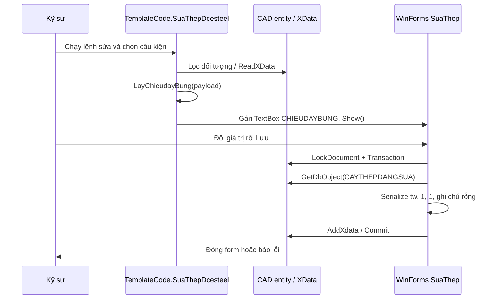
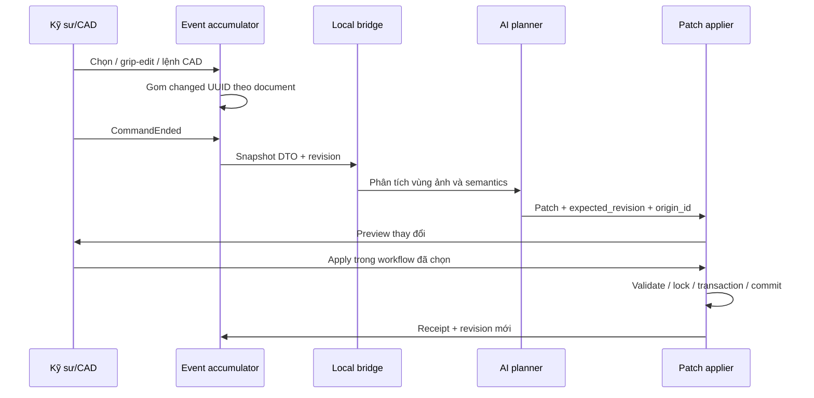

# DCE Steel và cơ chế CAD tương tác — Giải phẫu Vòng 2

**Ngày:** 2026-11-14 · **Vai trò:** CODEX, Chief Systems Architect · **Phiên bản:** 1.0.

## 1. Kết luận: giá trị nằm ở mô hình cấu kiện sống trong bản vẽ

DCE Pro/DCE Steel kết hợp nhiều lớp: hình học entity, Block và Dynamic Block, thuộc tính hiển thị, dữ liệu nghiệp vụ ẩn, form chỉnh sửa và adapter tới phần mềm tính toán. Vì vậy trải nghiệm “chọn đúng cấu kiện rồi sửa” có cơ sở kỹ thuật cụ thể; không thể tái tạo chỉ bằng cách sinh một DXF đẹp.

Vòng 2 xác minh được bốn điểm mới:

1. **Steel sử dụng kiến trúc lai:** có Dynamic Block, Block Attribute và hình học tạo trực tiếp bằng .NET. I/U/V không nhất thiết cùng cách biểu diễn với ống, bu lông hoặc bảng thống kê.
2. **XData Steel không mặc định là một bảng số 1040/1070.** Helper hiện tại tạo hai TypedValue: 1001 cho tên app và 1000 cho chuỗi payload. Bản DLL tham chiếu đọc được cho thấy một payload cụ thể có dạng `tw#soluong#socaukien#ghichu1`.
3. **Có cơ chế gom sự kiện theo lệnh CAD.** `DcePalette` đăng ký ObjectModified/ObjectAppended/ObjectErased, CommandWillStart/CommandEnded/CommandCancelled; một nhánh xử lý gọi ETABS `FrameObjAddByCoord` và refresh view.
4. **Không được suy rộng mọi sửa đổi thành tự tái sinh toàn hệ thống.** Handler “Lưu” của form `SuaThep` đã đọc được chỉ cập nhật XData chiều dày bụng, số lượng và ghi chú. Không thấy lệnh xóa nét, dựng DIM hay cập nhật Excel trong chính handler đó. Các nhánh sửa thép bê tông nằm trong assembly bị che thân mã nên chưa giải mã được thuật toán trọn vẹn.

Hướng nâng cấp `.agents/` là xây **mô hình cấu kiện có định danh và dependency graph**, với cả backend headless và backend live. Cần giữ được chỉnh tay của kỹ sư, không sinh lại toàn bộ bản vẽ mỗi lần thay một thông số.

## 2. Phương pháp và mức tin cậy

### 2.1 Tuân thủ chế độ chỉ đọc

Không sửa, lưu lại hoặc nạp bất kỳ tệp nào trong `C:/Dce Pro` và Starter Kit. Không chạy bộ cài, macro, XLL, LISP, DLL thương mại hoặc khởi động CAD/Revit để thử lệnh. Thư viện phân tích độc lập được cài riêng vào local Temp, không vào hai kho nguồn. Sử dụng lại quy trình nhận/đóng ca của [SKILL_DUAL_AGENT_BRIDGE](../skills/SKILL_DUAL_AGENT_BRIDGE/SKILL.md).

Công cụ khảo sát:

- `dnfile 0.18.0` và `dncil 1.0.2`: đọc metadata và giải mã từng instruction IL, resolve MethodDef/MemberRef/UserString. Không gọi method trong assembly thương mại.
- `ezdxf`: đọc trực tiếp `Cad/Form 2.dxf`, không ghi trở lại.
- `@mlightcad/libredwg-web 0.8.8`: đọc 13 Form DWG bằng WASM độc lập, dữ liệu vào bộ nhớ; không thực thi ứng dụng DCE.
- ZIP/XML reader: kiểm tra CUIX và manifest Excel-DNA.

**Giới hạn DWG quan trọng:** bộ đọc báo mã 76 trên cả 13 file. Theo enum của package, đây là tổ hợp UNHANDLEDCLASS=4, INVALIDTYPE=8, VALUEOUTOFBOUNDS=64. Nó vẫn trả bảng style/block/dictionary nhưng đây là kết quả **đọc một phần**, không phải xác nhận DWG hỏng. Không dùng kết quả này để round-trip/save, kiểm định mọi dynamic action hoặc tuyên bố không tồn tại object chưa đọc được. Những giá trị DIM chung được đối chiếu thêm với DXF; khả năng Dynamic Block được đối chiếu với lời gọi API trong DLL.

### 2.2 Phân biệt bản đang nạp và bản tham chiếu

LISP Steel chỉ có lệnh NETLOAD tới `AddinSteelCad/DbimSteelAutocad.dll`. Đây là assembly chính được đối chiếu. Bản `DbimSteelAutocad-ToanHuynh-2.dll` cùng thư mục có nhiều chuỗi/tên method dễ đọc hơn và được dùng làm **bản tham chiếu lịch sử**, không giả định đang được nạp.

Các tên token trong báo cáo thuộc đúng assembly ghi kèm. Token không ổn định giữa hai bản. Hash từng assembly và call/instruction evidence được lưu trong [hồ sơ Vòng 2](../memory/audits/dce_round2_20261114/).

`DCE Pro.dll`, `BcDCE Pro.dll`, `DCE Excel.dll` và các DLL Steel có mức bảo vệ khác nhau. Nhiều method chỉ cho thấy stub hoặc tên; một số instruction/call token bị làm rối và chuỗi được giải mã lúc chạy. “Parser đọc được instruction” không có nghĩa đã hiểu đầy đủ hành vi. Không chạy bộ giải mã của sản phẩm để vượt giới hạn khảo sát tĩnh.

Quy ước bằng chứng:

| Nhãn | Ý nghĩa |
| --- | --- |
| T | Đọc trực tiếp template DXF/XML/TXT |
| I | Lời gọi/constant/luồng IL đã giải mã được trong assembly chính |
| L | IL rõ trong bản DLL tham chiếu; cần đối chiếu khi áp cho bản chính |
| N | Chỉ có tên type/method hoặc dấu vết metadata |
| P | Thiết kế đề xuất cho `.agents/`, chưa triển khai |

## 3. Quản lý DIM: ba lớp phải tách biệt

### 3.1 Lớp style: tỷ lệ trình bày, không thay hình học

`Form 2.dxf` có header `$INSUNITS=4`, `$DIMSCALE=1`, `$DIMLFAC=1`, `$DIMASSOC=1`, `$DIMSTYLE=Standard`. Nhưng bảng DimStyle có họ DCE riêng:

| Style | DIMSCALE | DIMEXO | DIMEXE | DIMTXT |
| --- | ---: | ---: | ---: | ---: |
| Dce_20MV | 20 | 2 | 1 | 2 |
| Dce_50MV | 50 | 2 | 1 | 2 |
| Dce_100MV | 100 | 2 | 1 | 2 |
| Dce_200MV | 200 | 2 | 1 | 2 |

Các giá trị trên được đọc trực tiếp từ DXF, không suy ra từ tên style. Bộ đọc DWG cũng thấy cùng họ trong Form thường và Steel, với DIMLFAC=1 tại các style tương ứng; một số trường DXF không ghi tường minh thì phải dùng default của định dạng.

DIMEXO là khoảng hở từ điểm đo tới đầu đường dóng; DIMEXE là phần đường dóng vượt đường kích thước. Chúng không phải khoảng cách giữa mọi tầng DIM. DIMSCALE điều chỉnh kích thước đồ họa; DIMLFAC liên quan giá trị đo hiển thị. Header của bản vẽ không thay thế style gắn trên từng Dimension hoặc override trên entity.

Ở `Form 2_Steel.dwg`, kết quả đọc một phần còn thấy DIMDLI=3,75, DIMGAP=1 trong các style điển hình, cùng khác biệt DIMFXL/DIMFXLON giữa một số style. Đây là lý do không nên tạo tất cả style bằng một bộ số mặc định hoặc chỉ đổi tên `Dce_XXMV`. Template Steel còn có các style 220/250/300; Form 1_Steel có thêm 5/10/15.

Trong DLL chính, `DceCad.SetDimStyleCurrent` **0x06000EF5** mở DimStyleTable, gán `Database.Dimstyle`, gọi `SetDimstyleData`, Commit; có nhánh Abort và thông báo lỗi. Helper **0x06000F12** gọi setter Dimlfac/Dimscale. Đây là bằng chứng style được điều khiển từ code, không chỉ nằm thụ động trong Form. Giá trị runtime của mọi trường và mọi nhánh chưa được giải hết do chuỗi bị che.

### 3.2 Lớp điểm neo: code biết Point1, Point2 và vị trí đường DIM

`DceCad.DimRotate` bản chính **0x06000F0D**, bản tham chiếu **0x06000D76**, thực hiện:

1. Nhận `Point1`, `Point2`, `Point3`, `dimstyle`, `layer`, `NoiDungXdata`, `SYS_XData_App`, transaction.
2. Xử lý vector/góc từ các điểm và kiểm tra layer.
3. Tạo `RotatedDimension`.
4. Gán `XLine1Point`, `XLine2Point`, `Rotation`, `DimLinePoint`.
5. Gán `DimensionStyle` và layer, AppendEntity, AddNewlyCreatedDBObject.
6. Gọi `AddXdata` cho Dimension.

Như vậy Dimension là entity có dữ liệu và điểm định nghĩa, không phải text ghi số giả. Nhưng helper nhận điểm tọa độ; nó không tự biết điểm nào là mép cánh hoặc tâm bu lông. Bộ dựng cấu kiện bên trên phải cung cấp các điểm đó.

Bản tham chiếu `Connection.Dim1` **0x0600045F** có các nhánh `XB`, `YR`, `XT`, `YL`, gọi `DceCad.Style` và `DimRotate`. Các hàm dựng I/U/V/bu lông/bản bích cung cấp hình học cho lớp annotation. Tên hướng và lời gọi xác nhận khả năng chọn phía đặt DIM; chưa đủ để công bố chính xác công thức mọi offset mép bản mã/chuỗi bu lông trong bản chính.

### 3.3 Lớp liên kết: DIMASSOC không đồng nghĩa “sống theo cấu kiện”

Header DXF đang là DIMASSOC=1. Theo [tài liệu Autodesk về DIMASSOC](https://help.autodesk.com/view/ACD/2026/ENU/?caas=caas%2Fdocumentation%2FACDLT%2F2014%2FENU%2Ffiles%2FGUID-D77085A3-6E4C-4C18-AD70-21F54ED72492-htm.html), mức này tạo Dimension nguyên khối nhưng không tự ghép điểm đo với đối tượng hình học như mức 2. DIMASSOC không thuộc DimStyle.

Không thể từ header này kết luận tất cả Dimension runtime đều không associative; code có thể tạo liên kết/override sau đó. Ngược lại, chỉ thấy `RotatedDimension` cũng không chứng minh có liên kết topo với mép cánh. Trong helper đã đọc, không thấy tạo đối tượng DIMASSOC/subentity reference.

Do đó tách ba khả năng:

- DIM có đúng tọa độ đo khi dựng: đã có bằng chứng I/L.
- DIM mang XData để ứng dụng nhận biết/nghiệp vụ: đã có bằng chứng I/L.
- DIM tự tái bám mép cánh/lỗ khi topology thay đổi: **chưa xác minh đầy đủ**.

Bài học là cần một tầng anchor nghiệp vụ ngoài style. Chất lượng tương tác có thể đến từ code cập nhật điểm/DIM theo cấu kiện, không nhất thiết chỉ nhờ native associativity.

## 4. Block bê tông và Steel: không có một cơ chế duy nhất

### 4.1 Bê tông: hình học, ký hiệu và bảng thống kê là các tài sản khác nhau

`Form 2.dxf` xác minh trực tiếp:

| Block | Thành phần / Attribute đã đọc | Vai trò |
| --- | --- | --- |
| Dce_KhTenTruc | 2 Circle, 4 Line, ATTDEF `TRUC` | Bong bóng/ký hiệu trục |
| TenCauKien | ATTDEF `SOCAUKIEN`, `TENCAUKIEN` | Nhãn và số cấu kiện |
| TK1 | 3 LWPolyline, 9 Line, 9 ATTDEF | Dòng thống kê thanh thẳng |
| TK9 | 3 LWPolyline, 9 Line, 11 ATTDEF | Dòng thống kê hình đai |

TK1 có tag `KL`, `Lall`, `SKC`, `SL`, `sumL`, `DK`, `L`, `SH`, `TSL`; TK9 thêm các trường hình dạng `L1`, `L2`, `M`. Đây là schema trình bày nằm trong Block Attribute. Tên có ý nghĩa nghiệp vụ nhưng không đủ tự chứng minh đơn vị và công thức của mọi trường.

Bảng DWG thường đọc được thêm các họ `DCE_CL_REC1/REC2`, `DCE_CL_Circle`, `CL_Wall`, `CoL_Wall`, `DCE_BlockBeam2`, `DCE_Beam2`, `Dce_Pile`, `Dce_PileName`, `ColumnRecDBIM`, ký hiệu thép dọc/đai/sàn và chuỗi TK. Các bản Form còn có TK45/46/47; không nên khóa cứng “thư viện chỉ có TK1…TK44”.

Phải phân biệt Block ghi tên cấu kiện, Block mô tả hình dáng thống kê và nét cấu kiện thực. Tìm thấy Block cọc không có nghĩa toàn bộ đài móng luôn là một Dynamic Block. Cách dựng đài hoàn chỉnh chưa được xác minh từ thân IL bê tông.

### 4.2 Steel: catalog thực tế trong Form

Kết quả DWG đọc một phần cho thấy `Form 2_Steel` có 521 BlockTableRecord, so với 171 của `Form 2` thường. Đây là số record decoder trả, gồm anonymous/layout/helper, không phải số loại cấu kiện sử dụng. Form 1_Steel/3_Steel/4_Steel/5_Steel cũng đã được khảo sát; không giả định năm Form giống hệt nhau.

Các nhóm tên đã thấy:

| Nhóm | Block tiêu biểu |
| --- | --- |
| I/cánh/bụng | Dce_IWeb, Dce_IFlange, Dce_IFlangeDHR, Dce_BeamI1, Dce_PlanI, Dce_IPlate1 |
| Hộp/ống | DCE_SectHop, DCE_SectOng, DCE_Hop_Ngang, DCE_Ong_Ngang, Dce_BracingPipe1 |
| Bu lông/đai ốc/neo | Dce_Bolt, Dce_MBolt, Dce.Nut, Dce.nut12/16/20/24/30/36, Dce_AnchorL/J, Dce_AnchorExpansion |
| Bản mã/chân cột | Dce-ThepTam, Dce_BasePlateEle, Dce_BP_Pin4/Pin6, Dce_BP_Fix6/8/10/12, LKchancot7…10 |
| Xà gồ/giằng | Dce_XG, Dce_giangxago, Dce_BracingH, Dce_BracingX |
| Thống kê | DCE_BangThongKe, DCE_TH100/101/102, DCE_TH200, DCE_TH300, DCE_BTKCK |

`Dce-ThepTam` có 4 Line và Attribute `B`, `SL`, `TENCK`, `HINHDANG`, `VATCANH`. `Dce_BeamI1` chứa LWPolyline/Hatch; `Dce_MBolt` chứa Hatch/Line/LWPolyline/INSERT lồng nhau; `Dce_giangxago` có Line. Như vậy thư viện có hình học thực và cấu trúc phân cấp, không chỉ tên gọi hoặc ảnh minh họa.

Các marker `ACAD_ENHANCEDBLOCK`, `ACAD_ENHANCEDBLOCKDATA/HISTORY`, `AcDbBlockRepresentation` có mặt trong dictionary. **Không suy ra một Block cụ thể là Dynamic Block chỉ từ tên `*U...` hoặc marker toàn file.** Bộ đọc một phần chưa xác minh mọi graph/action/constraint của từng Block.

### 4.3 Bằng chứng .NET: Block động và entity đều được sử dụng

Trong DLL chính:

- `DceCad.BlockName` **0x06000EC2** kiểm tra IsDynamicBlock và lấy DynamicBlockTableRecord. Điều này giúp nhận diện tên gốc dù instance dùng anonymous representation.
- `DceCad.AddTagBlock` **0x06000EEF** thao tác DynamicBlockReferencePropertyCollection/PropertyName/set_Value; bản tham chiếu còn thấy đường AttributeCollection/Tag.
- `DceCad.ReadBlock` **0x06000EF1** đọc collection property/value. Bản tham chiếu **0x06000D62** đọc cả Attribute và Dynamic Property.
- `DceCad.SetDynamicBlockProperty` **0x06000F36** kiểm tra IsDynamicBlock, tìm PropertyName, set_Value, có nhánh báo lỗi.

Các hàm trong DLL tham chiếu cho biết sự phân công hình học:

| Hàm | Token tham chiếu | Cơ chế thấy trực tiếp |
| --- | --- | --- |
| Draw_MCN_I | 0x06000DE5 | SetDataPlanI → AddPoly cho các phần cánh/bụng; chuỗi PlanI_F/PlanI_W |
| Draw_MCN_U | 0x06000DD5 | SetDataMB → AddPoly; tên Channel_MCN |
| DrawSectV | 0x06000DC4 | SetDataThepV → AddPoly |
| Draw_MCN_Pipe | 0x06000DD6 | AddBlock → AddTagBlock; property DuongKinhNgoai/DuongKinhTrong |
| DrawBolt | 0x06000DDC | AddBlock → AddTagBlock; property Size Bolt |

Các hàm cùng tên vẫn tồn tại trong bản chính, nhưng không mặc định mọi constant/hành vi lịch sử đã giữ nguyên. Các helper AddPoly/AddCircle của bản chính gọi constructor AutoCAD Polyline/Circle; DimRotate gọi constructor Dimension. Đây là bằng chứng I bổ sung cho nhánh dựng trực tiếp.

Kết luận: câu trả lời cho “Block thường, Dynamic Block hay entity từ code?” là **cả ba, theo loại chi tiết và mục đích**. Source gốc không có ở đây; các lời gọi Microsoft.VisualBasic trong IL cho thấy không nên mặc định ngôn ngữ ban đầu là C#. Bản chất cần học là managed .NET và hợp đồng dữ liệu với AutoCAD.

### 4.4 Bu lông, bản mã, đường hàn và SystemSteel

Nguồn TXT có họ ISect/USect/VSect/PSect và cấu hình CAD. `AutoCad_HText.txt` hiện là `2.5`, `AutoCad_Plate.txt` là `PL-`, ký tự tách text là `*`. Chúng cho phép thay đổi cách thể hiện mà không biên dịch lại. Giá trị cấu hình này là quan sát tại máy, không phải tiêu chuẩn thiết kế.

Các form/hàm `DrawBasePlate`, `DrawBanBichMC`, `DrawDetailMember`, `CanopyDetail`, `Connection.LKKNEE`, `DrawRSBolt`, `DrawHoleOval`, `DrawAnchorBoltL` cho thấy nghiệp vụ đi theo chi tiết liên kết và mặt cắt. Với bản mã có thể phải phối hợp đường bao, chiều dày, lỗ, ký hiệu và bảng khối lượng. Không có căn cứ cho một “Block thép tổng quát” duy nhất.

**Đường hàn:** đã thấy hệ thống chi tiết liên kết và tài nguyên ký hiệu, nhưng chưa xác định đủ một Block/hàm với schema kích thước đường hàn và quy tắc cập nhật được kiểm chứng. Không lấy một tên Block viết tắt để khẳng định loại mối hàn, chiều dài hữu hiệu hoặc khả năng chịu lực. Đây là hạng mục cần fixture và trace bổ sung trước khi sao chép hành vi.

## 5. Thuộc tính ẩn và giao tiếp liên module

### 5.1 Schema XData xác minh được của Steel

`DceCad.AddXdata` bản chính **0x06000ED7** và tham chiếu **0x06000D48**:

```text
Input: ent, NoiDung, SYS_XData_App, transaction
RegAppTable.Has(app) ? giữ nguyên : tạo RegAppTableRecord(app)
ResultBuffer(
    TypedValue(1001, app),
    TypedValue(1000, NoiDung)
)
Mở entity để ghi → gán XData
```

Các mã 1001/1000 là constant trực tiếp trong thân IL bản chính. Phần gán property dùng VB LateBinding; bản tham chiếu lộ rõ chuỗi `ObjectId` và `XData`. `ReadXData` gọi GetXDataForApplication theo tên app rồi duyệt ResultBuffer/TypeCode/Value, có fallback và thông báo lỗi.

Một schema cụ thể trong bản tham chiếu:

```text
TemplateCode constructor: XdataDceSteel = "DceSteelRebar"
GandulieuKCThepBung(tw, soluong, socaukien, ghichu1)
    → ToString(tw) + "#" + ToString(soluong) + "#"
      + ToString(socaukien) + "#" + ghichu1
LayChieudayBung(payload)
    → Split("#") → kiểm tra phần tử đầu là số → trả nó; nếu không, trả "0"
```

Token tham chiếu: constructor **0x06001609**, serializer **0x0600160B**, parser **0x0600160D**. Tên param được lấy từ Param metadata, không đoán từ vị trí. Không gắn schema này cho toàn bộ thép hình, bê tông hoặc tất cả version DCE.

Định dạng chuỗi giúp phát triển nhanh và dễ mở rộng nhỏ nhưng có rủi ro dấu `#` trong ghi chú, locale số, thiếu version và mất nghĩa khi thêm trường. Đây là phân tích thiết kế, chưa phải sự cố đã tái hiện. Cần giữ raw payload khi import, không âm thầm “sửa” chuỗi của vendor.

### 5.2 XData, Attribute và ExtensionDictionary không loại trừ nhau

| Nơi lưu | Bằng chứng trong khảo sát | Kết luận |
| --- | --- | --- |
| XData | RegApp, ResultBuffer, 1001/1000; helper đọc/ghi | Đã xác minh cho luồng Steel nêu trên |
| Block Attribute | Tag trong template; AttributeCollection/Tag trong helper | Dùng cho nhãn/thống kê và giao diện nhập xuất |
| Dynamic Property | Collection/PropertyName/Value trong DLL | Dùng điều khiển hình học hoặc trạng thái Block |
| ExtensionDictionary/Xrecord | Dictionary dynamic có mặt trong DWG; scan call trực tiếp chưa cho schema nghiệp vụ chắc chắn | Chưa xác minh là kho canonical cho dữ liệu kết cấu của các luồng này |

Dictionary phục vụ graph Dynamic Block không đồng nghĩa DCE dùng Xrecord riêng để lưu toàn bộ mô hình. Cũng không được kết luận họ “không dùng dictionary” vì scan bỏ lỡ LateBinding hoặc code bị che.

Theo [tài liệu Autodesk](https://help.autodesk.com/cloudhelp/2021/ENU/OARX-IOP/files/GUID-752D0BE7-CF03-4AC1-8AA6-2DE5BE6A054A.htm), XData có giới hạn 16 KB mỗi object dùng chung cho các ứng dụng. Payload lớn và lịch sử dài cần cân nhắc dictionary hoặc kho ngoài, cùng khả năng clone/remap và tính di động DWG.

### 5.3 Cảnh báo về bridge `.agents/` hiện có

`dce_xdata_bridge.py` hiện dùng RegApp mặc định **DCE_PRO** và các field typed như DK/SL=1070, L/KL=1040, LINK_HANDLE=1005. Đây là schema nội bộ có triển khai/test, **không phải bằng chứng byte-for-byte tương thích với helper Steel 1001+1000 vừa xác minh**.

Không thay schema hiện có để giả làm schema vendor. Đề xuất tách codec: `agents_component_v1`, `dce_steel_legacy_string`, và codec bê tông chỉ bật sau khi xác minh payload thực. Dữ liệu typed của chúng ta có thể tốt cho nội bộ nhưng chỉ được gọi là interoperable sau fixture đọc–sửa–mở lại qua host của vendor.

### 5.4 CAD ↔ Excel: có nhiều đường trao đổi

Luồng thống kê không nhất thiết là “đọc XData rồi xuất Excel” duy nhất. Bản tham chiếu `CalVolumne.TKDuLieuExcelTong` **0x0600006D** chọn LINE/LWPOLYLINE/3DPOLYLINE/INSERT, kiểm tra tên Block, gọi ReadBlock, cho chọn điểm và gọi AddTH101. `AddTH101` **0x06000E4C** chèn Block/thay tag và có chuỗi tổng khối lượng.

Đường đã đọc này là gom thông tin để tạo bảng trong CAD; tên chứa “Excel” không đủ để khẳng định nó ghi workbook. Các lệnh export/import Excel trong CUIX là entry point khác; thân xử lý đầy đủ của DCE Pro hiện bị che.

Chiều Excel → chi tiết liên kết có bằng chứng rõ hơn trong DLL tham chiếu: `Connection.LKS/LKRS/LKKNEE/BANBICH` đọc Range/Value của workbook đang mở, dùng các ô như I2/I3, I28, I47, P3/P4 tùy hàm; đọc TXT cấu hình rồi gọi hàm dựng/Block. Đây là adapter theo layout bảng tính, không phải tự động phát hiện mọi workbook sửa ở bất kỳ đâu.

Không áp địa chỉ ô lịch sử thành schema cho mọi workbook/version. Vòng 1 đã thấy workbook thực khác một số tên mô tả trong adapter. Muốn đồng bộ an toàn phải nhận diện template/version/header và khóa phạm vi dữ liệu.

### 5.5 CAD ↔ ETABS: bằng chứng event-driven thực tế

Assembly chính có `DcePalette`:

| Token | Vai trò thấy trong IL |
| --- | --- |
| 0x060004CF | Tạo PaletteSet, UserControl và hai Button, gắn Click, hiện palette |
| 0x060004D0 | CheckKetNoiCSI; remove rồi add các event command/database; khởi tạo collection |
| 0x060004D1 | Gỡ event trong nhánh tương ứng |
| 0x060004D2/4D3 | Kiểm tra DBObjectCollection.Contains rồi Add đối tượng sự kiện |
| 0x060004D4 | Xử lý ObjectErased, kiểm tra cờ Erased và thêm vào collection |
| 0x060004D5…4D7 | Kiểm tra GlobalCommandName, gọi xử lý hoặc reset collection |
| 0x060004D8 | LockDocument, Transaction, duyệt collection, GetDbObject, FrameObjAddByCoord, Commit và reset |

Đây là bằng chứng mạnh cho pattern **gom thay đổi trong lúc người dùng thao tác, xử lý theo ranh giới lệnh**. Remove/add tránh đăng ký lặp trong nhánh đã thấy. Một handler còn gọi `ViewRefreshView` của ETABS.

Tên các lệnh được lọc bị che chuỗi trong bản chính, nên chưa khẳng định chính xác MOVE/STRETCH/ERASE nào được hỗ trợ hoặc cách xử lý từng Undo. Chỉ thấy FrameObjAddByCoord chưa đủ chứng minh giữ nguyên unique-name của ETABS hay bảo toàn gán tải/tổ hợp khi vẽ lại.

### 5.6 CAD ↔ Revit và việc nhận đúng cấu kiện

Metadata có các lớp CAD-to-Revit và phương thức gắn dữ liệu; báo cáo Vòng 1 mô tả phạm vi này. Vòng 2 chưa xác minh một registry identity dùng chung cho mọi host. ObjectId trong form là identity cục bộ phiên CAD; handle có thể dùng trong một DWG; tên cấu kiện/nhãn là identity nghiệp vụ nhưng có thể trùng. Không đồng nhất ba loại này với UUID xuyên CAD–Excel–ETABS–Revit.

Khi đổi tiết diện, có thể giữ vị trí bằng insertion point/local axes, cập nhật dynamic property hoặc dựng lại entity có dữ liệu. Các cơ chế thành phần đã có bằng chứng. Nhưng **chưa giải mã đầy đủ bộ ánh xạ identity và thuật toán bảo toàn mọi liên kết xung quanh**. Không thể khẳng định mọi thay đổi trong Excel tự đẩy đến đúng CAD instance mà không cần thao tác nhận/chọn/cập nhật.

## 6. Trải nghiệm sửa tương tác: luồng nào đã giải được?

### 6.1 Luồng Steel cụ thể đã truy được tới nút Lưu



Bản chính có `TemplateCode.SuaThepDcesteel` **0x060018BD**; bản tham chiếu **0x06001610** còn đọc được prompt “CHỌN CẤU KIỆN ĐỂ SỬA:”. Form `SuaThep` là **WinForms**, không phải WPF trong luồng này: có System.Windows.Forms.TextBox, Control.Show/Hide, Form.Close và Button Click.

`SuaThep.Button1_Click` tham chiếu **0x06001608** chuyển TextBox thành Integer, gọi serializer với `tw, 1, 1, ""`, gắn lại vào đối tượng đã chọn và Commit. Vì vậy không giả định handler này luôn bảo toàn số lượng/ghi chú cũ. Cần fixture để xác định UI này được dùng như thế nào trong workflow thực tế.

Điểm tiện cho kỹ sư là entity vẫn là đối tượng CAD họ đã chọn; ứng dụng giải payload rồi đưa đúng tham số vào form. Không cần người dùng tìm hàng Excel hoặc nhập lại toàn bộ vị trí.

### 6.2 Double-click bê tông: biết entry point, chưa chốt mapping UI

`DCE Pro.dll` có `DceEvent.DoubleClick_DCE` **0x06004B94**, `App_BeginDoubleClick` **0x06004BA5**; có các type `Links_SuaThepDoc`, `Links_SuaThepDai`, `EditThep.SuaCKThep` và các method `ReNameXdata`, `CapNhapSoLuongDaiDam`, `ReplaceDuLieuAn`, `TagDimVaThep`.

Nhưng những thân method quan trọng này không lộ call graph có ý nghĩa qua static scan hiện tại. Trong cả `DBimApps.cuix` và `MenuDCE.cuix`, `DoubleClickRoot.cui` đang rỗng. Điều này cho thấy không có mapping double-click trong hai XML được đọc; phù hợp giả thuyết mapping nằm ở event code, nhưng không chứng minh cách đăng ký/hủy và toàn bộ dispatch.

Do đó chưa thể khẳng định click đúp mọi dầm sẽ mở một form cụ thể, hoặc đường đổi `3D20 → 4D22` tự cập nhật tất cả tag/DIM/Excel theo một thứ tự đã xác minh. Các type trên là bằng chứng N cho chức năng, không phải mô tả runtime đã được quan sát.

### 6.3 Tái sinh nét cũ, DIM và thống kê: không gộp thành một thuật toán tưởng tượng

Ba loại update phải tách:

1. **Attribute/property update:** AddTagBlock/SetDynamicBlockProperty đổi giá trị trên Block hiện hữu. Có thể thay hình học nhờ dynamic graph và giữ insertion transform; đã xác minh lời gọi API, chưa kiểm thử mọi action.
2. **Metadata update:** form SuaThep lưu XData. Trong handler đã đọc, không có lời gọi Erase, Draw, DimRotate, AddTH101 hoặc Excel. Đường này không chứng minh tái sinh hình học.
3. **Procedural regeneration:** nhiều hàm Draw_* dựng entity/DIM/Block. Chưa truy được một pipeline erase-old → rebuild → reconnect → refresh thống kê hoàn chỉnh cho mọi loại cấu kiện. Cần tránh suy ra pipeline này chỉ từ việc các helper cùng tồn tại.

Các bảng thống kê có thể được dựng lại bằng lệnh gom/chọn; không có bằng chứng đủ cho việc mọi lần sửa metadata đều cập nhật bảng tức thời. Đây là điểm cần trace trên bản vẽ thử khi bước sang xác minh runtime.

### 6.4 Chống lỗi và lịch sử

Bằng chứng đã thấy: kiểm tra PromptSelectionStatus, khóa document, Transaction/Commit/Abort ở một số helper, try/catch với ThongBaoLoi/WriteMessage/MsgBox, kiểm tra Dynamic Block, fallback khi parser không nhận số, Contains chống thêm trùng collection, hủy/gỡ đăng ký event.

Đây là các lớp kiểm soát thao tác. Chúng **không chứng minh** tồn tại event-sourcing, lịch sử revision bền vững hoặc Undo nguyên tử xuyên CAD–Excel–ETABS. AutoCAD có lịch sử Undo của host nhưng việc helper dùng Transaction chưa đủ xác nhận các side effect ngoài CAD được Undo cùng nhau. `MayHoc.LichSuSua` của Vòng 1 là lịch sử sửa dữ liệu học, không được coi là lịch sử đầy đủ bản vẽ.

## 7. Bài học thiết kế cho Headless CAD Engine

### 7.1 Đưa semantics lên trước renderer

Đề xuất module độc lập, để `cad_plan_engine.py` là một backend:

```text
ComponentSpec + InstanceIdentity + Placement
           ↓
FeatureGraph + AnnotationIntent + ScheduleProjection
           ↓
Headless DXF Renderer  /  AutoCAD Live Renderer
```

`ComponentSpec` lưu tiết diện/thép/liên kết; `Placement` lưu local axes, anchor, rotation, scale; `InstanceIdentity` lưu UUID và revision. `FeatureGraph` đặt tên cho mép cánh/bụng, tâm lỗ, mép bản mã, trục cột. Dimension tham chiếu feature, không chỉ hai tọa độ đã tính một lần.

Ví dụ intent nội bộ **P**, không phải schema DCE đã giải mã:

```json
{
  "component_uuid": "component-id",
  "revision": 12,
  "kind": "steel_baseplate",
  "annotation": {
    "dimension_id": "bolt-gauge",
    "from_feature": "bolt_grid.col_0.center",
    "to_feature": "bolt_grid.col_1.center",
    "offset_paper_mm": 8,
    "style_role": "detail_dimension"
  }
}
```

Sau đổi gauge hoặc tiết diện, resolve lại feature → cập nhật điểm dim → giữ tùy chỉnh vị trí chữ/leader nếu còn hợp lệ. Không dùng DIMLFAC hoặc text override để làm số đo khớp kích thước mong muốn trong khi hình học sai.

### 7.2 Pattern: small identity in XData, model payload có version

Đề xuất RegApp riêng cho `.agents`, không ghi đè DceSteelRebar của vendor. XData nhỏ chứa schema/version, UUID, role, revision và đường dẫn liên kết hợp lệ. Payload lớn dùng ExtensionDictionary/Xrecord hoặc sidecar local có hash, theo khả năng từng backend. Attribute là projection hiển thị, không phải nguồn duy nhất khi người dùng thay text.

Thiết kế `ComponentRepository`, `VendorCodec`, `ProjectionMapper` tách nhau. VendorCodec chỉ đọc schema có chứng cứ; giữ raw khi không biết version. Handle liên kết local có thể giúp tìm nhanh nhưng không thay UUID khi COPY/INSERT/WBLOCK/import; cần quy tắc clone tạo UUID mới và remap quan hệ con.

### 7.3 Pattern: renderer lai và cập nhật theo role

- Tài sản lặp nhỏ: ordinary Block cho ký hiệu/marker và Attribute chuẩn hóa.
- Chi tiết tham số đơn giản trên host live: Dynamic Block nếu graph được kiểm tra.
- Hình học thay đổi topology: procedural entity builder từ ComponentSpec.
- Headless không cam kết đánh giá mọi dynamic action AutoCAD; sinh hình học tĩnh tương đương kèm semantics để live backend tiếp quản.

Định danh con theo role như `flange.top`, `web`, `bolt.row2.col3`, `dim.gauge`, `schedule.row`. Reconciler so fingerprint và cập nhật đúng nhóm. Chỉ xóa entity con do engine sở hữu và đã xác minh; không xóa nét người dùng bổ sung.

### 7.4 Pattern: giữ tùy chỉnh của kỹ sư như một lớp dữ liệu

Lưu tách `engineering_parameters`, `generated_geometry`, `user_overrides`. Override gồm vị trí nhãn, phía đặt dim, leader route, tên hiển thị, visibility có chủ đích. Khi regenerate, ưu tiên tái áp override còn hợp lệ; override mâu thuẫn thì hiển thị conflict trước khi ghi.

Ví dụ đổi `3D20 → 4D22` trong mô hình của chúng ta phải làm dirty rebar entities, tag, schedule quantity/weight và kiểm tra bố trí; không nhất thiết làm dirty trục cột, khung tên hay vị trí dầm. Regenerate tối thiểu giúp người dùng tiếp tục sửa trực tiếp mà không bị “reset bản vẽ”.

Schedule là một projection của model, có provenance và dirty flag. Quyết định khi nào refresh cần rõ: sau Apply/Commit hoặc lệnh Refresh; không phụ thuộc tên lệnh xuất Excel để đoán đồng bộ đã hoàn tất.

## 8. Sprint 2.5 — Live Interactive CAD Bridge

### 8.1 Thành phần

Đề xuất add-in .NET riêng, không sửa DLL/LISP thương mại:

1. `CadEventObserver`: theo dõi selection, command lifecycle và database change.
2. `ChangeAccumulator`: gom changed handles/UUID theo document và command, phân biệt appended/modified/erased/unerased.
3. `SnapshotService`: trong ngữ cảnh CAD hợp lệ, chuyển dữ liệu entity thành DTO bất biến.
4. `LocalBridgeTransport`: named pipe hoặc socket loopback có session token, payload limit, timeout và backpressure; log/cache trên ổ local.
5. `ProposalService`: AI xử lý snapshot, tạo patch có expected revision; không giữ DBObject/Transaction qua mạng.
6. `CadPatchApplier`: chạy trên ngữ cảnh CAD thích hợp, khóa document khi cần, kiểm tra precondition, preview rồi commit.

Không truy cập CAD DB trực tiếp từ socket worker. LockDocument giải quyết xung đột trong các ngữ cảnh modeless/COM, không tự làm API thread-safe. Quy tắc khóa được nêu trong [hướng dẫn Autodesk](https://help.autodesk.com/cloudhelp/2027/CSY/OARX-DevGuide-Managed/files/GUID-A2CD7540-69C5-4085-BCE8-2A8ACE16BFDD.htm).

### 8.2 Event coalescing theo lệnh

Học từ DcePalette: event chỉ ghi nhận thay đổi nhẹ, không chạy Vision hoặc vòng ghi dài trong ObjectModified. Kết thúc lệnh mới chụp snapshot/diff và gửi yêu cầu. CommandCancelled/Failed/Undo/Redo có semantics riêng; không áp kết quả AI dựa trên command đã bị hủy.

Selection change được debounce và chỉ lấy đối tượng hỗ trợ, sau khi đã có document/revision. Mọi hook phải được attach/detach theo vòng đời document; đóng DWG hoặc chuyển MDI không được khiến response sửa nhầm bản vẽ.



Với thao tác chỉ quan sát hoặc cập nhật preview, phản hồi ngay khi có snapshot; sửa kỹ thuật cần policy Apply rõ. “Tức thì” nên được đo thành latency UI, không hứa inference mạng luôn hoàn thành trong một khoảng cố định. Đề xuất mục tiêu đo ban đầu: observer không chặn tương tác, snapshot/ack nhanh trên fixture; thời gian Vision được hiển thị riêng và có timeout/cancel.

### 8.3 Giao thức patch và chống vòng lặp

Patch gồm `document_uuid`, `component_uuid`, `expected_revision`, `before_hash`, `operation`, params, `origin_id`, `idempotency_key`. Viết từ bridge sinh ObjectModified trở lại; đánh dấu origin và scope suppress để không lặp AI→CAD→AI vô hạn. Không bỏ tất cả event trong lúc apply vì có thể bỏ sót sửa của người dùng; đối chiếu expected object set và resnapshot sau commit.

Nếu người dùng sửa tiếp trong lúc AI tính, response cũ bị từ chối hoặc rebase có kiểm chứng. Multi-selection phải có batch boundary. Một patch chỉ tác động nhóm entity được allowlist; không thực thi chuỗi lệnh/script CAD tùy ý từ model.

### 8.4 Atomicity và lịch sử nhiều host

CAD commit và Excel/ETABS update không nằm chung một database transaction. Dùng outbox operation có receipt sau CAD commit, adapter external có idempotency và trạng thái pending/applied/failed. Nếu phía ngoài thất bại, UI báo chưa đồng bộ; không báo “Undo toàn bộ” khi chỉ hoàn tác được CAD.

Audit giữ patch/receipt/hash/revision, không dump toàn bộ tài liệu khi không cần. Undo của bridge là inverse patch có precondition hoặc phục hồi revision cục bộ; Undo host cần được quan sát và tạo delta mới cho external adapter. Đây là pattern **P**, không phải khẳng định DCE đã thực hiện như vậy.

### 8.5 Cổng nghiệm thu Sprint 2.5

| Ca thử | Điều kiện đạt |
| --- | --- |
| Chọn cấu kiện | Đúng UUID, loại và snapshot; không gửi DBObject sống ra worker |
| MOVE/STRETCH | Chỉ snapshot sau command phù hợp; semantics/anchor được cập nhật đúng |
| Đổi văn bản Attribute | Phân biệt chỉnh presentation với sửa tham số kỹ thuật |
| Undo/Redo/Cancel | Không còn dirty object ma; không apply patch command cũ |
| Đổi/đóng DWG | Response không sửa nhầm document; hook được tháo |
| Ghi từ AI | Không có vòng phản hồi vô hạn; apply lặp không tạo bản sao |
| Lỗi giữa batch | CAD rollback và external status trung thực |
| Scratch/Vision | Dùng Virtual Drive Guard; PNG có vòng đời cleanup và evidence cần thiết |

## 9. Lộ trình mở rộng kết cấu thép

### 9.1 Tách catalog, hình học, liên kết và kiểm tra chịu lực

Catalog tiết diện chứa family/dimensions/material/provenance/version. Hình học renderer dùng các feature cánh/bụng/góc/lỗ; module thiết kế liên kết nhận nội lực và trả kết quả có nguồn tiêu chuẩn. Không coi bản vẽ nhìn giống DCE là liên kết đã được thiết kế an toàn.

Template/shape có thể học về cấu trúc và tên role; việc phân phối lại tài sản thương mại là quyết định riêng của chủ sở hữu hệ thống. Không cần sao chép binary thương mại để xây adapter và schema nội bộ.

### 9.2 Các pha cụ thể

| Pha | Phạm vi | Đầu ra/gate |
| --- | --- | --- |
| S1 | I/U/V/ống/hộp ở mặt cắt và mặt đứng | SectionSpec, feature graph, units, orientation, fixture hình học |
| S2 | Bu lông, lỗ tròn/oval, pattern hàng/cột, mép bản mã | BoltGroupSpec, hole/bolt tách riêng, DIM edge/pitch/gauge gắn feature |
| S3 | Bản mã/gusset, baseplate, stiffener | PlateSpec/connection assembly; local axes, contour, thickness, child identity |
| S4 | Ký hiệu và geometry đường hàn | WeldSpec có type/side/size/length; fixture và quy tắc biểu diễn được chốt |
| S5 | Xà gồ và giằng | Reuse component/bolt/plate, kiểm tra chồng chéo và thống kê |
| S6 | Sửa live và round-trip bảng tính | Preserve identity, user overrides, revision, bảng thống kê và external receipt |

Mỗi pha phải có trường hợp đổi topology: tăng số bu lông, đổi I thành U, đổi lỗ tròn sang oval, đổi chiều tấm hoặc quay cấu kiện. Điều kiện đạt là không mất UUID cha, chỉ thay con cần thiết, DIM đo đúng feature, không nhân đôi thống kê, và nét người dùng không bị xóa ngoài phạm vi.

Không dùng Block scale không đều để giả thành tiết diện khác rồi tính khối lượng theo tên cũ. Geometry, specification và schedule phải được đối chiếu sau khi sửa.

## 10. Ma trận câu hỏi thực chiến và giới hạn kết luận

| Câu hỏi | Kết quả Vòng 2 |
| --- | --- |
| Quản lý được nhiều DimStyle và khoảng dóng? | Có: bảng style DXF + helper chọn/cập nhật style trong IL |
| DIM luôn bám associative vào cánh/bụng/lỗ? | Chưa chứng minh; helper dùng điểm, gắn XData; header template DIMASSOC=1 |
| Steel chỉ dùng Dynamic Block? | Không: bằng chứng cho renderer lai entity/Block/dynamic property |
| XData luôn tách 1040/1070 theo field? | Không đúng với helper Steel đã đọc; dùng payload 1000 dưới app1001 |
| XData app và payload nào đã biết? | DceSteelRebar và tw#soluong#socaukien#ghichu1 trong bản tham chiếu |
| Có form sửa cấu kiện? | Có: SuaThep WinForms, nhận entity đã chọn và CHIEUDAYBUNG |
| Double-click bê tông dispatch ra sao? | Có metadata entry point; thân xử lý còn bị che, CUIX double-click rỗng |
| Lưu form luôn regenerate toàn bản vẽ? | Không được chứng minh; handler cụ thể chỉ cập nhật metadata |
| Có live event CAD→ETABS? | Có nhánh event accumulator và FrameObjAddByCoord trong DLL chính |
| Có identity/Undo nguyên tử mọi host? | Chưa xác minh; không suy ra từ Transaction hoặc tên GanDL |

Vòng sau nếu được yêu cầu kiểm chứng runtime nên dùng project/DWG sao chép riêng, plugin quan sát độc lập và các bước trước–sau có hash/handle/measurement. Không chạy thử trực tiếp trong thư mục cài đặt để “lấp” các khoảng chưa rõ.

## 11. Hồ sơ kiểm toán và bàn giao

Các bằng chứng chính nằm tại `memory/audits/dce_round2_20261114/`:

- `source_before.json`, `source_integrity.json`: manifest hash/kích thước/mtime và so sánh cuối ca.
- `form2_dxf_authoritative.json`: header, DimStyle, Block, ATTDEF từ DXF đọc trực tiếp.
- `template_catalog.json`: catalog cô đọng của 13 DWG, luôn kèm warning76.
- `curated_method_evidence.json`: tên assembly/hash/token và call list các method then chốt.
- `round2_raw_evidence.zip`: kết quả phân tích tĩnh chi tiết, instruction/call dump và DWG decode một phần.
- `analysis_tools/`: script tái lập và version công cụ; không chứa binary thương mại để thực thi.

Ca này chỉ thay đổi báo cáo và hồ sơ/bus bàn giao; không triển khai các mẫu thiết kế vào engine. Kết quả 29/29 suite của Vòng 1 vẫn là bằng chứng hồi quy trước đó, không được ghi thành một lần chạy test mới của Vòng 2. Phép kiểm chứng mới ở đây là giải mã tĩnh, đối chiếu template và kiểm tra toàn vẹn nguồn.

**Trách nhiệm:** các kiến trúc đề xuất do trợ lý AI lập; kỹ sư phụ trách xác minh semantics, tiêu chuẩn và hành vi host trước khi đưa vào thiết kế/thi công. Các mục chưa đủ bằng chứng đã được ghi rõ, không coi tên method hoặc khả năng decoder là chứng nhận chức năng sản phẩm.
