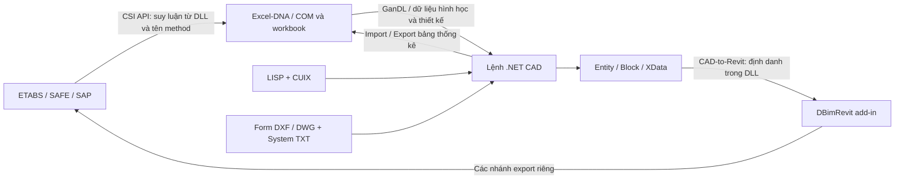
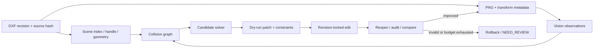

# Giải phẫu DCE Pro, MCP Starter Kit v5.0 và kiến trúc tích hợp

**Phiên bản:** 1.0 — 2026-11-14. **Thực hiện:** CODEX, Chief Systems Architect.

## 1. Kết luận kiến trúc

DCE Pro có giá trị lớn nhất ở kiến thức triển khai: mẫu CAD, thư viện workbook, ánh xạ lệnh nghiệp vụ và tích hợp nhiều host. Starter Kit cung cấp một mẫu cầu nối Revit ngắn, dễ kiểm tra, nhưng nhiều chức năng trong mô tả chưa có triển khai thực tế. `.agents/` đã có nền tảng CAD headless, kiểm tra đầu ra và cô lập scratch; phần thiếu quan trọng là điều khiển vòng lặp sửa có kiểm chứng và hợp đồng đồng bộ mô hình.

Ba quyết định đề xuất:

1. Sprint 2 phát triển bộ giải va chạm hình học có ràng buộc; Vision cung cấp quan sát và ưu tiên vùng kiểm tra. Mọi sửa đổi phải qua revision lock, kiểm toán DXF và so sánh trước/sau.
2. Sprint 3 xây bridge Revit riêng trong `.agents/`, kế thừa ý tưởng `RevitTask.RunAsync` và UUID. Phải bổ sung giao thức, lựa chọn tài liệu, revision, idempotency và kiểm thử Dimension trước khi gọi là live sync hai chiều.
3. Khai thác thư viện tiết diện từ `SystemSteel/*Sect_*.txt`, workbook và template. **Không trích `configDb.db` thành thư viện thép:** các DB đó chứa tài khoản/token/cấu hình cài đặt.

Kết quả hồi quy: **29/29 suite PASS**, runner full mất **98,09 giây**. Đối chiếu manifest trước/sau trên cả hai kho: **3.010/3.010 tệp giữ nguyên nội dung, kích thước và mtime**, không thêm hoặc mất tệp.

## 2. Phương pháp, mức bằng chứng và an ninh

Hai thư mục nguồn chỉ được đọc. Không chạy bộ cài PowerShell/BAT, XLL, macro XLSM, DLL thương mại hoặc add-in Revit. Không build hoặc cài Starter Kit. Phân tích DLL bằng chuỗi định danh tĩnh và `AssemblyName.GetAssemblyName`, không thực thi mã assembly. CUIX/XLSM/model.zip được đọc như ZIP; workbook XML được phân tích mà không chạy Excel.

SQLite được đọc từ bản sao riêng; kết nối bản sao dùng `mode=ro&immutable=1`. Snapshot DB được lưu local tại `C:/Users/ADMIN/AppData/Local/Temp/dce_anatomy_snapshots_20261114`. Bằng chứng chia sẻ chỉ giữ schema và mẫu đã che giá trị cấu hình. Không đưa token giấy phép vào báo cáo. Bản sao từng DB không đại diện một transaction xuyên nhiều DB; ca này không có bằng chứng thay đổi nguồn qua manifest cuối ca.

Quy ước:

- **Xác minh tĩnh:** trực tiếp thấy nội dung source/XML/schema hoặc định danh trong binary.
- **Suy luận:** liên hệ giữa module từ tên lệnh, API, cấu trúc workbook; chưa phải call graph đã chứng minh.
- **Đề xuất:** thiết kế mới, chưa được triển khai trong ca này.
- **UNVERIFIED:** cần compile, chạy host hoặc fixture chuyên dụng để xác nhận.

Không tái sử dụng báo cáo giải phẫu cũ như bằng chứng duy nhất. Các số liệu dưới đây lấy từ khảo sát mới; hồ sơ nằm tại [thư mục kiểm toán](../memory/audits/deep_anatomy_20261114/).

## 3. Trục 1 — Cấu trúc DCE Pro

### 3.1 Bản đồ module

| Vùng | Số tệp khảo sát | Vai trò có bằng chứng |
| --- | ---: | --- |
| `Cad/` | 15 | Form DWG/DXF cho CAD thường và Steel; `Form 2.dxf` là mẫu vector đọc được |
| `AddinRevit/` | 101 | Manifest `DBimRevit.addin`, assembly `AddinDbimDcepro/DBimRevit.dll`, thư viện CSI đi kèm |
| `AddinSteel/` | 176 | Excel-DNA XLL x86/x64, `DceSteel.dll`, ETABS/SAFE/SAP API, NetOffice và ExcelApi |
| `AddinSteelCad/` | 1.112 | Adapter CAD thép, LISP và cấu hình riêng; không đồng nhất với Excel add-in |
| `Excel/` | 151 | Workbook XLSM/XLSX và gói xử lý sự cố COM/add-in |
| `MayHoc/` | 2 | `mauhoc.db`, `model.zip` chứa schema và transformer chain |
| `System/` | 656 | Cấu hình nghiệp vụ, gồm một bản `configDb.db` |
| `SystemSteel/` | 301 | Mẫu tiết diện, ký hiệu và cấu hình thép |
| `SystemRvt/` | 39 | Cấu hình cho Revit |
| `V.2020/` | 23 | DLL Excel và bản API đi kèm |
| Gốc | 107 | DLL đa host, CUIX, LISP, SQLite, log và cấu hình binding |

Ngoài ra có `SystemBK`, `SystemRvt`, `SystemSteel`, bộ update, tài nguyên Icon và native SQLite x86/x64. Số tệp thể hiện phân bố tài sản, không dùng làm thước đo chất lượng thuật toán.

`Version.txt` hiện ghi `2027.0.2`, trong khi assembly `DCE Pro.dll` và `DCE Excel.dll` ghi `1.0.0.0`; `DBimRevit.dll` ghi `0.0.0.0`. Vì vậy khóa phiên bản tích hợp phải dùng hash và manifest tài sản, không chỉ AssemblyVersion. `CSiAPIv1.dll` có AssemblyVersion `1.0.0.0`; `ETABSv17.dll` là `17.0.0.0`. Sự hiện diện các DLL không chứng minh tương thích mọi phiên bản ETABS đã quảng bá.

### 3.2 SQLite: cấu hình, dữ liệu học và ranh giới bí mật

| Tệp | Schema quan sát | Số dòng |
| --- | --- | ---: |
| Gốc `configDb.db` | `ConfigSettings(config_key TEXT, config_value TEXT)` | 8 |
| Gốc `configDbSteel.db` | `ConfigSettings(config_key TEXT, config_value TEXT)` | 7 |
| `System/configDb.db` | Cùng tên bảng/cột | 8 |
| `AddinSteelCad/System/configDb.db` | Cùng tên bảng/cột | 7 |
| `MayHoc/mauhoc.db` | `MauHoc`, `LichSuSua`, `CauHinhModel` | 45.020; 3; 10 |

Các khóa cấu hình gồm `ToKen`, `TokenLicenseKey`, `TaiKhoanDangNhap`, `DtcInstall`, `DtcInstail`, `TokenComputer`, `TokenComputerName`; DB 8 dòng có thêm `TokenSignature`. Đây là bằng chứng trực tiếp bác bỏ giả định DB cấu hình đang chứa bảng tiết diện/cốt thép. Không lấy các giá trị này làm dữ liệu huấn luyện hoặc sao chép vào registry.

`MauHoc` có `Id`, `TextGoc`, `ChiSoSo`, `GiaTri`, `Feature`, `Nhan`, `Nguon`, `ThoiGian`, `Hash`. `LichSuSua` lưu `TextGoc`, `Truoc`, `Sau`, `ThoiGian`; `CauHinhModel` lưu tên, đường dẫn, số mẫu và thời gian. Cấu trúc này phù hợp với luồng học nhãn/trích thông tin từ text và phản hồi sửa. `model.zip` có `TransformerChain`, vocabulary và `TrainSchema`; cùng các DLL Microsoft.ML là bằng chứng về pipeline ML.NET. **UNVERIFIED:** loại estimator chính xác, chất lượng nhãn, độ chính xác mô hình và việc từng thành phần có được gọi trong phiên chạy hiện tại hay không.

### 3.3 Tiết diện và mẫu cấu kiện

Đọc trực tiếp 13 cặp `VSect_n.txt` / `V_KHn.txt`:

| Index | `VSect_n` | `V_KHn` |
| --- | --- | --- |
| 1 | `25 3` | `25` |
| 5 | `63 5` | `63` |
| 10 | `100 8` | `100` |
| 13 | `150 10` | `150` |

Dãy này có dạng kích thước danh nghĩa và chiều dày của thép góc; đây là **suy luận ngữ nghĩa**, chưa có chú giải trường trong tệp. Không tự gán các số thành thuộc tính cơ học hay chứng nhận tiêu chuẩn sản phẩm. Tệp chỉ có một dòng giá trị, không có đơn vị, mác thép, phiên bản hay schema.

Các họ khác cũng có mặt: `ISect_1 = 150 75 5 7`, `USect_1 = 75 40 5 7`, `PSect_1 = 22 2`. Họ I có 19 mẫu, U có 12, P có 11, V có 13 theo danh sách tệp. Ý nghĩa dự kiến là I/U: chiều cao, bề rộng, dày bụng, dày cánh; P: đường kính và dày. Phải xác minh từ hàm tiêu thụ hoặc bản vẽ mẫu trước khi đặt trạng thái `VERIFIED`.

Không dùng `V_KH` thay thế đầy đủ hình học; ký hiệu `25` không chứa chiều dày. Giữ index và tên họ để ghép đúng cặp; không ghép bằng thứ tự liệt kê lexicographic vì `10` đứng trước `2`.

### 3.4 AutoLISP, CUIX và DLL: giao diện mỏng, nghiệp vụ trong host

`DCE Pro.lsp` có nhiều wrapper `(defun c:... (command ...))`: `mb1 → XuatDuLieuModelEtabs`, `vd → VeDam_DCE`, `vc → VeCotDcePro`, `vv → VeVachDcePro`, cùng `GanLienKetThep`, `XuatDuLieuDam`, `ToiUuCatThep`. Các wrapper cho thấy tên entry point; không chứa toàn bộ thuật toán tính toán.

Khối khởi động LISP hiện có cơ chế trì hoãn NETLOAD tới khi CAD sẵn sàng, dùng `S::STARTUP`/reactor và `vl-catch-all-apply`. Nó chọn DLL theo AutoCAD/ZWCAD/GstarCAD/BricsCAD và host khác, tách CUIX theo host, ghi `DCE Load.log` khi được thực thi. Đây là lý do ca khảo sát không nạp LISP vào CAD: ngay bước khởi động cũng có thể ghi vào thư mục cài đặt.

`DBimApps.cuix` là ZIP gồm 21 thành phần; đọc XML thấy 197 phần tử `Command`. Những lệnh như `XuatThongKeExcelDCE`, `NhapThongKeTuExcelDCE`, `BlockToExcel_DCE`, `BlockExcelToCad_DCE`, `UPDATEMODELETABS` xác nhận giao diện trao đổi CAD–Excel và cập nhật ETABS. 197 là số entry XML, chưa loại trùng và không phải số API đã kiểm thử.

Định danh tĩnh trong DLL củng cố bản đồ:

- `DCE Pro.dll`: `ApiModelEtabs`, `FrameForce`, `GanDLApplicationColumn`, `AddXdata`, `DocXdata`, `DceRebarXDataTKT`, `ExportToRevit`.
- `V.2020/DCE Excel.dll`: `ExcelDna.Integration`, `GanDLApplicationExcelBeamDesign`, `GanDLApplicationExcelColumn`, `GanXDataChoCauKien`, `GetColumnFoce`.
- `AddinSteel/DceSteel.dll`: `ResultsFrameForce`, `ResultsJointReact`, `ResultsPierForce`, `cSapModel`, `KetNoiSafe`, `KetNoiSap2000` và các form thiết kế thép/liên kết.
- `DBimRevit.dll`: `DceCadToRevit`, `DceBeamCadToRevit`, `DceSlabCadToRevit`, `DceWallCadToRevit`, `CommandEtabsToRevit`, `DceExportMbToAutocad`, `GetPositionRevitAndAutocad`.

Đây là tên được nhúng trong binary, không chứng minh quan hệ gọi hoặc xử lý lỗi. Chưa giải biên dịch đầy đủ method body. Không suy ra layout XData hoặc địa chỉ ô Excel chỉ từ tên class.

### 3.5 Luồng ETABS → Excel → CAD → Revit



Mũi tên biểu diễn kiến trúc có bằng chứng giao diện, không phải trace một phiên chạy thực. DCE Pro còn có đường ETABS → Revit trực tiếp; không bắt buộc mọi dữ liệu đi qua Excel và CAD.

Workbook thực tế khác một số tên mô tả trong adapter `.agents/`:

| Workbook đọc trực tiếp | Sheet tiêu biểu | Phần tử công thức XML |
| --- | --- | ---: |
| `01. DCE_Etabs_2020.xlsm` | DATA, POINT_COLUMN, POINT_BEAM, TOA_DO, MAIN | 243 |
| `08. DCE_ColumnWall_2020.xlsm` | PIERFORCES, PIERSECTION, ColumnDesign, WallDesign, Column Detail, Wall Detail | 924 |
| `09. DCE_Beam_2020.xlsm` | BEAM FORCES, FRAME SECTION PROPERTIES, BEAM CONNECTIVITY DATA, TinhDam, BEAM DCE, DL_DCE | 2.714 |

Cả ba có `vbaProject.bin`. Đếm phần tử công thức không chứng minh workbook đã tính lại hoặc macro đã được kiểm tra. Đặc biệt không coi tên `05. DCE_BeamDesign_2020.xlsm` / sheet `Beam Design` trong mô tả adapter là tên chuẩn cho bộ file hiện tại. Cần adapter theo fingerprint workbook, header và named range, tránh địa chỉ ô cố định không version.

### 3.6 Tinh hoa và giới hạn

Tinh hoa là mô hình nghiệp vụ gắn host: lệnh ngắn cho người vẽ, Form và Block tiêu chuẩn hóa, Excel làm giao diện tính toán quen thuộc, XData làm cầu nối entity–thống kê và bộ API cho nhiều sản phẩm. Cơ chế trì hoãn NETLOAD phản ánh kinh nghiệm xử lý vòng đời CAD; ML.NET và lịch sử sửa mở ra khả năng học từ thao tác người dùng.

Giới hạn quan sát được gồm đường dẫn tuyệt đối `C:/Dce Pro`, nhiều bản DLL/API/cấu hình trùng vùng, thiếu schema trong TXT, workbook phụ thuộc macro/COM và mismatch giữa version sản phẩm với assembly. Có mã cấu hình binding nhiều assembly .NET trong `DCE Pro.dll.config`. Chưa có bằng chứng đủ để kết luận bộ thương mại không có thuật toán né chữ, cơ chế revision hay headless nội bộ; chỉ chưa xác minh được các khả năng đó trong ca này. Không dùng mức độ mở mã nguồn để phán xét độ tin cậy tính kết cấu.

## 4. Trục 2 — Starter Kit MCP/Revit v5.0

### 4.1 Bố cục và mức độ hoàn thiện

Kho có 9 tệp: installer, cấu hình IDE/BAT đăng ký, source C#/csproj/manifest, Python orchestrator, IDS và README. Đọc tĩnh installer thấy tải pip/npm/git và GitHub releases; cấu hình còn placeholder `USERNAME` cùng đường dẫn `C:/DCE_Workspace`. Không có bằng chứng các dependency đã cài hoặc source đã build thành DLL hoạt động.

Python kê 6 pinned tools, nhưng chỉ nhánh push `mode=live_tcp` và pull gọi socket. Các nhánh còn lại trả `EXECUTED_IN_ORCHESTRATOR` cùng `ok=true`; kể cả tên tool chưa được kiểm tra chặt. `headless_ifc`, ETABS ingest, 4-way audit và publisher chưa được thực thi trong source này. `tools/list` thiếu `inputSchema`; vòng lặp không có lifecycle/capability negotiation hoàn chỉnh. Không dùng server này làm thay thế SDK MCP hiện có của `.agents/`.

### 4.2 Revit.Async và luồng đơn

`OnStartup` gọi `RevitTask.Initialize(application)`, tạo cancellation token và chạy listener bằng `Task.Run`. Listener bind **Loopback:8080**, nhận từng kết nối rồi gọi handler không chờ kết thúc. Handler đọc một dòng UTF-8 JSON, lấy `method`/`params`, sau đó gọi `RevitTask.RunAsync(uiApp => ...)` để truy cập Document và mở Transaction.

Ý tưởng đúng: socket I/O ở luồng nền; API Revit chạy trong ngữ cảnh do ExternalEvent điều phối. `async` không làm Revit DB trở thành thread-safe hoặc chạy song song. Cơ chế này được mô tả trong [tài liệu Revit.Async](https://github.com/KennanChan/Revit.Async). Không giữ Document/Element sống qua await ở worker thread.

Các lỗi vận hành cần giải quyết:

| Quan sát trong source | Hệ quả | Yêu cầu Sprint 3 |
| --- | --- | --- |
| C# cố định 8080; Python cho đổi env port | Hai đầu có thể lệch; xung đột với RevitCortex cùng cổng | Cấu hình chung, kiểm tra port, health handshake |
| `AcceptTcpClientAsync()` không nhận token | Cancel có thể không thoát khi đang chờ kết nối | Chủ động Stop/dispose listener trong shutdown và chờ task |
| ReadLine không giới hạn payload/deadline | Client giữ kết nối hoặc gửi bản tin quá lớn | Giới hạn byte, deadline, số kết nối và hàng đợi hữu hạn |
| Handler fire-and-forget; parse ngoài try API | Lỗi JSON/socket có thể không có response và khó quan sát | Bắt lỗi toàn handler, tracking task, log theo request_id |
| Không xác thực, chỉ bind loopback | Tiến trình local bất kỳ có thể yêu cầu sửa mô hình | Session token local, ACL file token, allowlist method |
| Dùng ActiveUIDocument tại thời điểm chạy | Người dùng đổi tài liệu giữa enqueue và execute | project/document GUID phải khớp trước transaction |
| Payload gọi là JSON-RPC nhưng response chỉ `{ok,...}` | Không có id/result/error tương ứng chuẩn | Envelope version và correlation ID rõ ràng |

### 4.3 SSOT_SCHEMA_GUID và giới hạn “không mất Dimension”

GUID cố định là `A4E9C8B1-2D3F-4A5B-8C7E-9F0A1B2C3D4E`. `GetOrCreateSsotSchema` tạo schema `DCE_US_SSOT_Identity`, trường chuỗi `SSOT_UUID`, read/write Public. Push tìm Element bằng `ExtensibleStorageFilter`, so UUID, rồi đổi `LocationPoint.Point`; chưa có thì tạo FamilyInstance và gắn Entity chứa UUID.

Update tại chỗ có thể giảm thay ElementId so với xóa–tạo lại. Nhưng UUID chỉ là định danh. Source không đọc Dimension, Reference, StableRepresentation, view, tag, witness line hoặc association. **Không có bằng chứng bảo toàn Dimension hai chiều.** Pull còn xuất UUID dự phòng `REVIT-{UniqueId}` mà không gắn ngược UUID đó vào phần tử, nên vòng push tiếp theo có thể tạo bản sao.

Các khoảng trống ngữ nghĩa:

- Push chỉ có columns; chọn Level và FamilySymbol đầu tiên, chưa ánh xạ tên tầng/type.
- B/H chỉ tham gia tính tâm; không gán kích thước tiết diện cho FamilySymbol.
- Chưa đặt chiều cao/top constraint/rotation/material, chưa có wall/beam/slab/rebar/delete.
- Tìm toàn mô hình cho từng UUID, chưa có index và kiểm tra UUID trùng.
- Pull trả `center_xy_mm` nhưng mảng có cả X/Y/Z, làm tròn 0,1 mm; không trả B/H, grid, offset hay base revision.
- Không có three-way merge, tombstone, expected_revision, idempotency hay model fingerprint.
- Public write schema không phải ranh giới bảo mật; schema cần version và migration có kiểm tra field.

`dryRun` chạy Transaction rồi RollBack là ý tưởng nên giữ. Cần kiểm tra TransactionStatus và failure processor; không báo `ok=true` khi thiếu FamilySymbol khiến không tạo gì.

### 4.4 Build/runtime

`csproj` thực tế có **R24 → net48**, **R25/R26 → net8.0-windows**, Revit.Async `2.0.1`, System.Text.Json `8.0.5`, API NuGet theo `$(RevitVersion).*`. Vì vậy không lặp lại kết luận cũ rằng kit chỉ target .NET 8. Configuration mặc định không có TargetFramework rõ ràng; phải chọn cấu hình, khóa dependency và kiểm chứng restore/build ngoài thư mục nguồn.

Máy có thư mục Revit 2021/2024; chọn **2024** làm host thử đầu tiên. Sự hiện diện thư mục chưa xác minh license hay khả năng mở project. Chưa compile source nên tương thích overload Initialize, type inference của lambda/switch và API qua các target đều **UNVERIFIED**.

Tại thời điểm khảo sát, Autodesk đã công bố cập nhật runtime .NET 10 cho dòng 2025/2026. Không khóa support chỉ theo năm sản phẩm: phải kiểm tra build host và runtime thực tế; tham chiếu [thông báo Autodesk](https://blog.autodesk.io/autodesk-desktop-products-2025-2026-net-10-updates/). Điều này không thay đổi nội dung net8 trong csproj đang phân tích.

### 4.5 IDS: seed kiểm tra thông tin, chưa phải kiểm toán kết cấu

`DCE_Structural_BIM_Audit.ids` có namespace/schemaLocation IDS 1.0 và hai specification cho IFC4: IFCCOLUMN/Pset_ColumnCommon và IFCWALL/Pset_WallCommon, yêu cầu LoadBearing=true. Applicability minOccurs=1 khiến mô hình thiếu hẳn nhóm cột hoặc tường cũng cần được xử lý theo quy tắc số lượng.

Tiêu đề/description nhắc mác bê tông, UUID, dầm/sàn và tiêu chuẩn kết cấu; phần requirements thực tế chỉ kiểm tra hai thuộc tính LoadBearing. Không có kiểm tra cường độ, UUID, hình học, cốt thép, tổ hợp tải hoặc khả năng chịu lực. IDS phù hợp mô tả yêu cầu thông tin, không thay bộ tính toán. Xem [phạm vi IDS](https://github.com/buildingSMART/IDS/blob/development/Documentation/UserManual/specifications.md).

`dataType="IFCLOGICAL"` phải được đối chiếu với property template IFC4 chính thức; LoadBearing thường dùng IfcBoolean. Không tự coi IFCLOGICAL/IFCBOOLEAN là tương đương. Trước kích hoạt cần validate XSD 1.0 đúng release, property template và fixture IFC đạt/trượt; đánh dấu **UNVERIFIED** cho schema conformance và execution hiện tại. [Tài liệu property facet buildingSMART](https://github.com/buildingSMART/IDS/blob/development/Documentation/UserManual/property-facet.md) là nguồn tham khảo về cách kiểm tra property/type.

## 5. Trục 3 — Đối chiếu với `.agents/`

| Năng lực | `.agents/` hiện tại | So với hai kho |
| --- | --- | --- |
| CAD headless | `cad_plan_engine.py` tạo KC-01/02/03, kế thừa seed, dim/hatch/frame/setout | Có triển khai và hồi quy; kit chỉ mô tả gọi orchestrator |
| Preview | `dce_render_preview.py`: full layout/crop, PNG, metadata và vòng đời file | Có triển khai thật; không cần CAD GUI cho DXF |
| Cô lập I/O | Guard chỉ cho C:/D: fixed NTFS/ReFS; chặn junction/cloud, route cache, session local | Kiểm tra được trong source; chưa thấy cơ chế tương đương trong kit |
| Vision delivery | MCP `consume_preview` trả ảnh rồi xóa backing file; release/context/TTL | Vận chuyển ảnh đã có, vòng suy luận–sửa chưa tự động |
| Chất lượng đồ họa | Compliance + Zero White Text Lock, regression | Có kiểm tra minh bạch; không chứng minh vượt toàn bộ chất lượng CAD thương mại |
| Sửa có revision | CadEditSession move TEXT/MTEXT/DIMENSION phẳng, verify round-trip/unselected entities | Nền tảng phù hợp né chữ có giới hạn |
| Revit native | Chưa có live bridge được kiểm thử trong host | DCE Pro có add-in rộng; kit có source mẫu hẹp |
| Thiết kế nghiệp vụ/ML | Có adapter/calculator riêng và registry | DCE có nhiều workbook, cấu hình, form và dữ liệu học hơn phạm vi Sprint 1 |

Điểm cần sửa trong thiết kế tiếp theo: `edit_entity` vẫn cho phép thiếu expected_revision và tự lấy revision hiện tại. Đây chưa phải điều kiện bắt buộc ở boundary MCP. `column_revit_center` dùng model mét và offset mm; `_col_centers` hạn chế offset trong [0..size], trong khi export center chưa áp cùng validation. Sprint 3 cần một bộ kiểm tra dùng chung, hỗ trợ signed offset theo contract, và tách tọa độ công trình khỏi dịch trang `PLAN_X0/PLAN_Y0`.

`render_preview` chưa trả phép biến đổi world→pixel. Full-layout qsave auto-fit và crop có `bbox_inches="tight"` làm cho dpi/view_box riêng lẻ chưa đủ để ánh xạ ngược chính xác. Đây là chốt bắt buộc trước khi cho Vision điều khiển di chuyển entity.

## 6. Trục 4 — Sprint 2: Vision Perception Loop & Anti-Collision Engine

### 6.1 Thành phần và hợp đồng

Đề xuất thêm các module độc lập `cad_scene_index.py`, `cad_collision_solver.py`, `cad_vision_loop.py`; dùng adapter hiện có làm cổng thực thi. Không gắn inference model vào engine sinh CAD.



Mỗi scene lưu `drawing_hash`, `revision`, `layout`, `units`, `view_id`, `entity_handle`, `entity_type`, `layer`, `owner`, `transform`, `bbox/outline`, `movable`, `semantic_role`. Observation Vision gồm `revision`, hai handle hoặc vùng ảnh, loại lỗi, confidence và lý do. Lỗi không gắn chắc entity chỉ được đánh dấu cần xem, chưa được tạo MOVE.

Artifact render thêm `pixel_width/height`, ma trận affine world↔pixel, crop bounds thực tế, content extent, padding và tọa độ gốc ảnh. Nên render canvas có kích thước/bounds cố định để đo transform từ chính axes/backend. Unit test ba điểm chuẩn không thẳng hàng; kiểm tra sai số ánh xạ pixel theo ngưỡng cấu hình. Không lấy công thức “pixel = mm × dpi/25,4” cho DXF auto-fit.

### 6.2 Phát hiện và giải va chạm

Scene index duyệt TEXT/MTEXT và DIMENSION; lấy font metrics tương ứng renderer, line spacing, alignment, rotation, width và ký tự Unicode. BBox chữ xoay dùng polygon; broad-phase spatial grid/R-tree giảm số cặp, narrow-phase polygon intersection xác định overlap thực. INSERT/ATTRIB, nested block và paper-space đánh dấu unsupported ở MVP, không coi là đã xử lý.

Phân loại vật cản: khung/title/schedule/void là vùng cứng; hình học kết cấu không di chuyển; hatch là vùng đọc cần đánh giá mức tương phản; không coi mọi giao chữ–SOLID hatch là lỗi giống nhau. Tách đường leader được phép chạm anchor khỏi giao cắt không cho phép.

Mỗi nhãn có anchor và tập vị trí ứng viên theo hướng/ring, quy đổi clearance từ mm trên giấy sang model theo tỷ lệ view. Khóa nhãn grid, cốt cao độ và chuỗi dim đặc biệt theo vai trò. Hàm mục tiêu đề xuất: tổng phạt overlap, vượt vùng cho phép, chiều dài leader, lệch anchor và phá nhóm nhãn. Vi phạm vùng cứng có cost vô hạn; trọng số là tham số versioned, không tuyên bố có giá trị tối ưu từ ca khảo sát này.

Giải các nhãn ưu tiên trước, giữ thứ tự tie-break theo handle để tái lập. Chạy local search trên collision graph rồi đánh giá toàn cảnh để tránh sửa một vùng tạo lỗi vùng khác. Giới hạn đề xuất ban đầu: tối đa 3 vòng sửa, 8 ứng viên/nhãn/vòng và time budget do caller cấp. Dừng khi hết va chạm cứng hoặc không cải thiện; không ép mọi bản vẽ về PASS bằng cách ẩn chữ.

### 6.3 Bảo toàn bản vẽ

Patch phải nêu `expected_revision`, `handle`, before fingerprint, dịch chuyển và lý do. Bắt buộc revision tại boundary MCP; commit batch nguyên tử, không để người xem nhận nửa nhóm nhãn đã sửa. Giữ riêng revision draft để rollback nếu kết quả kiểm toán xấu hơn.

Chỉ MOVE TEXT/MTEXT hoặc đường dim tuyến tính/aligned được hỗ trợ. Không đổi nội dung, style, layer, tiết diện hay tọa độ cấu kiện để né va chạm. Với DIMENSION, đo lại measurement và extension origins; không sửa text override để che sai số. Workbench hiện đã có kiểm tra một phần này nhưng INSERT/ATTRIB và annotation Revit vẫn ngoài phạm vi.

### 6.4 Tiêu chí nghiệm thu đề xuất

| Gate | Điều kiện chấp nhận |
| --- | --- |
| Scene/transform | Mapping pixel→world được fixture kiểm tra; handle và revision khớp DXF |
| Tập hỗ trợ | TEXT/MTEXT xoay/Unicode, linear/aligned DIM có fixture; loại chưa hỗ trợ báo rõ |
| Bất biến | 0 thay đổi entity ngoài phạm vi; measurement và điểm gốc dim giữ nguyên; audit DXF 0 error |
| Solver | Không còn overlap cứng trên fixture giải được; fixture vô nghiệm trả NEED_REVIEW |
| Revision | Patch stale bị từ chối; batch lỗi rollback toàn bộ |
| Lifecycle | Scratch local, consume/release cleanup, timeout không bỏ khóa phiên |
| Evidence | Lưu revision/hash, patch, metric trước/sau và crop đối chứng; chỉ giữ ảnh cần audit |

Chia Sprint 2 thành 2A scene/transform, 2B deterministic solver, 2C vòng Vision có budget. Mỗi pha chỉ chuyển tiếp khi gate trước PASS. Thời gian thực thi sẽ đo trên fixture; không lấy tốc độ preview của sheet nhỏ làm cam kết cho mọi bản vẽ.

## 7. Sprint 3 — Revit Live Sync Bridge

### 7.1 Kiến trúc đề xuất

SDK MCP Python hiện có → client socket local có token → bounded queue C# → Revit.Async/ExternalEvent → validation trong đúng Document → Transaction → response/versioned manifest. Duy trì UI context cho toàn bộ thao tác Revit DB, chỉ đưa DTO thuần dữ liệu ra worker.

MVP chạy Revit 2024 trên project thử riêng. Không cài hoặc chỉnh add-in thương mại. Source bridge được tạo trong workspace riêng khi triển khai Sprint 3, build ra scratch local và chỉ đăng ký add-in sau khi người dùng yêu cầu triển khai.

Envelope tối thiểu: `protocol_version`, `request_id`, `idempotency_key`, `session_id`, `document_guid`, `base_revision`, `method`, `dry_run`, `payload_hash`, `payload`. Response giữ `request_id`, `status`, `revision`, `changes`, `errors`, `warnings`, `transaction_status` và trạng thái executed/rolled_back/unknown.

Timeout phía client không đồng nghĩa transaction đã rollback. Lưu receipt theo idempotency_key và có `get_operation_status`; reconnect/retry không được tạo thêm cấu kiện. Revit modal/busy trả trạng thái chờ có giới hạn; cancellation trước chạy phải loại yêu cầu khỏi queue.

### 7.2 SSOT và tọa độ

Contract versioned dùng mm cho hình học, radian cho góc và định danh ổn định `project_uuid/entity_uuid`. Cần trường units, coordinate_frame, shared-origin transform, level_uuid, family/type mapping, geometry, material, source provenance và revision. Không dùng ElementId hoặc DXF handle làm định danh xuyên tài liệu.

Ánh xạ rõ hai quy ước:

- Engine: `center_x_mm = model_x_m × 1000 + offset_x_mm`.
- Kit: `center_x_mm = grid_x_mm + B_mm/2 − a_left_mm`.
- Khi hai trường grid trùng nhau: `a_left_mm = B_mm/2 − offset_x_mm`; tương tự Y.

Đây là định nghĩa chuyển hệ tọa độ, không phải kết quả tính kết cấu. Cần kiểm tra miền offset/finite number thống nhất, không clamp âm thầm. Không xuất tọa độ có dịch khung giấy của renderer sang tọa độ project Revit.

Schema Extensible Storage mới lưu UUID, schema version, last_sync_revision, source hash và owner; có mapping manifest local tới Revit UniqueId và CAD object UUID. Không đổi field của một schema GUID cũ rồi giả định file cũ vẫn đọc được; migration tạo schema/version có chủ đích.

### 7.3 Đồng bộ và Dimension

Mỗi lượt sync so sánh ba phía: baseline đã đồng bộ, bản SSOT mới và snapshot Revit hiện tại. Sửa cùng field ở cả hai phía tạo conflict có giải thích; thay đổi field khác nhau có thể merge. Xóa dùng tombstone, không coi entity thiếu trong payload là lệnh xóa.

Upsert dùng index UUID toàn model, kiểm tra trùng và mapping đúng type/level. Pull trả đủ schema như push, không chỉ center. Phần tử chưa có identity được đưa vào quy trình adopt có giao dịch; UUID dự phòng phải được persist trước khi tham gia upsert.

Bảo toàn Dimension là một workstream riêng: trước sửa thu thập Dimension/Tag phụ thuộc, view, references và baseline đo. Ưu tiên cập nhật instance tại chỗ. Không hứa stable reference tồn tại sau đổi family/topology; trường hợp không ánh xạ được thì rollback hoặc yêu cầu review, không xóa annotation để giao dịch “thành công”. CAD Dimension 2D và Revit Dimension có semantics khác nhau; không serialize trực tiếp một loại thành loại kia.

Acceptance: push lặp không tăng số lượng; pull→push không drift ngoài tolerance được chốt; stale revision/UUID trùng bị từ chối; dry-run không làm đổi project; mở nhầm document bị chặn; timeout/retry có receipt; fixture Dimension giữ tham chiếu và giá trị hoặc rollback rõ. Thử riêng move, đổi tiết diện, đổi level, đổi family và xóa. Wall/beam/slab chỉ mở rộng sau cột đạt gate.

## 8. Phương án làm giàu thư viện tiết diện/thép

### 8.1 Pipeline trích xuất

1. Lập allowlist nguồn TXT họ I/U/V/P và metadata workbook/template. DB `configDb*` chỉ phục vụ phát hiện schema cấu hình; dừng xuất nội dung khi thấy token/account.
2. Snapshot local và ghi SHA-256, đường dẫn, thời gian quan sát, encoding. Không sửa file nguồn hoặc mở bằng chương trình có thể tự lưu.
3. Parser theo family/index và số token. Giữ raw values, raw text hash; từ chối dòng thiếu/thừa số, NaN, giá trị không hợp lệ hoặc index trùng.
4. Chuẩn hóa schema nội bộ, đối chiếu đơn vị/ý nghĩa từ hàm tiêu thụ hoặc tài liệu sản phẩm. Bản ghi chưa đủ ngữ nghĩa nằm ở staging.
5. So khớp catalog đã có trong `dce_engineering_rules.json`, không ghi đè mẫu khác chỉ vì cùng display_name. Dedupe theo family, dimensions, nguồn và version.
6. Kiểm chứng bằng fixture hình học hoặc tài liệu tiết diện độc lập trước khi bật dùng cho thiết kế. Đưa vào registry với provenance và trạng thái xác minh.

Schema bản ghi đề xuất:

```json
{
  "section_id": "dce_local:V:1",
  "family": "V",
  "source_index": 1,
  "raw_tokens": [25, 3],
  "dimensions_mm": null,
  "material_grade": null,
  "section_properties": null,
  "verification_status": "PENDING_SEMANTIC_MAPPING",
  "provenance": {
    "source_path": "C:/Dce Pro/SystemSteel/VSect_1.txt",
    "sha256": "computed-by-importer",
    "parser_version": "1.0"
  }
}
```

Ví dụ cố ý chưa gán dimensions_mm khi chưa xác minh ngữ nghĩa; sau xác minh mới tạo mapping rõ. Không tự lấy config giá trị làm TCVN clause, không tự suy ra fy/fu, Ix/Iy, khả năng chịu lực hoặc mật độ thép từ tên thương mại. Nếu cần tính thuộc tính hình học, dùng module tính riêng với Calculation_Logs và test chuẩn. `MayHoc` là tập dữ liệu ngôn ngữ/nhãn cần kiểm tra chất lượng riêng, không phải catalog thép.

### 8.2 Mốc hoàn thành và ưu tiên

| Pha | Đầu ra | Phụ thuộc / gate |
| --- | --- | --- |
| Import 1 | Manifest + parser TXT + staging registry | Schema và provenance; không token/account |
| Sprint 2A | Scene index + render transform | Fixture ánh xạ pixel/world |
| Sprint 2B | Solver và batch edit có rollback | Bất biến entity/dimension |
| Sprint 2C | Vision loop có budget + audit | Không tự chốt khi metric chưa đạt |
| Sprint 3A | Contract + fake server/protocol tests | Framing/auth/idempotency/document identity |
| Sprint 3B | Build Revit 2024 bridge + dry-run | Test project riêng; không mutate phần mềm thương mại |
| Sprint 3C | Cột upsert/pull/three-way merge | Không duplicate/drift, preserve Dimension hoặc rollback |
| BIM audit | IDS đã validate + IFC fixtures | Có toolchain IFC và property template đúng release |

Đây là lộ trình theo cổng nghiệm thu, chưa phải ước lượng số ngày đã cam kết. Không triển khai Sprint 2/3 trong ca viết báo cáo này.

## 9. Hồi quy, toàn vẹn nguồn và phần chưa xác minh

Chạy từ thư mục `.agents/`:

```powershell
python -B tests/run_all_tests.py --report-dir 'G:/My Drive/Google AI Studio/.agents/memory/audits/deep_anatomy_20261114/full_tests'
```

Đây là runner mặc định full, không phải Fast Tier. [timings.json](../memory/audits/deep_anatomy_20261114/full_tests/timings.json) xác nhận `selected_suites=29`, `all_passed=true`; thư mục chứa log riêng cho từng suite. Không sửa assertion, không bỏ suite.

Một thay đổi test bắt buộc cho security protocol: `tests/test_dce_deep_integration.py` trước đây gọi `DceOptionController()` trên cài đặt thật rồi set/rollback TXT. Nay test transaction copy System/SystemSteel/SystemRvt vào TemporaryDirectory và truyền dce_root của bản sao. Các test fallback CAD patch kết nối COM về offline để không gửi lệnh vào CAD đang mở. Thay đổi này nằm trong `.agents/`; không chỉnh thư mục nguồn thương mại.

[source_integrity.json](../memory/audits/deep_anatomy_20261114/source_integrity.json) xác nhận 3.010 tệp trước/sau, danh sách thay đổi rỗng. Manifest SHA-256 và mtime là bằng chứng phát hiện thay đổi nội dung, không thay thế cơ chế kiểm toán syscall của hệ điều hành.

UNVERIFIED còn lại: call graph/thuật toán DLL đầy đủ; tính đúng của công thức workbook và macro; accuracy mô hình ML; live CSI/COM; build/load bridge Revit; round-trip identity/Dimension; validate XSD và thực thi IDS; ngữ nghĩa/đơn vị mọi mẫu tiết diện; license/khả năng khởi chạy host. Các mục này có gate cụ thể ở phần đề xuất, không được ghi thành năng lực đã hoàn thành.

## 10. Danh mục bằng chứng và trách nhiệm

| Hồ sơ | Nội dung |
| --- | --- |
| `source_manifest_before.json` | Hash/kích thước/mtime từng file ở hai kho |
| `source_integrity.json` | Kết quả so sánh sau khảo sát và hồi quy |
| `sqlite_schema_and_samples.json` | Schema, số dòng, mẫu cấu hình che giá trị; snapshot DB ở local |
| `section_text_samples.json` | Toàn bộ 26 file VSect/V_KH đã đọc |
| `dll_static_identifiers.json` | Định danh binary, không phải call graph |
| `archive_inventory.json`, `cuix_commands.json` | Cấu trúc ZIP/CUIX và entry command |
| `workbook_structure.json` | Sheet, macro presence và số phần tử công thức |
| `full_tests/` | Log và timing của 29 suite |

Đường dẫn tệp nguồn quan trọng để tái kiểm tra:

- [DCE Pro.lsp](<C:/Dce Pro/DCE Pro.lsp>), [manifest Revit thương mại](<C:/Dce Pro/AddinRevit/DBimRevit.addin>), [Excel-DNA manifest](<C:/Dce Pro/AddinSteel/DceSteel-AddIn.dna>).
- [C# bridge](<D:/DCE_MCP_CAD_Revit_Starter_Kit_v5.0/03_DCE_RevitBridge_CSharp_Addin/DCERevitExternalApp.cs>), [csproj](<D:/DCE_MCP_CAD_Revit_Starter_Kit_v5.0/03_DCE_RevitBridge_CSharp_Addin/DCE.RevitBridge.csproj>).
- [Python orchestrator kit](<D:/DCE_MCP_CAD_Revit_Starter_Kit_v5.0/04_DCE_CAD_BIM_MCP_Server_Python/dce_cad_bim_mcp_server.py>), [IDS](<D:/DCE_MCP_CAD_Revit_Starter_Kit_v5.0/04_DCE_CAD_BIM_MCP_Server_Python/DCE_Structural_BIM_Audit.ids>).
- [Engine hiện tại](../skills/Technical_Illustrator/cad_integration/cad_plan_engine.py), [preview](../tools/dce_render_preview.py), [guard](../tools/dce_virtual_drive_guard.py), [MCP adapter](../tools/mcp_dce_cad_server.py).

| Trách nhiệm | Chủ thể |
| --- | --- |
| Đề xuất kiến trúc | Trợ lý AI — cần kỹ sư có chứng chỉ hành nghề kiểm tra xác nhận trước khi ký hồ sơ thiết kế |
| Build, vận hành Revit/CSI và xác minh dữ liệu tiết diện | Người triển khai và kỹ sư phụ trách từng gate |
| Phê duyệt triển khai live sync | Chủ hệ thống sau khi xem kết quả trên project thử |

Báo cáo này là đánh giá kiến trúc và phân tích tĩnh. Các quy tắc kỹ thuật lấy từ phần mềm cần được kỹ sư kiểm tra trước khi dùng làm căn cứ tính toán hoặc hồ sơ thi công.
