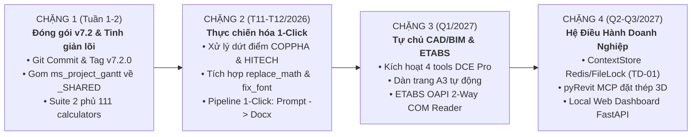

# BÁO CÁO CHIẾN LƯỢC: ĐÁNH GIÁ HIỆN TRẠNG & LỘ TRÌNH ĐỊNH HƯỚNG PHÁT TRIỂN HỆ SINH THÁI AGENTIC (v7.2 → v10.0)
## HỆ THỐNG TRỢ LÝ AI KỸ SƯ KẾT CẤU & QUẢN TRỊ DỰ ÁN CẤP ENTERPRISE

> **Mã tài liệu:** STRAT-REP-20261104-001  
> **Phiên bản hệ sinh thái:** v7.2 (Unified Master Architecture)  
> **Thời điểm thẩm định:** 04/11/2026 — 13:45 (+07:00)  
> **Cơ sở hệ thống:** `.agents/` (`g:\My Drive\Google AI Studio\.agents`)  
> **Phạm vi áp dụng:** Toàn bộ 13 Production Skills, 111 Deterministic Calculators, 21 Tiêu chuẩn Locked, và các dự án kỹ thuật thực tế.

---

## 1. TỔNG QUAN HIỆN TRẠNG HỆ SINH THÁI (EXECUTIVE SUMMARY)

Trải qua các đợt tái cấu trúc và chuẩn hóa toàn diện từ phiên bản v1.0 đến v7.2, hệ sinh thái điều phối kết cấu `.agents` đã chính thức chuyển hóa từ một tập hợp các công cụ hỗ trợ riêng lẻ thành một **Hệ điều hành Kỹ thuật Số Đa Tác nhân (Enterprise Multi-Agent Engineering Operating System)** chuyên sâu cho lĩnh vực Xây dựng Dân dụng & Công nghiệp tại Việt Nam.

Nền tảng vận hành trên nguyên tắc cốt lõi **Deterministic First** (Tính toán xác định qua mã nguồn Python, cấm tuyệt đối mô hình ngôn ngữ lớn LLM tự nhẩm tính số liệu kỹ thuật), kết hợp cùng **Quy trình Thẩm tra 7 Cổng Kiểm soát (Stage Gates 0–6)** và **Hệ thống 20 Quy tắc Cứng (Hard Rules)** bảo đảm tính an toàn pháp lý cao nhất.

### 1.1. Bảng Chỉ Số Định Lượng Năng Lực Hệ Thống (Health Dashboard)

| Chỉ số định lượng | Kết quả kiểm tra thực tế | Trạng thái kỹ thuật | Ý nghĩa & Đánh giá vận hành |
|---|:---:|:---:|---|
| **Production Skills** | **13 / 13 skills** | 🟢 100% Hoạt động | Không còn skill nháp hay placeholder; toàn bộ đều có mã nguồn thực thi. |
| **Deterministic Calculators** | **111 scripts** | 🟢 Đầy đủ | Tăng từ 104 lên 111 (bổ sung bộ xuất BOQ VE, CPM/EVM, ISO KPI, QLTK Tracking). |
| **Tiêu chuẩn Locked** | **21 tiêu chuẩn** | 🟢 Chốt cứng | Nguồn sự thật duy nhất (TCVN 2737:2023, 5575:2024, 5574:2018, 9386:2025, TT 34/2026...). |
| **Test Suites Tự động** | **17 / 17 suites** | 🟢 PASS 100% | **444 checks ĐẠT / 0 lỗi** trong 28.85 giây (bao gồm trọn vẹn Suite 17 mới). |
| **Zero White Text Lock (Điều 12b)** | **311 / 311 files** | 🟢 0 Vi phạm | Quét sạch 100% nguy cơ "chữ trắng in trên giấy trắng" trong Word và Excel. |
| **Anti-[Repaired] Excel Sanity** | **Suite 17 (15/15 tests)** | 🟢 PASS | Triệt tiêu vĩnh viễn lỗi hỏng XML do openpyxl `freeze_panes` và crash `MergedCell`. |
| **Cơ sở Dữ liệu Phân loại Ý định** | **417 keywords / 7 pipelines** | 🟢 Vững chắc | 192 primary, 164 secondary, 61 regex, 19 anti-keywords, phân nhánh chính xác. |
| **Độ đồng bộ Tài liệu Báo cáo** | **0 Stale-claims** | 🟢 Đồng bộ | File tổng hợp `BAO_CAO_PHAT_TRIEN_DIEU_PHOI_AI.md` khớp 100% với mã nguồn hiện hữu. |

---

## 2. ĐÁNH GIÁ CHI TIẾT 5 TRỤ CỘT NỀN TẢNG KỸ THUẬT HIỆN HỮU

### 2.1. Trụ Cột 1: Điều Phối Tác Nhân & Chuỗi Thực Thi Khép Kín (Global Dispatcher & Stage Gates)
- **Cơ chế Phân loại Tự động (`intent_classifier.py`):** Hệ thống phân loại ngôn ngữ tự nhiên đạt độ chính xác cao. Khi `confidence >= 0.85`, skill được kích hoạt tức thì; khi có sự đan xen giữa vai trò *Thẩm tra/Đại diện Chủ đầu tư* (`Design_Evaluation`) và *Thiết kế/Tự tính toán cốt thép* (`Structural_Design_Engineer`), bộ quy tắc Tie-breaker phân xử rành mạch không để xảy ra xung đột quyền hạn.
- **Quy trình 7 Cổng Kiểm soát Thẩm tra (Stage Gates 0–6):**
  - **Gate 0:** Kiểm tra tính hợp thức pháp lý của Báo cáo ĐCCT, thuyết minh chịu lửa QCVN 06:2022/BXD, bóc tách bảng cân bằng đất TMB và phân cấp công trình theo Thông tư 34/2026/TT-BXD và QCVN 03:2022/BXD.
  - **Gate 1:** Quét và giải nén vector EMF, rà soát 100% bản vẽ, bóc tách bảng tính gốc và kiểm đếm lỗi `#VALUE!`, `#REF!`.
  - **Gate 2 & 3:** Thẩm tra chuyên sâu tải trọng tĩnh, hoạt tải mái, gió bốc ngược, tải xe PCCC trên nắp bể ngầm theo TCVN 2737:2023 và tổ hợp ULS/SLS nghịch đảo cực đoan.
  - **Gate 4:** Phân tích đường truyền lực 3D, độ mảnh bản bụng xà gồ, ổn định chân cột và kiểm toán chống đẩy nổi Archimedes ($K_{\text{đn}} \ge 1.15$).
  - **Gate 5:** Đối soát hình học 4 chiều KT $\leftrightarrow$ MB $\leftrightarrow$ MC/Chi tiết $\leftrightarrow$ TMKC.
  - **Gate 6:** Kích hoạt chế tài hợp đồng RFI/NCR và xuất bản báo cáo chính thức.
- **Review Gate (Cổng Kiểm duyệt An toàn):** Nghiêm cấm AI tự ý ghi đè file output khi chưa hiển thị bảng tóm tắt hệ số sử dụng $\eta$, số liệu kiểm tra và nhận được sự phê duyệt tường minh từ kỹ sư.

### 2.2. Trụ Cột 2: Cơ Chế Tính Toán Xác Định & Liêm Chính Tiêu Chuẩn (Deterministic Math & Standards Graph v2.0)
- **Triệt tiêu Hoàn toàn Ảo giác (No Hallucination):** 111 scripts tính toán trả về cấu trúc JSON chuẩn gồm `Calculation_Logs` (từng bước giải tích) và `Standard_Method` (phiên bản tiêu chuẩn thực sự cài đặt). Thiếu dữ kiện lập tức trả về `Data Missing`, tuyệt đối không tự bịa số liệu.
- **Standards Graph v2.0 (`standards_graph.py`):**
  - Tích hợp công cụ phát hiện xung đột **E004 Conflict Detector**, ngăn chặn việc trích dẫn lẫn lộn tiêu chuẩn hết hiệu lực (ví dụ dùng TCVN 2737:1995 song song với TCVN 2737:2023).
  - Quản lý bộ nhớ SQLite WAL chủ động với `PRAGMA wal_checkpoint(TRUNCATE)` và hỗ trợ truy vấn tác động nghịch đảo (Inverse Impact Query).

### 2.3. Trụ Cột 3: Chuẩn Hóa Văn Bản Doanh Nghiệp (Corporate Output Infrastructure)
- **Quy tắc Cấm Chữ Trắng (Zero White Text Lock — Điều 12b AGENTS.md):**
  - Quét sạch 311 files mã nguồn, đảm bảo không có bất kỳ khai báo chữ trắng nào trong bảng biểu Word (`.docx`) và Excel (`.xlsx`).
  - Bảo vệ tuyệt đối khả năng in ấn trên máy in laser đen trắng (chế độ in mặc định bỏ qua màu nền) và tối ưu hóa khi xem trong Word Dark Mode.
- **Bộ Token Màu In Ấn Tự Nhiên (Natural Print Palette v4.4):**
  - Bảng biểu sử dụng nền sáng khoáng tự nhiên: Xanh Đá Phiến Sương Nhạt (`#DCE4EC`), Đá Vôi Sáng (`#EAE6DF`) đi cùng chữ Xanh Thép Trầm (`#1E3246`) hoặc Mực Than Chì (`#1C1E21`).
- **Engine Kiểm Định Bảng Tính Excel (`xlsx_view_sanity.py` v2.1):**
  - Khắc phục triệt để lỗi openpyxl freeze panes sinh selection rác, loại bỏ emoji trò chuyện trong bảng tính kỹ thuật, khóa cứng cấu hình in Landscape `fitToWidth = 1`.
- **Độ Sâu Diễn Giải Tối Thiểu (Minimum Narrative Depth):**
  - Bắt buộc các báo cáo/tờ trình chính thức phải có độ dài thuyết minh kỹ thuật $\ge 800$ từ, chấm dứt tình trạng sinh văn bản ngắn cụt lủn hoặc hời hợt.

### 2.4. Trụ Cột 4: Quản Lý Dự Án & Tiến Độ Chuẩn PMO (Project Management Office)
- **Engine Biểu Đồ Gantt MS Project (`ms_project_gantt.py` v1.1.0):**
  - Thiết kế chuẩn PMO quốc tế: Giao diện Split View (Bảng Task Sheet 8 cột bên trái + Gantt Canvas bên phải), thanh tổng hợp Summary Brackets, đường găng CPM tô đỏ, mũi tên liên kết Finish-to-Start stepped vuông góc, thước đo thời gian 2 tầng và dải đánh dấu ngày nghỉ Tết.
  - Tự động ngắt sang đúng 01 trang A4 xoay ngang (Landscape $29.7 \times 21.0\text{ cm}$) riêng biệt trong Word ở độ phân giải **300 DPI**, sau đó tự động trả về khổ dọc cho nội dung tiếp theo.
- **Chuẩn Trao Đổi Dữ Liệu MSPDI XML (`msproject_xml_engine.py`):**
  - Xuất dữ liệu cấu trúc XML (SaveVersion 14) tương thích 100% với Microsoft Project 2016–365, hỗ trợ nạp ngược để tính toán phương sai tiến độ (Slippage) và phân tích giá trị thu được EVM (SPI, CPI, EAC).

### 2.5. Trụ Cột 5: Trí Tuệ Bản Vẽ CAD & Điều Phối Đa Bộ Môn
- **CAD Deep Reader v1.0.0 (`cad_deep_reader.py`):**
  - Tự động nhận diện đường dẫn cài đặt AutoCAD `accoreconsole.exe` trên hệ điều hành Windows để chuyển đổi DWG sang DXF nền mà không cần mở giao diện AutoCAD.
  - Trích xuất toàn bộ Layer, Text, Block, MText để phục vụ bóc tách tự động và đối soát kích thước hình học.
- **Đối Soát 4 Chiều (`drawing_calc_crosscheck.py`):**
  - Truy vết tọa độ nút chân cột từ bảng Joint Reactions của ETABS sang bảng tính móng; đối chiếu kích thước, vị trí cổ cột, diện tích cốt thép $A_{s,\text{drawing}} \ge A_{s,\text{tt}}$ giữa Kiến trúc $\leftrightarrow$ Mặt bằng $\leftrightarrow$ Mặt cắt chi tiết $\leftrightarrow$ Thuyết minh tính toán.

---

## 3. BẢNG KIỂM KÊ TÌNH TRẠNG 13 PRODUCTION SKILLS

| STT | Tên Kỹ Năng (Skill) | Phiên Bản | Số Scripts | Chức Năng Cốt Lõi | Mức Độ Hoàn Thiện Thực Tế |
|:---:|---|:---:|:---:|---|---|
| 1 | `Cost_Estimator` | 1.4.0 | 8 | Tính toán chi phí BOQ, Value Engineering, Embodied Carbon, CAPEX, xuất Excel phân tích đa phương án. | 🟢 **Production**: Đã hoàn thiện engine xuất Excel `boq_ve_excel_exporter.py`. |
| 2 | `Design_Evaluation` | 3.4.0 | 18 | Thẩm tra kết cấu và đa bộ môn cấp Chủ trì, thực thi 7 Stage Gates, CAD Deep Reader trích xuất DWG/DXF. | 🟢 **Core Engine**: Trụ cột thẩm tra toàn diện nhất hệ thống. |
| 3 | `Global_Dispatcher` | 1.0.0 | 5 | Điều phối trung tâm, phân loại ý định (Intent), quản lý Pipeline đa kỹ năng, Approval Gate. | 🟢 **Production**: 17/17 benchmark tests pass tuyệt đối. |
| 4 | `Project_Manager` | 2.0.0 | 8 | Giám đốc PMO, lập Master Schedule, vẽ Gantt 300 DPI, xuất XML MS Project, tính EVM/CPM, KPI ISO 9001. | 🟢 **Production**: Nâng cấp v2.0 hoàn chỉnh trọn bộ công cụ PMO. |
| 5 | `SKILL_BIM_COORDINATION` | 1.4.0 | 1 | Kiểm soát xung đột hình học, lưới trục, cao độ thông thủy và đối soát nội bộ bản vẽ KT-KC-MEP. | 🟢 **Production**: Kết nối chặt chẽ với Gate 1 và Gate 5. |
| 6 | `SKILL_FORENSIC` | 1.2.0 | 5 | Giám định sự cố nứt/sập/biến dạng, tính toán ngược tải trọng thực tế, xếp hạng xác suất nguyên nhân. | 🟢 **Production**: Giao thức 7 bước điều tra sự cố chuẩn mực. |
| 7 | `SKILL_GEOTECH` | 3.1.0 | 20 | Đánh giá ĐCCT, tính thông số đất Plaxis, hố đào sâu, Base Heave, chuyển đổi tải Plaxis sang ETABS. | 🟢 **Chuyên Sâu**: Sở hữu kho thư viện 20 bài toán cơ học đất. |
| 8 | `SKILL_PHULUC` | 2.3.0 | 0* | Lập thuyết minh & phụ lục tính toán chi tiết step-by-step (.docx) chuẩn BKTECHS và TVTK Đa Hạng Mục. | 🟢 **Production**: `docx_generator_v2.py` (1.460 dòng) xử lý biểu thức Math mượt mà. |
| 9 | `SKILL_RFI` | 1.4.0 | 5 | Phát hành phiếu RFI, biên bản NCR, áp dụng 4 điều khoản chế tài hợp đồng TVTK (NĐ 175/2024, FIDIC). | 🟢 **Production**: Công cụ chế tài kỹ thuật và pháp lý sắc bén. |
| 10 | `SKILL_TEMPWORKS` | 1.0.0 | 4 | Thiết kế cốp pha sàn, cốp pha cột, cốp pha vách, cây chống shoring, hệ giằng ổn định thi công. | 🟢 **Production**: Đảm bảo an toàn kết cấu tạm theo TCVN 4453. |
| 11 | `SKILL_VERIFY` | 3.2.0 | 10 | Kiểm chứng độc lập 6 bộ lọc (EMF deep parser, load combos, ETABS joint tracer, formula checker). | 🟢 **Production**: Chốt chặn phát hiện gian lận và sai lệch số liệu. |
| 12 | `Structural_Design_Engineer` | 1.3.0 | 14 | Kỹ sư thiết kế độc lập, tính dầm/cột/móng, liên kết bu lông/hàn/neo, xuất Calculation Sheet chi tiết. | 🟢 **Production**: Cung cấp log giải tích xác định cho thuyết minh. |
| 13 | `Technical_Illustrator` | 1.4.0 | 13 | Vẽ mặt cắt 2D kỹ thuật chính xác (Matplotlib), sơ đồ Gantt PMO, minh họa khái niệm 3D. | 🟢 **Production**: Hơn 100 template mặt cắt kỹ thuật có sẵn trong registry. |

*\*Ghi chú: SKILL_PHULUC tập trung vào engine kết xuất tài liệu Word lớn (`docx_generator_v2.py`) tiếp nhận dữ liệu từ các skill tính toán.*

---

## 4. MA TRẬN ĐỊNH HƯỚNG PHÁT TRIỂN 3 CHIỀU (3-DIMENSIONAL STRATEGY)

Trong giai đoạn tiếp theo (2026–2027), hệ sinh thái cần phát triển đồng bộ theo 3 chiều không gian:

```
                                ▲ CHIỀU 1: ĐỘ SÂU KỸ THUẬT (Vertical Depth)
                                │ • ETABS OAPI 2 chiều (Direct COM Sync)
                                │ • Giải tích phi tuyến bậc cao P-Delta & Nền đàn hồi
                                │ • Tối ưu hóa cắt thép 11.7m theo lô sản xuất
                                │
                                │
   CHIỀU 3: MÔI TRƯỜNG VẬN HÀNH ┼──────────────────────────────► CHIỀU 2: BỀ RỘNG BẢN VẼ & BIM
   (Operational Scale)          │                                (Horizontal Breadth)
   • Multi-tenant ContextStore  │                                • Dàn trang A3 tự động (Layout Packing)
   • Redis / FileLock local C:\ │                                • Tự động vẽ Cột, Vách, Móng, Khung thép
   • Local Web UI / API Cloud   │                                • pyRevit MCP: Đặt cốt thép 3D trong Revit
```

### Chiều 1: Chiều Sâu Kỹ Thuật (Vertical Depth)
- Chuyển từ việc đọc báo cáo gián tiếp sang **kết nối OAPI trực tiếp hai chiều với ETABS và SAFE**.
- Tích hợp các bài toán cơ học kết cấu phức tạp: Giải tích hiệu ứng bậc hai $P-\Delta$, mô hình nền đàn hồi Winkler/Pasternak cho móng bè, và bài toán tối ưu hóa cắt thép thanh 11.7m hạn chế tối đa đầu mẩu vụn.

### Chiều 2: Bề Rộng Bản Vẽ & Mô Hình Hóa BIM (Horizontal Breadth)
- Mở rộng năng lực tự động vẽ của `cad_bridge.py`: Từ dầm sàn sang toàn bộ cấu kiện chính (cột, vách thang máy, móng cọc, chi tiết liên kết thép).
- Phát triển module tự động đóng khung, dàn trang bản vẽ A3 (`viewport_auto_packer.py`) trong PaperSpace.
- Tự động hóa mô hình hóa BIM: Xuất dữ liệu sang Autodesk Revit thông qua pyRevit MCP để đặt thép 3D tự động.

### Chiều 3: Môi Trường Vận Hành Cấp Doanh Nghiệp (Operational Scale)
- Chuyển đổi tầng lưu trữ dữ liệu trung gian từ file JSON trên ổ mạng đám mây (`g:\My Drive`) sang lớp trừu tượng `ContextStore` (Local In-Memory Cache + Thread-safe FileLock trên ổ cứng cục bộ `C:\Local`).
- Xây dựng giao diện điều hành trực quan cục bộ (Local Web Cockpit) phục vụ làm việc nhóm trong phòng kỹ thuật.

---

## 5. LỘ TRÌNH TRIỂN KHAI CHI TIẾT THEO 4 GIAI ĐOẠN (MASTER ROADMAP 2026–2027)



### 5.1. CHẶNG 1: Đóng Gói Release v7.2 & Tinh Giản Lõi Dùng Chung (Ngay lập tức — Tuần 1–2)
*Mục tiêu: Đóng băng thành quả v7.2, dọn dẹp các bản sao trùng lặp, tạo điểm tựa an toàn tuyệt đối.*

1. **Commit Toàn Bộ Working Tree & Gắn Thẻ Phiên Bản:**
   - Thực hiện `git add .` và tạo commit chính thức:
     `feat(ecosystem): Release v7.2 - Zero White Text Lock, PMO MS Project Gantt Engine & Suite 17 XLSX View Sanity`.
   - Gắn tag cố định: `v7.2.0`.
2. **Quy Chuẩn Hóa Thư Viện Dùng Chung (`_SHARED/`):**
   - Hợp nhất 2 bản sao của `ms_project_gantt.py` (tại `Project_Manager` và `Technical_Illustrator`) thành một file duy nhất tại `_SHARED/SHARED_CONTEXT/ms_project_gantt.py`.
   - Chuẩn hóa các công cụ kiểm toán `xlsx_view_sanity.py` và `audit_zero_white_text.py` thành các lệnh kiểm tra tự động chạy định kỳ.
3. **Mở Rộng Kiểm Thử Hồi Quy 111 Calculators:**
   - Cập nhật `tests/test_runner.py` (Suite 2) để tự động chạy smoke-test cho toàn bộ 111 calculator scripts hiện có, chính thức đóng dứt điểm nợ kỹ thuật **TD-07**.

### 5.2. CHẶNG 2: Thực Chiến Hóa Dự Án Đang Mở & Pipeline 1-Click (Tháng 11 – Tháng 12/2026)
*Mục tiêu: Đem toàn bộ sức mạnh của nền tảng vào giải quyết dứt điểm các hồ sơ dự án đang mở tại `01_Projects`.*

1. **Dự Án COPPHA (`01_Projects\COPPHA`):**
   - Tích hợp các bộ lọc sửa lỗi Word Math và chuẩn hóa font chữ (`replace_math_docx.py`, `fix_docx_font.py`) vào thẳng lõi `SKILL_PHULUC/docx_generator_v2.py`.
   - Vận hành `SKILL_TEMPWORKS` xuất trọn bộ Thuyết minh & Phụ lục Tính toán Cốp pha dầm sàn, ván khuôn cột, hệ cây chống shoring chịu tải trọng thi công đạt chuẩn TCVN 4453:1995.
2. **Dự Án CỔNG HITECH (`01_Projects\CONG HITECH`):**
   - Đưa script vẽ chi tiết cụm con lăn chịu lực (`draw_roller_connection.py`) vào danh mục mẫu chuẩn của `Technical_Illustrator`.
   - Thiết lập chu trình tự động: *Tính toán khả năng chịu lực bánh xe/con lăn $\rightarrow$ Kiểm toán đường hàn/bu lông $\rightarrow$ Xuất Tờ trình kỹ thuật (.docx) đạt chuẩn Natural Print Palette*.
3. **Hiện Thực Hóa Pipeline 1-Click (`tools/end_to_end_pipeline.py`):**
   - Khép kín luồng làm việc tự động:
     $$\text{Yêu cầu kỹ thuật} \longrightarrow \text{Tính toán TCVN} \longrightarrow \text{Bóc BOQ \& VE} \longrightarrow \text{Lập Tiến độ Gantt} \longrightarrow \text{Báo cáo Word/Excel 300 DPI}$$

### 5.3. CHẶNG 3: Tự Chủ Bản Vẽ CAD Đa Cấu Kiện & Đồng Bộ ETABS OAPI (Quý 1/2027)
*Mục tiêu: Giải quyết bài toán tự động sản xuất hồ sơ bản vẽ thiết kế kỹ thuật thi công.*

1. **Kích Hoạt Tài Sản Giải Phẫu DCE Pro:**
   - Hiện thực hóa 4 công cụ độc lập trong `.agents/tools/`: `dce_xdata_bridge.py`, `dce_excel_bus.py`, `dce_option_controller.py`, `dce_cad_automation.py`.
   - Chuẩn hóa hệ mã DxfCode XData TypedValue (1001, 1000, 1002, 1005, 1040, 1070, 1071) tương thích hoàn hảo chuẩn Autodesk DXF.
2. **Mở Rộng Tự Động Vẽ Đa Cấu Kiện & Dàn Trang A3:**
   - Nâng cấp `cad_bridge.py` tự động vẽ Cột BTCT, Vách thang máy, Móng cọc, Dầm thép hình I/H kèm bảng thống kê cốt thép tự động.
   - Xây dựng module xếp khung bản vẽ A3 (`viewport_auto_packer.py`): Tự động tính toán bao hình cấu kiện và xếp gọn vào PaperSpace Layout A3 ($420 \times 297\text{ mm}$) với tỷ lệ chuẩn $1/20, 1/25, 1/50, 1/100$.
3. **Module Kết Nối Trực Tiếp ETABS OAPI (`etabs_com_reader.py` v2.0):**
   - Đọc trực tiếp kết quả phân tích nội lực, phản lực chân cột (Joint Reactions), trôi tầng (Drift) từ file `.edb` đang mở trong ETABS.
   - Bơm thẳng phản lực chân cột vào module tính móng của `Structural_Design_Engineer` và `SKILL_GEOTECH` mà không cần xuất file Excel trung gian.

### 5.4. CHẶNG 4: Hệ Điều Hành Kết Cấu Doanh Nghiệp (Quý 2 – Quý 3/2027)
*Mục tiêu: Mở rộng khả năng cộng tác đa người dùng và tích hợp mô hình BIM 3D.*

1. **Lớp Trừu Tượng `ContextStore` (Xóa Nợ Kỹ Thuật TD-01):**
   - Thay thế việc ghi đọc file JSON trên ổ mạng ảo `g:\My Drive` bằng cơ chế đệm kép: In-Memory / Redis Buffer kết hợp FileLock thread-safe trên ổ cứng cục bộ `C:\Local`.
   - Ngăn chặn hoàn toàn hiện tượng nghẽn I/O và race conditions khi chạy song song nhiều bài toán tính toán lớn.
2. **Tiện Ích pyRevit MCP (Mô Hình Cốt Thép 3D):**
   - Xây dựng tiện ích mở rộng `pyRevit/AgenticStructural.extension`: Nhận dữ liệu JSON từ `Structural_Design_Engineer` để tự động dựng các thanh thép 3D (Rebar Element) trực tiếp trong môi trường Autodesk Revit.
3. **Giao Diện Điều Hành Trực Quan Cục Bộ (Local Web Cockpit):**
   - Xây dựng Web Dashboard cục bộ nhẹ bằng FastAPI + Tailwind CSS:
     - Giám sát luồng thẩm tra 7 Gates theo thời gian thực.
     - Trực quan hóa Đồ thị Tiêu chuẩn (Standards Graph Visualizer).
     - Bảng điều khiển tiến độ PMO và trạng thái xử lý RFI/NCR.

---

## 6. SỔ ĐĂNG KÝ NỢ KỸ THUẬT & KẾ HOẠCH XỬ LÝ (TECHNICAL DEBT STATUS)

| Mã Nợ | Phân Loại | Mô Tả Nợ Kỹ Thuật | Tác Động Nghiệp Vụ | Kế Hoạch Xử Lý | Trạng Thái |
|:---:|:---:|---|:---:|:---:|:---:|
| **TD-01** | Architecture | Handoff qua file JSON cục bộ chưa tối ưu cho đa luồng đồng thời (concurrent). | Medium | Chuyển sang `ContextStore` (Chặng 4) | 🟡 Đang chờ |
| **TD-02** | Integration | Parser hồ sơ CAD/BIM phụ thuộc dữ liệu trích xuất trung gian. | High | Giải quyết xong qua `cad_deep_reader.py` | 🟢 **ĐÃ ĐÓNG** |
| **TD-03** | Coverage | Các skills `TEMPWORKS`, `BIM`, `PM` ở dạng placeholder. | High | Toàn bộ 13 skills đã lên Production | 🟢 **ĐÃ ĐÓNG** |
| **TD-04** | Calculation | Chưa có module giải tích phi tuyến bậc cao $P-\Delta$ và móng bè đàn hồi. | Medium | Xây dựng trong Chặng 3 (Q1/2027) | 🟡 Đang chờ |
| **TD-05** | Delivery | Thiếu template Thuyết minh phụ lục cho cốp pha, liên kết thép đặc thù. | Low | Bổ sung trong Chặng 2 (T11/2026) | 🔵 Đang xử lý |
| **TD-06** | Integration | Chưa có module kết nối trực tiếp OAPI hai chiều với ETABS/SAFE. | Medium | Xây dựng trong Chặng 3 (Q1/2027) | 🟡 Đang chờ |
| **TD-07** | Quality | Độ phủ kiểm thử tự động Suite 2 mới bao quát 13/111 calculators. | Medium | Mở rộng lên 111/111 trong Chặng 1 | 🔵 Đang xử lý |

---

## 7. KẾ HOẠCH HÀNH ĐỘNG CỤ THỂ TRONG NGÀY HÔM NAY

| Bước | Nhiệm vụ cụ thể | Công cụ thực hiện | Sản phẩm đầu ra |
|:---:|---|---|---|
| **1** | **Commit & Tag Release v7.2.0** | `git add . && git commit` | Toàn bộ 42 modified files & 17 untracked files được lưu trữ an toàn trong lịch sử Git. |
| **2** | **Xử lý tài liệu dự án COPPHA** | Chạy `SKILL_TEMPWORKS` & `SKILL_PHULUC` | Thuyết minh cốp pha dầm sàn, cây chống hoàn chỉnh (.docx) chuẩn TCVN 4453. |
| **3** | **Xử lý bản vẽ & tờ trình HITECH** | Chạy `Structural_Design_Engineer` | Tờ trình phê duyệt giải pháp con lăn chịu lực kèm bản vẽ chi tiết 2D. |

---

## BẢNG TRÁCH NHIỆM & DUYỆT TÀI LIỆU (APPROVAL MATRIX)

| Bên liên quan | Vai trò trách nhiệm | Chữ ký / Đề xuất thực hiện |
|---|---|---|
| **Trợ lý AI (Gemini Antigravity)** | Lập báo cáo chiến lược, tổng hợp kiểm toán mã nguồn & đề xuất lộ trình | *Trợ lý AI — cần kỹ sư có chứng chỉ hành nghề kiểm tra xác nhận trước khi ký.* |
| **Kỹ sư Trưởng / Quản lý Dự án** | Thẩm định nội dung kỹ thuật, phê duyệt lộ trình và phân bổ nguồn lực | *(Ký và ghi rõ họ tên)* |

---

> *Tuyên bố miễn trừ trách nhiệm (Disclaimer): Tài liệu này do trợ lý AI lập tự động dựa trên hiện trạng mã nguồn, tài sản giải phẫu kỹ thuật và các đợt kiểm thử thực tế của hệ sinh thái `.agents`. Kết quả rà soát và định hướng mang tính tham khảo kỹ thuật, phải được kỹ sư có chứng chỉ hành nghề phù hợp kiểm tra, hiệu chỉnh và chịu trách nhiệm trước khi đưa vào áp dụng chính thức cho các dự án thiết kế, thi công hoặc quản lý đầu tư xây dựng.*

