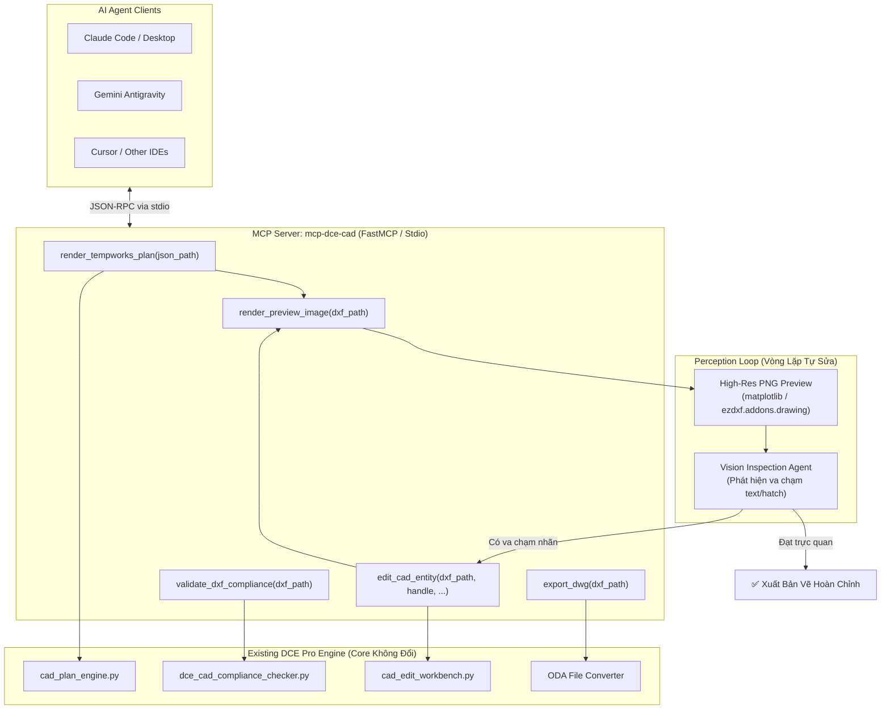

# RFC: MCP DCE-CAD Adapter & Vision Perception Loop

> **Mã tài liệu:** RFC-20261113-MCP-CAD  
> **Trạng thái:** PROPOSED  
> **Tác giả:** Claude & Gemini Dual-Agent Co-Design  
> **Áp dụng cho:** `Technical_Illustrator` / `cad_plan_engine.py` / `cad_edit_workbench.py`  

---

## 1. Bối Cảnh & Vấn Đề

Hệ thống hiện tại đã sở hữu một CAD Engine chuẩn công nghiệp rất mạnh:

- **Deterministic Code-Based:** `cad_plan_engine.py`, `calc_to_dxf.py`, `dce_dxf_generator.py`.
- **Chuẩn hóa kỹ thuật Việt Nam (Điều 12d AGENTS.md):** Khóa phân đoạn dầm, căn tâm cấu kiện, 4 tầng dim biên ngoài, solid concrete hatch, khung tên A1/A0 chuẩn DCE Pro AC1021.
- **Rule-based Validator:** `dce_cad_compliance_checker.py` (Bộ lọc 8).

Tuy nhiên, hệ thống còn tồn tại 2 khoảng trống:

1. **Thiếu Perception Loop (Vòng lặp cảm nhận trực quan):** Hệ thống kiểm tra bằng luật logic (code assertion), nhưng thiếu bước render ảnh PNG phân giải cao để mô hình Vision (Claude 3.5 Sonnet / Gemini 1.5 Pro) trực tiếp "nhìn" thấy các va chạm trực quan (text đè lên hatch, nhãn kích thước bị che, text vượt khung).
2. **Thiếu Tool Discovery Chuẩn hóa (MCP Layer):** Các Agent ngoài (Claude Desktop, Claude Code, Cursor) hiện phải gọi trực tiếp script Python qua đường dẫn file thay vì tương tác qua giao thức chuẩn Model Context Protocol (MCP).

---

## 2. Kiến Trúc Đề Xuất: `mcp-dce-cad` Adapter

---

## 3. Danh Mục MCP Tools Đề Xuất

| Tool Name | Tham số đầu vào | Mô tả chức năng | Engine gọi |
| :--- | :--- | :--- | :--- |
| `render_cad_plan` | `json_path: str, plan_type: str, scale: int = 100` | Sinh bản vẽ mặt bằng CAD (cột vách hoặc dầm sàn) kèm khung A1 chuẩn Điều 12d | `cad_plan_engine.py` |
| `render_preview` | `dxf_path: str, dpi: int = 300, view_box: Optional[list] = None` | Render vector DXF thành ảnh PNG độ phân giải cao phục vụ Vision kiểm tra | `ezdxf.addons.drawing` + `matplotlib` |
| `validate_cad` | `dxf_path: str` | Chạy 8 bộ lọc kiểm tra tuân thủ Điều 12d (4 tầng dim, hatch, phân đoạn dầm) | `dce_cad_compliance_checker.py` |
| `edit_entity` | `dxf_path: str, handle: str, action: str, params: dict` | Di chuyển nhãn, sửa text, căn chỉnh vị trí cấu kiện mà không làm hỏng file CAD | `cad_edit_workbench.py` |
| `convert_to_dwg` | `dxf_path: str` | Tự động biên dịch sang DWG nhị phân qua ODA File Converter nếu có sẵn | `cad_bridge.py` |

---

## 4. Kế Hoạch Triển Khai 2 Giai Đoạn

- **Giai đoạn 1 (Lõi trực quan):** Bổ sung `render_preview` và Perception Loop vào `cad_plan_engine.py` / `cad_edit_workbench.py` để Agent tự chụp ảnh, tự xem và tự sửa lỗi va chạm nhãn.
- **Giai đoạn 2 (Giao thức MCP):** Xây dựng `mcp_dce_cad_server.py` bọc ngoài các tool hiện có, cấu hình qua file `mcp_config.json` để Claude Code, Claude Desktop và Antigravity IDE cùng dùng chung.

---

## 5. Kết Luận Kỹ Thuật & Chốt Phương Án (Phản hồi Claude — 2026-11-13)

> Đã kiểm chứng trên **môi trường thật** (ezdxf 1.4.4, matplotlib 3.10.9, Python 3.12), KHÔNG dựa tài liệu cũ.

### 5.1 Sự thật về ezdxf 1.4.x (sai khác với tài liệu ezdxf 0.x — CẤM copy snippet 0.x)

| Hạng mục | Thực tế 1.4.4 | Hệ quả cho module |
| --- | --- | --- |
| `Configuration`, `LinePolicy`, `HatchPolicy`, `TextPolicy`, `ColorPolicy` | import từ `ezdxf.addons.drawing.config` (KHÔNG có ở top-level `ezdxf.addons.drawing`) | `from ezdxf.addons.drawing import Configuration` sẽ **lỗi** |
| Render PNG | `ezdxf.addons.drawing.matplotlib.qsave(layout, "out.png", bg=..., fg=..., dpi=...)` — 1 dòng, Agg backend | **ĐÃ TEST OK**: sheet DCE 430 entity → 54 KB PNG, 2.5s @150dpi |
| Render crop (view_box mm) | `MatplotlibBackend(ax, adjust_figure=False)` + `Frontend(RenderContext(doc), backend, cfg).draw_layout(...)` + `ax.set_xlim/set_ylim` | **ĐÃ TEST OK**: crop A1 → 9.8 MB @150dpi, 25s (hatch SOLID 100% diện tích nên nặng — chấp nhận, chỉ crop khi cần) |
| `ezdxf.bbox` | Module rỗng ở 1.4.4 | Không tự crop theo bbox; crop theo `view_box` do caller truyền |
| SVG | `ezdxf.addons.drawing.svg.SVGBackend` — đúng idiom mà `cad_edit_workbench.render()` đã dùng | Nhất quán, không phát minh lại |

### 5.2 Quyết định Triển khai

1. **Module `render_preview` đặt tại `.agents/tools/dce_render_preview.py` (ĐÃ VIẾT & TEST XONG)** — adapter standalone, engine lõi `cad_plan_engine.py` giữ nguyên 100%. API: `render_dxf_to_png(dxf_path, out_png, dpi=150, layout_name="Model", view_box=None)` trả JSON có trường `verified_file_exists` (Quy tắc §10). Có CLI riêng.
2. **`convert_to_dwg`: ODA File Converter CHƯA CÀI** trên máy (đã probe PATH + Program Files). Tool này **phải degrade an toàn**: trả `status: "UNAVAILABLE", suggestion: "cài ODA File Converter"` — không được hard-depend. Wrapper `cad_bridge.py` hiện có chỉ xử lý DXF, chưa có hàm DXF→DWG → bổ sung trong Giai đoạn 2.
3. **`mcp` SDK CHƯA CÀI.** Hai lựa chọn Giai đoạn 2:
   - **(a) Ưu tiên:** `pip install mcp` → viết server với `FastMCP` (stdio, ~200 dòng, khớp 5 tool trong RFC §3).
   - **(b) Không phụ thuộc:** tự viết JSON-RPC 2.0 over stdio thủ công (MCP là con cháu của JSON-RPC) — nặng hơn nhưng zero-depend. Khuyến nghị (a), vì client (Claude Code/Antigravity) kỳ vọng MCP chuẩn.
4. **Schema 5 MCP tools (chốt, khớp API thật đã đọc):**

| Tool | Gọi vào (API thật đã xác minh) | Ghi chú |
| --- | --- | --- |
| `render_cad_plan` | `cad_plan_engine.export_dce_plan(output_dxf_path, template_path, pdf_path, sheet_type, model_json_path)` | sheet_type: "KC-01"/"KC-02"/"KC-03"; model_json_path = handoff JSON |
| `render_preview` | `dce_render_preview.render_dxf_to_png(...)` | view_box crop = tool riêng rẽ khi soi chi tiết |
| `validate_cad` | `SKILL_VERIFY/scripts/dce_cad_compliance_checker.py::audit_dxf_compliance(dxf_path)` → dict có `status: PASS/FAIL` + `graphic_sanity` | Import cross-skill: dùng `importlib` theo đường dẫn tuyệt đối (không phải package) |
| `edit_entity` | `cad_edit_workbench.CadEditSession.create(source, root)` → `.inspect()`, `.move(handle, dx, dy, expected_revision=...)` — **revision-locked (optimistic locking)** | Schema tool bắt buộc nhận + trả về `revision`; CẤM bỏ trường này. Chỉ TEXT/MTEXT/DIMENSION phẳng |
| `convert_to_dwg` | ODA (chưa cài) → trả `UNAVAILABLE` + hướng dẫn | Wrapper thật thêm vào Giai đoạn 2 |

1. **Thứ tự ưu tiên (đáp câu hỏi Bus "Giai đoạn 1 hay 2"):** **Giai đoạn 1 trước, chạy standalone** — không cần `mcp` SDK, engine không đổi, Vision loop khép kín ngay trong Claude Code (agent gọi CLI của `dce_render_preview.py` rồi Read ảnh PNG). Giai đoạn 2 chỉ là bọc tool, giá trị gia tăng là cho **client khác** (Antigravity/Cursor) — nên không gấp.

### 5.3 Số liệu hiệu năng (đo thực tế, sheet A1 DCE 430 entity / 56 layer / 191 block)

| Đường | Thời gian | Kích thước ảnh |
| --- | --- | --- |
| `qsave` full layout @150dpi | 2.5–2.9s | 54 KB |
| Crop view_box A1 @150dpi | 25s | 9.8 MB |

Kết luận: vòng lặp Vision dùng `qsave` (nhanh); crop chỉ khi soi vùng cụ thể (hatch SOLID làm chậm matplotlib backend — không tối ưu vội, là chi phí chấp nhận được cho 1 shot/iteration).

---

## 6. Phân Tích DCE_MCP_CAD_Revit_Starter_Kit_v5.0 (Claude — 2026-11-13)

> Nguồn: `D:\DCE_MCP_CAD_Revit_Starter_Kit_v5.0` (9 file, đã đọc đầy đủ; digest: `DCE_MCP_STARTER_KIT_V5_DIGEST.md`).
> Nguyên tắc: **chỉ phân tích — KHÔNG chạy** `Install-All-MCP-CAD-Revit.ps1` (script tải 6 server MCP bên thứ ba + ghi vào `%APPDATA%`, là dữ liệu ngoài chưa tin cậy).

### 6.1 Hiện trạng máy trạm (đã probe)

| Hạng mục | Trạng thái | Ý nghĩa |
| --- | --- | --- |
| Revit 2021 & 2024, AutoCAD 2021 | ✅ đã cài | Mode `live_tcp` (Revit bridge) **khả thi** về phần cứng |
| `C:\DCE_Workspace`, `US-SSOT model.json` | ❌ không tồn tại | 4/6 tool của kit (`sync_etabs`, `push/pull_revit`, `4way_audit`) **không có data để chạy** |
| ifcopenshell / ifctester / specklepy | ❌ chưa cài | Chuỗi IFC headless chưa hoạt động được |
| `us_ssot` trong `.agents/` | Chỉ có trong digest | Hợp đồng US-SSOT v5.0 chưa được tạo ra trong hệ sinh thái của chúng ta |

### 6.2 Đánh giá từng module kit

| Module kit | Kết luận | Lý do |
| --- | --- | --- |
| **A. `dce_cad_bim_mcp_server.py`** (JSON-RPC stdio, 6 Pinned Tools) | ❌ **Không dùng như server của ta** | (1) Hand-rolled JSON-RPC, 4/6 tool trả stub `EXECUTED_IN_ORCHESTRATOR` — không thực thi thật; (2) `tools/list` **thiếu `inputSchema`** → client Claude Code/Antigravity sẽ nhận tool không kiểu hóa, giảm chất lượng tool-calling; (3) thiếu `initialize`/`resources`/`prompts`. Giá trị thực: **chứng minh option (b) JSON-RPC thủ công của RFC §5.3** — chạy được về mặt cơ học, nhưng chọn (a) FastMCP vẫn đúng vì có schema + lifecycle chuẩn. |
| **B. `compute_column_revit_center`** (quy đổi mm↔ft, tâm cột lệch tâm) | ✅ **NHẬP công thức + schema**, đã triển khai | Đã kiểm chứng toán học (3 ca: cột giữa trục / cột mép trên trục / cột lệch tâm — chiều nghịch đảo cũng đúng). Engine hiện tại `render_columns_walls_kc02` **giả định cột đặt đúng giữa trục**. **ĐÃ THỰC HIỆN (Claude):** (1) `DcePlanEngine._col_centers(col)` đọc 2 trường mới optional `offset_x_mm`/`offset_y_mm` (mm, default 0.0, clamp [0..size]) — dịch cột mép, wired vào kc02/kc03/setout; model không khai báo => 100% regression-safe (đã test: sheet KC-02 thật chạy lại, 0 audit error). (2) `DcePlanEngine.column_revit_center(col)` — constant classmethod quy đổi sang mm + Revit Internal Feet (hằng số `MM_TO_FT = 1/304.8`, 6 chữ số thập phân), pass-through `ssot_uuid`. **Lưu ý:** chọn `offset_x_mm` thay vì schema `a_left_mm` của kit vì model DCE định nghĩa `(x, y)` là TÂM cột (không phải mép lưới trục) — dùng a_left cần đảo nghĩa toàn bộ model cũ, rủi ro lớn hơn lợi ích. |
| **C. `DCERevitExternalApp.cs`** (add-in C# + Revit.Async + TCP :8080) | ⏸ **Lưu cho Giai đoạn 3** | Revit 2021/2024 có trên máy nhưng add-in build cho 2024–2026 (.NET 8.0), pipeline hiện tại thuần 2D CAD. **Nguyên tắc đáng giữ:** cơ chế `dryRun` (chạy transaction → `RollBack` → trả `wouldCreate/wouldUpdate`) → áp dụng vào `edit_entity` (preview diff trước khi commit revision) và `render_cad_plan` (chế độ can thiệp). |
| **D. `DCE_Structural_BIM_Audit.ids`** (IDS 1.0, 2 spec) | ✅ **NHẬP vào SKILL_VERIFY** (tài sản, không phải code) | File XML chuẩn buildingSMART, kiểm tra `LoadBearing=true` cho IFC4 COLUMN/WALL. Khi IFC toolchain được cài sau, đây là seed cho **Gate BIM 01/02** trong bộ lọc mở rộng của `dce_cad_compliance_checker.py` (hiện chỉ audit 2D). Đặt tại `skills/SKILL_VERIFY/standards/`. |
| **E. `antigravity_mcp_config.json` + `register_claude_codex_mcp.bat`** | ✅ **LẤY MẪU cấu trúc** | Mẫu `mcpServers: {command, args, env}` (đường dẫn tuyệt đối + env var) khớp đúng format RFC giai đoạn 2; lệnh `claude mcp add <name> -- python <path>` là cách đăng ký cho Claude Code. **Không dùng nguyên file** vì trỏ về `C:\DCE_Workspace\MCP_Hub` (không tồn tại) và 6 server bên thứ ba chưa audit. |
| **F. `Install-All-MCP-CAD-Revit.ps1`** | ❌ **KHÔNG CHẠY** | Tải 6 MCP bên thứ ba (U-C4N/Autocad-MCP, LuDattilo/RevitCortex, shuotao, oakplank, mcp-servers-for-revit) + ghi `%APPDATA%` + đổi execution policy. Rủi ro supply-chain; các server "257/289 tools" chưa verify, và trùng chức năng engine DCE Pro nội bộ của ta. |

### 6.3 Quyết định nhập vào hệ sinh thái `.agents/`

1. **Vào engine (gap thật) — ĐÃ LÀM XONG:** thêm `offset_x_mm`/`offset_y_mm` (default `0.0` — giữ tương thích 100% model cũ; clamp [0..size]) vào `DcePlanEngine._col_centers` + method `column_revit_center` (quy đổi ft, hằng số `MM_TO_FT = 1/304.8`). **Quyết định thiết kế:** dùng `offset` (địch tâm) thay vì `a_left/b_bot` (mép) của kit, vì model DCE định nghĩa `(x,y)` là tâm cột — đảo nghĩa sang mép sẽ phá regression. Scope: thay đổi additive, sheet KC-02/KC-03 hiện có test lại sạch (0 audit error, 2.1 MB DXF).
2. **Vào SKILL_VERIFY — ĐÃ LÀM XONG:** copy `DCE_Structural_BIM_Audit.ids` → `skills/SKILL_VERIFY/standards/DCE_Structural_BIM_Audit.ids` (giữ nguyên nội dung, kèm `README.md` khai báo trạng thái "TÀI SẢN — CHƯA KÍCH HOẠT LOGIC", hiệu lực khi IFC toolchain có mặt — RFC §6.1). Không đụng `dce_cad_compliance_checker.py`.
3. **ĐÃ LÀM THÊM — Khóa regression cho engine (RFC §6.3.1):** bổ sung `class TestDceV5OffsetAndRevitConversion` (5 test) vào `.agents/tests/test_dce_cad_compliance.py`, khóa chặt: (a) model cũ không offset giữ 100% vị trí giữa trục, (b) cột mép `offset_x_mm = bx/2` dịch đúng, (c) offset vượt biên bị chặn, (d) `column_revit_center` khớp công thức kit 3 ca, (e) export KC-02 audit PASS. **Kết quả: 14/14 test PASS (5.9s).**
4. **Vào Giai đoạn 2 (RFC §5):** `mcp_dce_cad_server.py` viết bằng **FastMCP** (đã quyết), nhưng lấy mẫu `mcpServers` structure từ kit E; đăng ký Claude Code bằng `claude mcp add`. Nguyên tắc `dryRun` (kit C) áp cho tool `edit_entity` + `render_cad_plan`.
5. **GIAI ĐOẠN 3 (đề xuất, chưa lên Bus):** Revit 2D→3D — build `DCE.RevitBridge` add-in (chỉ target **Revit 2024** — bản mới nhất trên máy) + tạo `us_ssot_model.json` v5.0 làm SSOT duy nhất. Precondition: `pip install ifcopenshell ifctester` + xác nhận Revit 2024 license. **Ngoài phạm vi ca hiện tại.**
6. **Từ chối:** cài 6 MCP bên thứ ba (F), dùng server stub của kit (A), kích hoạt IFC audit khi chưa có toolchain (D chỉ là tài sản).

### 6.4 Rủi ro & phụ thuộc

| Rủi ro | Mức | Mitigation |
| --- | --- | --- |
| Revit API 2021 khác 2024 (add-in chỉ target 2024–2026) | Trung bình | Giai đoạn 3 lock bản Revit 2024; không hỗ trợ 2021 |
| `us_ssot_model.json` chưa có schema chính thức trong `.agents/` | Cao (đối GĐ3) | Trước khi GĐ3: định nghĩa schema JSON + thêm vào `SKILL_BRIDGE.md` (data contract) |
| Port TCP 8080 chiếm dụng | Thấp | Env var `REVIT_BRIDGE_TCP_PORT` (kit đã hỗ trợ) |
| Kit là dữ liệu ngoài (chưa audit nguồn gốc code C#/PS1) | Cao | Chỉ lấy **công thức + schema + mẫu cấu hình** (đã review trong §6.2), không chạy script cài đặt |
