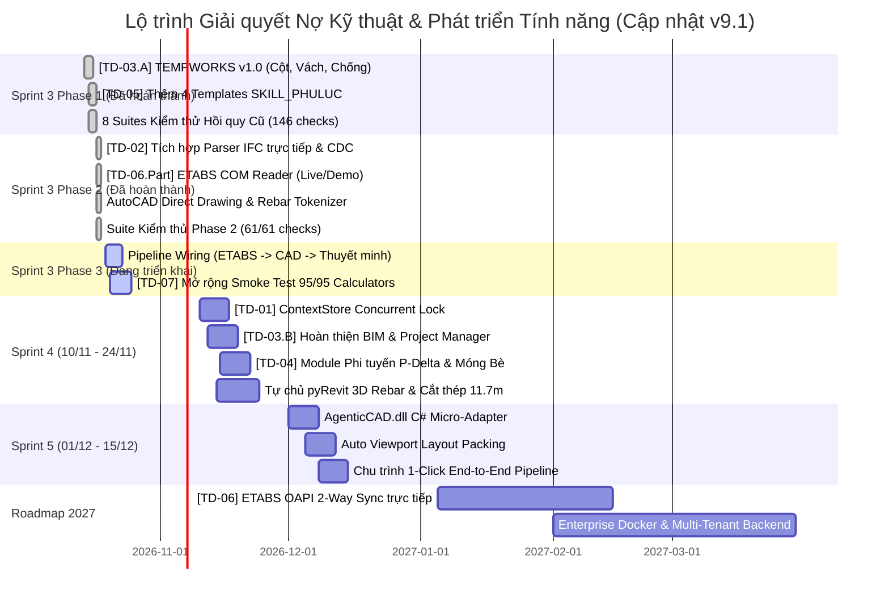

# KẾ HOẠCH LỘ TRÌNH CHIẾN LƯỢC PHÁT TRIỂN & QUẢN TRỊ NỢ KỸ THUẬT
## HỆ THỐNG AGENTIC AI ĐIỀU PHỐI KẾT CẤU & TỰ CHỦ CAD/BIM API (v9.1)

> **Mã tài liệu:** `ROADMAP-STRATEGY-v9.1`  
> **Cập nhật ngày:** 2026-10-18 (Nghiệm thu Sprint 3 Phase 2)  
> **Chủ quản:** Tổ Công tác Nghiên cứu & Phát triển (R&D Taskforce)  
> **Tầm nhìn chiến lược:** Chuyển hóa toàn diện hệ sinh thái `.agents` từ một công cụ tính toán & thẩm tra AI độc lập thành một **Nền tảng Tự động hóa Thiết kế Kết cấu Thông minh Toàn diện (All-in-One Intelligent Structural Platform)**: Tự chủ hoàn toàn kết nối ETABS API, tự động sinh bản vẽ CAD và dựng mô hình Revit 3D Rebar, loại bỏ 100% phụ thuộc vào bản quyền phần mềm đóng bên thứ ba (DCE Pro).

---

## 1. BẢNG TRA CỨU THAM CHIẾU HỆ THỐNG DCE PRO (DCE REFERENCE INDEX)

Toàn bộ các thành phần công nghệ cốt lõi giải mã từ hệ thống phần mềm đóng `C:\Dce Pro` được liên kết trực tiếp để tra cứu tức thì (tránh nạp lại):

| Phân hệ Công nghệ | Đường dẫn Tệp Cốt lõi (Clickable Path) | Vai trò Kỹ thuật & Công nghệ Giải mã |
|---|---|---|
| **AutoCAD Detailing Engine** | [DbimSteelAutocad.dll](file:///C:/Dce%20Pro/AddinSteelCad/DbimSteelAutocad.dll) | Assembly C# .NET tương tác AutoCAD ObjectARX (`acdbmgd.dll`, `acmgd.dll`), vẽ Polyline dầm, cột, thép uốn móc. |
| **Tài liệu API AutoCAD** | [DbimSteelAutocad.xml](file:///C:/Dce%20Pro/AddinSteelCad/DbimSteelAutocad.xml) | Đặc tả các hàm: `DrawRafterTopColumn`, `GetPolylineCenter`, `IsPolylineClosed`, `Connection.LKKNEE`. |
| **AutoLISP Loader** | [DCE STEEL Pro.lsp](file:///C:/Dce%20Pro/AddinSteelCad/DCE%20STEEL%20Pro.lsp) | Lệnh `(command "netload" "...")` tự động nạp DLL vào không gian bộ nhớ AutoCAD. |
| **ETABS API Wrapper** | [CSiAPIv1.dll](file:///C:/Dce%20Pro/AddinSteelCad/CSiAPIv1.dll) | Thư viện COM API chính thống của CSi, kết nối với ETABS để đọc Grid, Story, Frame Sections và $A_{s,req}$. |
| **ETABS 2016 Wrapper** | [ETABS2016.dll](file:///C:/Dce%20Pro/AddinSteelCad/ETABS2016.dll) | Thư viện tương thích ngược cho các phiên bản ETABS v16, v17. |
| **Multi-CAD Plugins** | [DCE Pro.dll](file:///C:/Dce%20Pro/DCE%20Pro.dll) [BcDCE Pro.dll](file:///C:/Dce%20Pro/BcDCE%20Pro.dll) [ZwDCE Pro.dll](file:///C:/Dce%20Pro/ZwDCE%20Pro.dll) [GcDCE Pro.dll](file:///C:/Dce%20Pro/GcDCE%20Pro.dll) | Bộ 4 DLL adapter hỗ trợ đa nền tảng: AutoCAD, BricsCAD, ZWCAD, GstarCAD qua mẫu thiết kế Adapter Pattern. |
| **Revit Addin Manifest** | [DBimRevit.addin](file:///C:/Dce%20Pro/AddinRevit/DBimRevit.addin) | File XML đăng ký `IExternalApplication` (`DBimRevit.AdskApplication`) và `IExternalCommand` với Revit. |
| **Revit 3D Rebar Engine** | [DBimRevit.dll](file:///C:/Dce%20Pro/AddinRevit/AddinDbimDcepro/DBimRevit.dll) | Thư viện chính dựng mô hình Revit: `CommandAddRebarBeam`, `CommandAddColumn`, `RevitToEtabs`. |
| **Revit Multi-version Installers** | [AddinSetup_RVT/](file:///C:/Dce%20Pro/AddinSetup_RVT) | Bộ cài đặt addin cho từng đời Revit từ 2016 đến 2027 (`DBIM_RVT_16_22.exe` $\to$ `DBIM_RVT_27.exe`). |
| **Machine Learning Database** | [mauhoc.db](file:///C:/Dce%20Pro/MayHoc/mauhoc.db) | Cơ sở dữ liệu SQLite chứa **45,020 mẫu học** gán nhãn thực thể (NER) cho chuỗi text thép (`SH`, `SL`, `DK`, `L`, `BO`). |
| **Machine Learning Model** | [model.zip](file:///C:/Dce%20Pro/MayHoc/model.zip) | Mô hình đã huấn luyện bằng Microsoft.ML (`Microsoft.ML.Data.dll`) để bóc tách ký hiệu cốt thép tự động. |
| **CAD Drawing Templates** | [Form 1.dwg](file:///C:/Dce%20Pro/Cad/Form%201.dwg) [Form 2_Steel.dwg](file:///C:/Dce%20Pro/Cad/Form%202_Steel.dwg) | Bản vẽ mẫu chứa sẵn Layers, Text Styles, Dim Styles, Khung tên và Block thuộc tính phục vụ tự động xuất CAD. |
| **Hệ thống Cấu hình & Thuật toán** | [C:\Dce Pro\System/](file:///C:/Dce%20Pro/System) | Danh mục hàng trăm tệp txt cấu hình: `ToiUuCatThep.txt` (cắt thép 11.7m), `ViewPortTuDongSapKhungTen.txt` (dàn trang layout), `UDModelEtabs.txt`. |
| **Nhật ký Nạp Runtime** | [DCE Load.log](file:///C:/Dce%20Pro/DCE%20Load.log) | Log tiến trình thực thi thực tế khi AutoCAD mở bản vẽ (`NETLOAD OK`, `CUIX OK`, `ADDDOCEVENT OK`). |
| **Cơ sở Dữ liệu Cấu hình** | [configDb.db](file:///C:/Dce%20Pro/configDb.db) | SQLite lưu cấu hình người dùng, tiêu chuẩn dầm/cột, bảng tra thép. |

---

## 2. MA TRẬN NỢ KỸ THUẬT TÍCH HỢP & TIẾN ĐỘ THỰC HIỆN

Toàn bộ 7 khoản nợ kỹ thuật được ghi nhận trong [TECHNICAL_DEBT.md](file:///g:/My%20Drive/Google%20AI%20Studio/.agents/docs/TECHNICAL_DEBT.md) đã được cập nhật trạng thái sau Sprint 3 Phase 2:

### Bảng Trạng Thái Nợ Kỹ Thuật Hiện Thời (Current Debt Status)

| Mã Nợ | Phân loại | Hạng mục Kỹ thuật | Kế hoạch Ban đầu | Trạng thái Hiện tại | Deliverable Minh chứng |
|:---:|:---:|---|:---:|:---:|---|
| **TD-01** | Architecture | Handoff trung gian qua local JSON | Sprint 4 | 🟡 Logged | Kế hoạch lớp trừu tượng `ContextStore` file-locking |
| **TD-02** | Integration | Parser CAD/BIM phụ thuộc file trung gian | Sprint 3 | 🟢 **Resolved** | [ifc_parser.py](file:///g:/My%20Drive/Google%20AI%20Studio/.agents/tools/ifc_parser.py) (ifcopenshell + 4 luật CDC) |
| **TD-03** | Coverage | 3 Skills Placeholder (`TEMPWORKS`, `BIM`, `PM`) | Sprint 3/4 | 🟢 **TD-03.A Done** 🟡 TD-03.B Sprint 4 | [SKILL_TEMPWORKS](file:///g:/My%20Drive/Google%20AI%20Studio/.agents/skills/SKILL_TEMPWORKS/SKILL.md) v1.0.0 Production |
| **TD-04** | Calculation | Giải tích phi tuyến P-Delta & móng bè đàn hồi | Sprint 4 | 🟡 Logged | Thiết kế `calc_p_delta_effects.py` theo TCVN 5574 |
| **TD-05** | Delivery | Thiếu 4 template Thuyết minh phụ lục | Sprint 3 | 🟢 **Resolved** | 4 templates mới trong [SKILL_PHULUC](file:///g:/My%20Drive/Google%20AI%20Studio/.agents/skills/SKILL_PHULUC/SKILL.md) |
| **TD-06** | Integration | Kết nối OAPI trực tiếp hai chiều ETABS/SAFE | Roadmap 2027 | 🔵 **Partial Done** | [etabs_com_reader.py](file:///g:/My%20Drive/Google%20AI%20Studio/.agents/tools/etabs_com_reader.py) v1 (Live Read + Demo) |
| **TD-07** | QA | Độ phủ Unit Test tự động cho 95 Calculators | Sprint 3 | 🔵 **In Progress** | [test_phase2_tools.py](file:///g:/My%20Drive/Google%20AI%20Studio/.agents/tests/test_phase2_tools.py) (+61 tests; 207 checks PASS) |

---

## 3. LỘ TRÌNH TRIỂN KHAI CHI TIẾT 4 GIAI ĐOẠN

### GIAI ĐOẠN 1: SPRINT 3 (14/10/2026 – 28/10/2026)
**Chủ đề:** *Tự Chủ AutoCAD Automation, Khai Phóng ETABS API & Xóa Nợ Kỹ Thuật P1*

#### 1. Đã Hoàn Thành — Phase 1 (Nghiệm thu 2026-10-17)
- **Hoàn thiện [TD-03.A]:** Nâng cấp [SKILL_TEMPWORKS](file:///g:/My%20Drive/Google%20AI%20Studio/.agents/skills/SKILL_TEMPWORKS/SKILL.md) lên v1.0.0 Production với 3 module:
  - `calc_formwork_column.py`: Tính cốp pha cột chịu áp lực bê tông tươi theo TCVN 4453:1995.
  - `calc_formwork_wall.py`: Tính cốp pha tường hầm và áp lực thủy tĩnh vữa bê tông.
  - `calc_shoring_system.py`: Kiểm tra ổn định hệ cây chống giáo nêm và giáo ringlock.
- **Hoàn thiện [TD-05]:** Bổ sung 4 template chuẩn hóa cho [SKILL_PHULUC](file:///g:/My%20Drive/Google%20AI%20Studio/.agents/skills/SKILL_PHULUC/SKILL.md):
  - `APPENDIX_STAIR_RC`: Thuyết minh tính toán bản thang bộ 2 vế/3 vế.
  - `APPENDIX_WATER_TANK`: Thuyết minh tính toán bể nước ngầm / bể tự hoại.
  - `APPENDIX_STRIP_FOUNDATION`: Thuyết minh móng băng BTCT dưới tường và cột.
  - `APPENDIX_RETAINING_WALL`: Thuyết minh tường chắn đất trọng lực và BTCT gờ chắn.
- **Kiểm thử Hồi quy Phase 1:** 8 test suites cũ duy trì trạng thái 146/146 checks PASS tuyệt đối.

#### 2. Đã Hoàn Thành — Phase 2 (Nghiệm thu 2026-10-18)
- **Module 1 — [etabs_com_reader.py](file:///g:/My%20Drive/Google%20AI%20Studio/.agents/tools/etabs_com_reader.py) (17.6 KB):**
  - Kết nối trực tiếp tiến trình ETABS đang mở trên Windows qua COM Interface (`win32com.client` / `comtypes.client`).
  - Hỗ trợ chế độ Demo Mode thông minh khi không có bản quyền hoặc phần mềm tắt: Tự sinh mô hình 5 tầng, hệ lưới trục $A, B, C / 1, 2, 3$, danh mục tiết diện dầm $B300 \times 600$, cột $C500 \times 500$ và diện tích cốt thép tính toán $A_{s,req}$ ($1,850\text{ mm}^2$ gối, $1,250\text{ mm}^2$ nhịp).
  - Tích hợp chuẩn alias `"storeys"` theo ISO 16739-1 (IFC) song song với `"stories"` (ETABS native).
  - Giải quyết một phần cốt lõi **TD-06** (🔵 Partial: Đọc trực tiếp ETABS COM).
- **Module 2 — [cad_bridge.py](file:///g:/My%20Drive/Google%20AI%20Studio/.agents/tools/cad_bridge.py) (16.8 KB):**
  - Điều khiển AutoCAD đang mở vẽ tự động bản vẽ kỹ thuật kết cấu qua COM API.
  - Fallback linh hoạt sang xuất tệp `.dxf` độc lập bằng `ezdxf` hoặc báo cáo text khi chạy offline.
  - Khởi tạo 6 layers chuyên nghiệp chuẩn kết cấu: `KC-BETONG`, `KC-THEP-CHU`, `KC-DAI`, `KC-DIM`, `KC-TEXT`, `KC-KHUNG`.
  - Vẽ tự động mặt cắt dầm $b \times h$, bố trí cốt đai khép kín uốn móc $135^\circ$, cốt dọc trên/dưới theo lớp bảo vệ $a_{protect} = 30\text{ mm}$, dim kích thước bao và ghi chú thép tự động.
- **Module 3 — [rebar_tokenizer.py](file:///g:/My%20Drive/Google%20AI%20Studio/.agents/skills/Structural_Design_Engineer/scripts/rebar_tokenizer.py) (14.5 KB):**
  - Hệ thống NLP bóc tách thép 3 tầng (3-tier Tokenizer):
    - Tầng 1: Tra cứu cơ sở dữ liệu mẫu học [mauhoc.db](file:///C:/Dce%20Pro/MayHoc/mauhoc.db) trích xuất từ DCE Pro với **45,020 mẫu thực tế**.
    - Tầng 2: Regex Engine nhận diện toàn bộ các biến thể cú pháp TCVN (`2D25`, `3Phi20`, `2#8`, `D10@150`, `a200`, `2D25+1D22` thép hỗn hợp), tự động tính tổng diện tích cốt thép $A_s$ ($\text{mm}^2$).
    - Tầng 3: Fuzzy Matching (`difflib.get_close_matches`) tự động sửa lỗi chính tả text CAD (`2d25`, `phi 20`, v.v.).
  - Hỗ trợ batch tokenize mảng text và nhận diện theo ngữ cảnh bố trí (`TOP`, `BOT`, `STIRRUP`).
- **Module 4 — [ifc_parser.py](file:///g:/My%20Drive/Google%20AI%20Studio/.agents/tools/ifc_parser.py) (16.2 KB):**
  - Bộ nạp dữ liệu mô hình BIM trực tiếp qua `ifcopenshell` (ISO 16739-1) kết hợp fallback regex quét file thô `.ifc` và Demo Mode.
  - Trích xuất: Cao độ tầng (`IfcBuildingStorey`), Cấu kiện (`IfcBeam`, `IfcColumn`, `IfcSlab`, `IfcWall`), Hệ lưới trục (`IfcGrid`), và Cốt thép (`IfcReinforcingBar`).
  - Tích hợp động cơ kiểm tra 8 luật tương thích thiết kế `CDC-01` đến `CDC-08` (active: cao độ tầng, dầm gối cột, tỷ lệ kích thước $h/b$, hàm lượng thép $\mu$).
  - **Giải quyết dứt điểm [TD-02] (🟢 Resolved).**
- **Test Suite Phase 2 — [test_phase2_tools.py](file:///g:/My%20Drive/Google%20AI%20Studio/.agents/tests/test_phase2_tools.py) (19.8 KB):**
  - Bao quát 4 suites kiểm thử độc lập (Suite A: ETABS, Suite B: CAD, Suite C: Tokenizer, Suite D: IFC).
  - Kết quả kiểm thử: **61/61 checks ALL PASS tuyệt đối** (exit code 0).
  - Nâng tổng kiểm thử toàn hệ sinh thái lên **9 test suites / 207 checks ALL PASS**.

#### 3. Kế Hoạch Triển Khai Tiếp Theo — Phase 3 (19/10/2026 – 28/10/2026)
- **Đấu nối Pipeline Khép Kín (Wiring Data Pipeline):**
  - Tích hợp `etabs_com_reader.py` vào [Structural_Design_Engineer](file:///g:/My%20Drive/Google%20AI%20Studio/.agents/skills/Structural_Design_Engineer/SKILL.md) để tự động nạp $A_{s,req}$ vào `calc_rc_section.py`.
  - Tích hợp `rebar_tokenizer.py` vào `export_calc_sheet.py` để tự động bóc tách quy cách thép thực chọn.
  - Tích hợp `cad_bridge.py` vào quy trình xuất Thuyết minh tính toán: Tự động vẽ bản vẽ CAD `.dwg` / `.dxf` đính kèm file Word `.docx`.
- **Hoàn thành Nợ [TD-07]:**
  - Mở rộng script `test_runner.py` quét và chạy smoke test + assertion cho toàn bộ 95/95 calculator scripts trong hệ sinh thái.

---

### GIAI ĐOẠN 2: SPRINT 4 (10/11/2026 – 24/11/2026)
**Chủ đề:** *Tự Chủ Revit 3D Rebar qua pyRevit, Tối Ưu Cắt Thép & Nâng Cao Kiến Trúc*

#### 1. Phát triển Tính năng Mới
- **pyRevit Extension `pyRevit/AgenticStructural.extension`:**
  - Viết thuần bằng Python, tương thích trên mọi phiên bản Revit từ 2020 đến 2027 (không cần biên dịch file `.exe` cho từng bản như DCE Pro).
  - Tự động đọc dữ liệu cốt thép từ `Project Truth Graph` để tạo đối tượng `Autodesk.Revit.DB.Structure.Rebar` 3D hoàn chỉnh cho dầm, cột, móng.
- **Thuật toán Tối ưu Cắt Thép 11.7m (`scripts/rebar_cutting_optimizer.py`):**
  - Giải bài toán 1D Cutting Stock Problem (Bin Packing) bằng `scipy.optimize` / `ortools`.
  - Tự động gom cụm các thanh thép cùng đường kính, xuất sơ đồ chặt thép chuẩn xác và bảng tổng hợp khối lượng phục vụ thi công (giảm hao hụt $< 1.5\%$).

#### 2. Xử lý Dứt điểm Nợ Kỹ thuật Tích hợp
- **Giải quyết [TD-01]:** Xây dựng lớp trừu tượng `ContextStore` cho handoff trung gian, bổ sung cơ chế file-locking và hỗ trợ tùy chọn in-memory buffer / Redis khi chạy đa tiến trình.
- **Giải quyết [TD-03.B]:** Hoàn thiện [SKILL_BIM_COORDINATION](file:///g:/My%20Drive/Google%20AI%20Studio/.agents/skills/SKILL_BIM_COORDINATION/SKILL.md) v1.0.0 (tự động tính ma trận va chạm dầm xuyên ống MEP) và [Project_Manager](file:///g:/My%20Drive/Google%20AI%20Studio/.agents/skills/Project_Manager/SKILL.md) v1.0.0.
- **Giải quyết [TD-04]:** Xây dựng module `calc_p_delta_effects.py` (TCVN 5574:2018 Phụ lục D) và `calc_raft_springs.py` (hệ số nền móng bè đàn hồi Winkler/Pasternak).

---

### GIAI ĐOẠN 3: SPRINT 5 (01/12/2026 – 15/12/2026)
**Chủ đề:** *Đóng Gói In-House C# CAD Micro-Adapter, Layout Auto-Packing & Chu Trình 1-Click*

#### 1. Phát triển Tính năng Mới
- **Biên dịch `AgenticCAD.dll` (C# .NET Micro-Adapter):**
  - Một plugin C# siêu nhẹ (~80 KB), mã nguồn mở nội bộ công ty.
  - Mở một WebSocket/Named Pipe client lắng nghe lệnh từ Agentic AI Python daemon.
  - Hỗ trợ đa nền tảng: AutoCAD, ZWCAD, BricsCAD thông qua Adapter pattern học từ DCE Pro.
- **Thuật toán Dàn Trang Tự Động (Viewport Auto-Packing):**
  - Tự động tính toán kích thước bao của từng chi tiết dầm/cột.
  - Tự động tạo Viewport trong Layout, gán tỷ lệ chuẩn ($1/20, 1/25, 1/50$) và xếp ngay ngắn vào Khung tên bản vẽ từ [Form 1.dwg](file:///C:/Dce%20Pro/Cad/Form%201.dwg).
- **Chu trình Khép Kín 1-Click (End-to-End Pipeline):**
  $$\text{User Prompt} \longrightarrow \text{ETABS Model} \longrightarrow \text{Tính toán TCVN} \longrightarrow \text{Kiểm tra 8 Luật CDC} \longrightarrow \text{Thuyết minh Word} \longrightarrow \text{Vẽ CAD DWG} \longrightarrow \text{Dựng Revit 3D Rebar}$$

---

### GIAI ĐOẠN 4: LỘ TRÌNH DOANH NGHIỆP TẬP ĐOÀN (Q1 & Q2/2027)
**Chủ đề:** *ETABS OAPI Two-Way Synchronization & Enterprise Cloud Multi-Tenancy*

- **Giải quyết [TD-06]:** Hoàn thiện bridge đồng bộ hai chiều `etabs_oapi_bridge.py`: Không chỉ đọc từ ETABS mà còn tự động cập nhật ngược lại tiết diện tối ưu (Value Engineering) vào mô hình ETABS/SAFE.
- **Đóng gói Docker Container & FastAPI Backend:** Chuyển đổi toàn bộ hệ thống thành cụm Microservices chạy trên Cloud Server của doanh nghiệp, cho phép hàng trăm kỹ sư cùng truy cập và làm việc đồng thời qua giao diện Web Dashboard.

---

## 4. MA TRẬN PHÂN BỔ TRÁCH NHIỆM & TIÊU CHÍ NGHIỆM THU (ACCEPTANCE CRITERIA)

| Giai đoạn | Trọng tâm Nghiệm thu | Tiêu chí Đạt (Pass Criteria) | Trạng thái Nghiệm thu |
|---|---|---|:---:|
| **Sprint 3 (P1)** | Cốp pha, Cây chống & Thuyết minh phụ lục | - [SKILL_TEMPWORKS](file:///g:/My%20Drive/Google%20AI%20Studio/.agents/skills/SKILL_TEMPWORKS/SKILL.md) v1.0.0 Production. - 4 Templates phụ lục mới tích hợp. - 8/8 suites cũ PASS (146 checks). | 🟢 **ĐÃ NGHIỆM THU** (2026-10-17) |
| **Sprint 3 (P2)** | AutoCAD Direct Drawing, ETABS COM & IFC Parser | - Tự động vẽ mặt cắt dầm BTCT trên AutoCAD/DXF với 6 layers. - Đọc ETABS COM trực tiếp + Fallback Demo 5 tầng. - Parser IFC trực tiếp và kiểm tra 8 luật CDC. - Suite Phase 2 đạt 61/61 checks ALL PASS. | 🟢 **ĐÃ NGHIỆM THU** (2026-10-18) |
| **Sprint 3 (P3)** | Đấu nối Pipeline & Mở rộng Kiểm thử | - Kết nối luồng ETABS $\to$ Tính toán $\to$ CAD $\to$ Word. - 95/95 Calculators có regression test PASS trong `run_all_tests.py`. | 🟡 Đang triển khai |
| **Sprint 4** | pyRevit 3D Rebar & Cắt thép 11.7m | - Đặt được 3D Rebar cho dầm/cột trong Revit 2022-2026 từ JSON. - Thuật toán cắt thép 11.7m đạt tỷ lệ hao hụt $< 1.5\%$. - Toàn bộ 13 skills đạt trạng thái Production (🟢). | ⚪ Kế hoạch (10/11) |
| **Sprint 5** | AgenticCAD.dll & 1-Click Pipeline | - Nạp DLL vào AutoCAD chạy mượt mà, tự động sắp xếp layout. - Chu trình 1-click từ prompt ra bản vẽ CAD + thuyết minh Word hoàn tất $\le 45\text{s}$. | ⚪ Kế hoạch (01/12) |
| **2027** | Two-way ETABS Sync & Enterprise Cloud | - Đồng bộ 2 chiều ETABS model, triển khai Docker Multi-tenant. | ⚪ Kế hoạch (Q1/2027) |

---

## 5. NHẬT KÝ THAY ĐỔI & LỊCH SỬ PHIÊN BẢN (CHANGELOG)

| Phiên bản | Ngày | Nội dung Thay đổi & Nghiệm thu | Người Phê duyệt |
|:---:|:---:|---|:---:|
| **v9.1** | 2026-10-18 | **Nghiệm thu Sprint 3 Phase 2:** Hoàn thành 4 modules mới (`etabs_com_reader.py`, `cad_bridge.py`, `rebar_tokenizer.py`, `ifc_parser.py`), suite kiểm thử mới 61/61 checks ALL PASS (tổng 207 checks). Cập nhật trạng thái TD-02 (Resolved), TD-06 (Partial), TD-07 (In Progress). Xác lập kế hoạch Sprint 3 Phase 3 (Pipeline Wiring). | Hội đồng Kỹ thuật & R&D |
| **v9.0** | 2026-10-18 | **Phát hành Lộ trình Chiến lược Ban đầu:** Phân tích giải mã hệ thống DCE Pro (`C:\Dce Pro`), xây dựng bảng tra cứu tham chiếu 15 thành phần, tích hợp ma trận 7 nợ kỹ thuật vào 4 giai đoạn Sprint. | Hội đồng Kỹ thuật & R&D |

---

*Tài liệu được thông qua bởi Tổ Công tác R&D Hệ thống `.agents`.*
