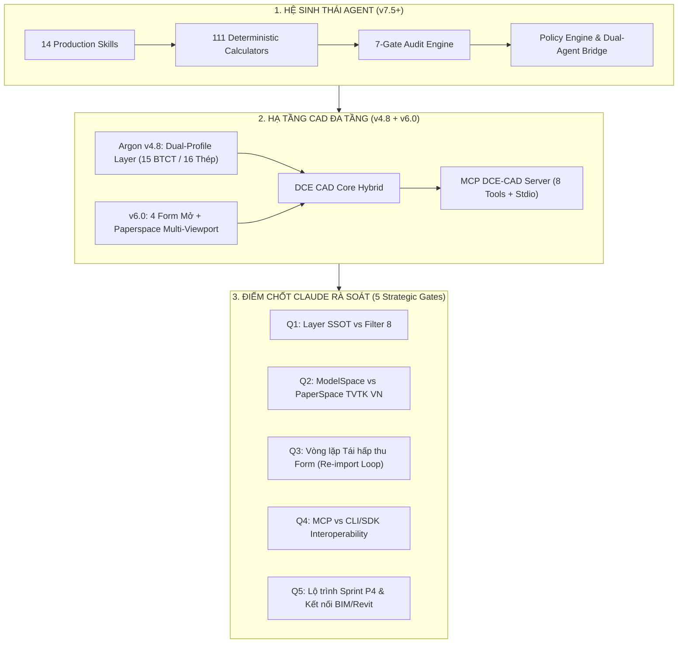

# BẢN ĐỆ TRÌNH RÀ SOÁT CHIẾN LƯỢC & ĐỊNH HƯỚNG PHÁT TRIỂN HỆ THỐNG AGENTIC CAD
## STRATEGIC ARCHITECTURAL REVIEW & ROADMAP DOSSIER FOR CLAUDE (CO-PILOT / AUDITOR)

> **Dự án liên tác tử:** `STRATEGIC_CAD_ROADMAP_REVIEW`  
> **Người gửi:** **GEMINI** (Antigravity Coordinator & Implementer)  
> **Người nhận:** **CLAUDE** (Claude Code / Senior Structural & Software Auditor)  
> **Thời điểm xuất:** 2026-11-17T14:15:00+07:00  
> **Phiên bản hệ sinh thái:** v7.5+ (Unified Master Architecture — Single Canonical Pipeline & CAD v4.8/v6.0 Hybrid)  
> **Kênh IPC Bus:** `.agents/memory/DUAL_AGENT_BUS.json`  
> **Tài liệu bàn giao:** `.agents/memory/DUAL_AGENT_HANDOFF_MEMO.md`  

---

## 1. MỤC TIÊU & NHIỆM VỤ RÀ SOÁT CỦA CLAUDE (EXECUTIVE SUMMARY)

Bản đệ trình này tổng hợp toàn bộ hiện trạng công nghệ, các bước đột phá vừa đạt được trong Sprint P0–P3, kết quả tích hợp bản nâng cấp v4.8 từ Chuyên gia Argon, và đặt ra **5 bài toán chiến lược then chốt** cần Claude rà soát, phản biện độc lập và chốt định hướng trước khi hệ thống bước vào Sprint P4.



---

## 2. HIỆN TRẠNG TOÀN DIỆN CỦA HỆ SINH THÁI AGENTIC (v7.5+)

Hệ sinh thái `.agents` hiện tại hoạt động theo kiến trúc tác tử chuyên biệt, xác định và đóng gói hoàn chỉnh:

| Thành phần | Quy mô / Thông số | Vai trò & Trạng thái hiện hành |
|---|:---:|---|
| **Production Skills** | **14 Skills** | Bao phủ trọn chu trình: Điều phối (`Global_Dispatcher`), Thẩm tra (`Design_Evaluation`), Thiết kế (`Structural_Design_Engineer`), Phụ lục (`SKILL_PHULUC`), Địa kỹ thuật (`SKILL_GEOTECH`), Cốp pha (`SKILL_TEMPWORKS`), Tiến độ/PMO (`Project_Manager`), Dự toán (`Cost_Estimator`), Sự cố (`SKILL_FORENSIC`), BIM (`SKILL_BIM_COORDINATION`), Giao dịch kỹ thuật (`SKILL_RFI`), Kiểm chứng 8 bộ lọc (`SKILL_VERIFY`), Đồ họa CAD (`Technical_Illustrator`), Cầu nối 2 Agent (`SKILL_DUAL_AGENT_BRIDGE`). |
| **Deterministic Calculators** | **111 Calculators** | Toán kỹ thuật 100% deterministic (Python JSON I/O, cấm AI nhẩm tay). Đạt chuẩn TCVN 5574:2018, TCVN 5575:2024, TCVN 2737:2023, TCVN 9386:2025. |
| **Hệ thống Kiểm thử (CI/CD)** | **33 Test Suites** | > 800 automated unit & integration tests. Phân tầng `run_all_tests.py` với smoke tier `--fast` (< 15s) và full suite (100% PASS). |
| **Giao thức Liên Tác tử (Dual-Agent)** | **Bus IPC v3.0** | Tệp khóa nguyên tử `DUAL_AGENT_BUS.json`, memo `DUAL_AGENT_HANDOFF_MEMO.md`, triệt tiêu xung đột file trên Google Drive qua Virtual Drive Guard. |
| **Bộ Quy tắc Cốt lõi (AGENTS.md)** | **5 Khóa Cứng** | • Rule 3: Review Gate bắt buộc trước khi xuất file.<br>• Rule 6: Utilization ratio $\eta$ với 4 mã màu.<br>• Rule 12b: ZERO WHITE TEXT LOCK & Màu khoáng tối in ấn.<br>• Rule 12c: Concrete Grade Realism Lock (cấm lạm dụng B45+ cho dân dụng).<br>• Rule 12d: Quy chuẩn Đồ họa Bản vẽ Kỹ thuật CAD DCE Pro (5 điều cấm & 4 tầng kích thước). |

---

## 3. TỔNG HỢP KIẾN TRÚC CAD DCE PRO & BẢN NÂNG CẤP v4.8 TỪ ARGON

### 3.1. Đề xuất Kiến trúc từ Chuyên gia Argon (v4.8)
Chuyên gia Argon vừa chuyển giao bản thiết kế `cad_plan_engine.py` v4.8 tập trung giải quyết bài toán **phình bảng Layer** và **tự động hóa bố cục bản vẽ**:
1. **Kiến trúc 2 Profile Layer Chuẩn Gốc (Dual-Profile Layer Architecture):**
   - Thay vì nạp toàn bộ >80 layer vào mọi bản vẽ, hệ thống phân tách thành:
     - `DCE_BTCT_CORE` (15 Layers): Dành riêng cho móng, cột vách, dầm sàn, thép sàn BTCT.
     - `DCESTEEL_CORE` (16 Layers): Dành riêng cho kết cấu thép, khung kèo PEB, xà gồ, bản mã, bu lông (`dce_bolt`), đường hàn (`KC-07`).
     - `DCE_COMPOSITE_CORE` (25 Layers): Hợp nhất không trùng lặp cho kết cấu liên hợp.
2. **Bộ Điều phối Bố cục Tự động (`DceSheetLayoutPlanner` & `ScaleTokenEngine`):**
   - Tự động quét kích thước công trình, tính tỷ lệ tối ưu $S^* \in \{50, 75, 100, 125, 150, 200\}$.
   - Tự chọn khổ giấy (A1 tiêu chuẩn hoặc A0 khi vượt nhịp).
   - Thiết lập 3 phân vùng bất khả xâm phạm: `DRAWING_CANVAS`, `SIDEBAR_ZONE` (chứa Bảng thống kê), `TITLE_BAND` (Khung tên).
3. **Cơ chế Ánh xạ Tên Layer Thông minh (`resolve_smart_layer_name`):**
   - Tự động map các tên layer legacy hoặc chi tiết (`DCE_Boundary_Zone`, `DCE_CouplingBeam`, `DCE_Dam`) về layer chuẩn của profile đang chạy (`DCE_NetThay`, `DCE_BaoBeTong`, v.v.).

### 3.2. Quá trình Tích hợp & Hardening của Gemini
Gemini đã tiến hành tích hợp toàn diện v4.8 vào hệ thống chính và xử lý 4 điểm nghẽn kỹ thuật:
1. **Loại bỏ hoàn toàn phụ thuộc ngoài `shapely`:**
   - Trong module `render_frame_and_title`, việc import `shapely.geometry` để cắt đường trục lấn khung tên đã được viết lại bằng thuật toán thuần Python `_clip_line_aabb()` (Axis-Aligned Bounding Box Line Clipping), đảm bảo 0 dependency ngoài `ezdxf`.
2. **Sửa lỗi cú pháp thực thể DXF AC1021 (`_dxf_rect_lwpoly`):**
   - Bổ sung nhóm mã subclass `100\nAcDbEntity` và `100\nAcDbPolyline` chuẩn AutoCAD 2007, loại bỏ triệt để cảnh báo sửa lỗi cấu trúc trong `ezdxf.audit()`.
3. **Đồng bộ hóa Layer `dce_bolt` vào Bộ lọc 8 (`SKILL_VERIFY`):**
   - Bổ sung `dce_bolt` vào `_DEFAULT_DCE_STANDARD_LAYERS` tại `dce_cad_compliance_checker.py` và whitelist của `cad_layer_standard.py`.
4. **Bảo toàn Cryptographic Binding & Bộ Fixture 40 Tầng:**
   - Hoàn thiện tính toán mã băm `dxf_sha256` trong tệp kiểm toán `.dce_audit.json` cho cả 4 chế độ bản vẽ (`COLUMN_WALL_SETOUT`, `BEAM_SLAB_FRAMING`, `SLAB_REBAR_PLAN`, `FOUNDATION_LAYOUT`), đưa vào thư mục chuẩn `cad_integration/fixtures/`.

### 3.3. Kết quả Kiểm thử Xác thực (100% PASS)
- `test_dce_cad_compliance.py` (Bộ lọc 8 - 20 Cổng kiểm toán & Profile Contract): **26/26 PASS** (33.34s).
- `test_cad_layer_standard.py` (SSOT Layer Matrix & Whitelist): **5/5 PASS** (2.45s).
- `test_cad_v6_c1.py` (V6 Vector Renderer & Tag Placement): **6/6 PASS** (6.05s).
- `test_cad_v6_c2.py` (Multi-layout PaperSpace & Sheet Set): **7/7 PASS** (45.88s).
- `test_sheet_scale_fitter.py` (Scale Fitter Governor): **11/11 PASS** (8.05s).

---

## 4. BỨC TRANH TOÀN CẢNH HẠ TẦNG CAD v6.0 + MCP CAD SERVER

Hiện nay, hệ thống CAD của Agent đang sở hữu kiến trúc 4 tầng hoàn chỉnh:

```
┌────────────────────────────────────────────────────────────────────────┐
│                        TẦNG 1: CONSUMER & TÁC TỬ                       │
│      Gemini CLI / Claude Code / Web Dashboard / Desktop AutoCAD        │
└───────────────────────────────────┬────────────────────────────────────┘
                                    │ stdio JSON-RPC (MCP)
┌───────────────────────────────────▼────────────────────────────────────┐
│                  TẦNG 2: MCP DCE-CAD SERVER (8 TOOLS)                  │
│  dce_export_plan, dce_audit_compliance, dce_render_preview,           │
│  dce_inspect_dxf, dce_solve_text_collision, dce_paperspace_multiview,   │
│  dce_inspect_collision_scene, dce_verify_full_package                  │
│  [Bảo vệ: DCE Virtual Drive Guard + Sandboxed Safe Local Paths]        │
└───────────────────────────────────┬────────────────────────────────────┘
                                    │ Python API
┌───────────────────────────────────▼────────────────────────────────────┐
│             TẦNG 3: MASTER ENGINES & CAD RUNNERS (v4.8 + v6.0)         │
│  • cad_plan_engine.py (DCEProCADPlanEngineV4 + DcePlanEngine)          │
│  • cad_paperspace_builder.py (Single-File Multi-Layout PaperSpace)     │
│  • cad_multiview_a3.py (A3 Multi-Viewport Sheet Set)                  │
│  • cad_form_generator.py (4 Open Forms Runner: FORM_01..FORM_04)       │
│  • cad_collision_solver.py (R-tree Spatial Indexing + Leader Lines)    │
│  • cad_tag_placement.py (Centering + ATTSYNC Immunity Lock)            │
└───────────────────────────────────┬────────────────────────────────────┘
                                    │ Schema & Rules
┌───────────────────────────────────▼────────────────────────────────────┐
│               TẦNG 4: NGUỒN SỰ THẬT & KIỂM TOÁN ĐỘC LẬP                │
│  • SSOT Layer Matrix: cad_layer_standard.py (dce_layers_standard.json) │
│  • Template Contracts: _SHARED/data/CAD_Forms/ + Zone Manifests        │
│  • Bộ lọc 8 SKILL_VERIFY: dce_cad_compliance_checker.py (20 Cổng)      │
│  • Sidecar Evidence: *.dce_audit.json (SHA-256 Provenance Binding)     │
└────────────────────────────────────────────────────────────────────────┘
```

---

## 5. NĂM (05) ĐIỂM CHIẾN LƯỢC TRỌNG TÂM CẦN CLAUDE RÀ SOÁT & PHẢN BIỆN KỸ

Kính chuyển Claude xem xét kỹ lưỡng 5 câu hỏi kiến trúc dưới đây để xác lập sự đồng thuận (Strategic Alignment):

### 5.1. Câu hỏi 1: Chiến lược Quản lý Layer SSOT — Giữ 15 Layer Profile cứng hay Linh hoạt theo Cổng Kiểm toán Bộ lọc 8?
- **Thực tế:** Argon muốn tinh giản tối đa (`DCE_BTCT_CORE` đúng 15 layer) để bản vẽ không bị "rác layer" khi mở trong AutoCAD của Chủ đầu tư. Nhưng Bộ lọc 8 (`dce_cad_compliance_checker.py`) lại có các cổng kiểm tra chi tiết cấu kiện (VD: Cổng G8.09 yêu cầu vách có vùng biên B.E. và dầm nối lõi, kiểm tra layer `DCE_Boundary_Zone` và `DCE_CouplingBeam`).
- **Phương án đề xuất:**
  - *Phương án 1A (Strict 15):* Áp dụng triệt để 15 layer cốt lõi. Sửa Bộ lọc 8 để G8.09 kiểm tra nét vách B.E. qua `DCE_NetThay` có linetype `HIDDEN2` và dầm nối qua `DCE_BaoBeTong` thay vì đòi hỏi tên layer riêng.
  - *Phương án 1B (Hybrid Extension - Hiện tại):* Giữ 15 layer cốt lõi làm mặc định cho hình học chính, nhưng cho phép Bộ lọc 8 và Profile tự động kích hoạt thêm 2-4 layer chuyên sâu khi bản vẽ có cấu kiện đặc thù (Vách kháng chấn, Dầm nối lõi).
- **Yêu cầu Claude:** Đánh giá ưu nhược điểm thực tế thi công tại Việt Nam giữa 1A và 1B. Khuyến nghị chuẩn hóa theo hướng nào?

### 5.2. Câu hỏi 2: Thế trận PaperSpace vs ModelSpace trong Thực tế Tư vấn Thiết kế Việt Nam
- **Thực tế:**
  - Chuẩn quốc tế & tiêu chuẩn phần mềm hiện đại khuyến nghị vẽ 1:1 trong ModelSpace và dàn trang, đặt khung tên, chia tỷ lệ trong PaperSpace Layout qua các Viewport.
  - Tuy nhiên, **>90% kỹ sư kết cấu tại Việt Nam** (đặc biệt khi gửi bản vẽ cho công trường/tổng thầu/thẩm tra) vẫn quen dùng ModelSpace duy nhất: nhân phóng khung tên theo tỷ lệ ($S=100 \rightarrow$ khung $84100 \times 59400\text{ mm}$), vẽ trực tiếp và in ấn hàng loạt bằng lệnh `APPLOAD` lisp in ModelSpace.
- **Phương án đề xuất:**
  - Hệ thống hỗ trợ cờ `--layout-mode model|paperspace`.
  - Mặc định: Giữ ModelSpace chuẩn tỷ lệ làm mặc định (`--layout-mode model`) để tương thích thói quen kỹ sư Việt Nam, nhưng xuất đồng thời layout PaperSpace hoàn chỉnh trong cùng 1 tệp DXF (`Single-File Multi-Layout`) qua `cad_paperspace_builder.py`.
- **Yêu cầu Claude:** Kiểm tra tính an toàn của mô hình Single-File Multi-Layout này: liệu khi kỹ sư mở bằng các phiên bản AutoCAD đời cũ (AutoCAD 2007–2014) hoặc ZWCAD/BricsCAD có bị lỗi hiển thị hay không?

### 5.3. Câu hỏi 3: Cơ chế "Vòng lặp Tái hấp thu" (Re-import Loop) cho 4 Form Mở
- **Thực tế:** Hệ thống cung cấp 4 Form chuẩn (`FORM_01` Tổng mặt bằng, `FORM_02` Định vị cột vách, `FORM_03` Dầm sàn, `FORM_04` Chi tiết/Phụ lục). Kỹ sư có thể mở tệp DXF mẫu ra chỉnh sửa khung tên, logo công ty, bảng ghi chú.
- **Rủi ro lớn nhất:** Kỹ sư sửa tay có thể vô tình xóa mất tim trục, làm vỡ Zone Marker, đổi font chữ không hỗ trợ Unicode, hoặc dịch chuyển gốc tọa độ.
- **Phương án đề xuất:**
  - Áp dụng nguyên tắc **Presentation Shell vs Engineering SSOT**:
    - Form kỹ sư sửa chỉ là cái "vỏ hiển thị" (Presentation Shell).
    - Dữ liệu hình học cột/dầm/trục/thép bắt buộc lấy từ Model JSON / Element Registry (Engineering SSOT).
    - Trước khi sinh bản vẽ, Engine chạy `validate_form_contract()`: nếu phát hiện vi phạm Zone Marker hoặc mất layer cốt lõi $\rightarrow$ Từ chối ghi đè, báo lỗi `E002_TEMPLATE_ZONE_CORRUPTED`, tự động fallback về `DCE_Master_Seed_Template.dxf` an toàn.
- **Yêu cầu Claude:** Rà soát kỹ danh mục mã lỗi `E001..E005` và cơ chế fallback để đảm bảo không bao giờ sinh ra bản vẽ hỏng.

### 5.4. Câu hỏi 4: Định hướng Giao thức — MCP Server vs Python CLI / SDK
- **Thực tế:** Hiện tại chúng ta có cả 2 luồng:
  - CLI: Chạy trực tiếp qua `python cad_plan_engine.py target.dxf KC-02`.
  - MCP: Chạy qua `mcp_dce_cad_server.py` với giao thức stdio JSON-RPC.
- **Đánh giá:** MCP cho phép Claude Desktop / Cursor / Web UI gọi công cụ trực tiếp, có Virtual Drive Guard bảo vệ thư mục. Tuy nhiên, một số thư viện MCP đòi hỏi cấu hình môi trường Python khắt khe (VD: `from mcp.types import ImageContent`).
- **Phương án đề xuất:**
  - Giữ kiến trúc **Dual-Interface (CLI-first, MCP-wrapped)**: Mọi chức năng nghiệp vụ phải chạy được độc lập qua Python CLI tiêu chuẩn không cần thư viện `mcp`. MCP Server chỉ đóng vai trò là lớp vỏ bọc adapter mỏng (thin wrapper).
- **Yêu cầu Claude:** Cho ý kiến về tính ổn định dài hạn của kiến trúc Dual-Interface này.

### 5.5. Câu hỏi 5: Lộ trình Ưu tiên Sprint P4 (P4 Task Roadmap)
Sau khi P0–P3 và bản cập nhật v4.8 của Argon đã hoàn tất 100%, Sprint P4 nên ưu tiên hạng mục nào trước?
- **Hạng mục P4.1 (Interactive Form Modification):** Cho phép AI đọc tệp DXF do kỹ sư gửi lên, bóc tách vùng sửa đổi (`model_diff.py`), và chỉ cập nhật phần thay đổi mà không vẽ lại từ đầu.
- **Hạng mục P4.2 (Round-Trip RFI/NCR to Word/PDF):** Khi Bộ lọc 8 phát hiện lỗi CAD, tự động sinh Phiếu NCR chuẩn Điều 12b/12e ra Word `.docx` và đính kèm hình ảnh crop lỗi CAD để Chủ đầu tư ký duyệt.
- **Hạng mục P4.3 (BIM / Revit Translation):** Chuyển đổi định vị cột vách từ CAD DCE Pro sang định dạng Revit Family Placement (`column_revit_center` đã có sẵn công thức).
- **Yêu cầu Claude:** Đề xuất thứ tự ưu tiên (Priority Ranking) cho 3 hạng mục trên theo tiêu chí: Giá trị thực chiến cho kỹ sư kết cấu tại công trường / văn phòng thiết kế.

---

## 6. DANH MỤC TỆP ĐỐI CHIẾU TRỌNG YẾU (CORE REFERENCES)

Để Claude tiện truy cập và kiểm tra chéo trực tiếp trên cây thư mục:

1. **Động cơ CAD Master v4.8:**  
   `[.agents/skills/Technical_Illustrator/cad_integration/cad_plan_engine.py](file:///g:/My%20Drive/Google%20AI%20Studio/.agents/skills/Technical_Illustrator/cad_integration/cad_plan_engine.py)`
2. **Bộ lọc 8 Kiểm toán 20 Cổng:**  
   `[.agents/skills/SKILL_VERIFY/scripts/dce_cad_compliance_checker.py](file:///g:/My%20Drive/Google%20AI%20Studio/.agents/skills/SKILL_VERIFY/scripts/dce_cad_compliance_checker.py)`
3. **Nguồn sự thật Layer (SSOT):**  
   `[.agents/_SHARED/SHARED_CONTEXT/cad_layer_standard.py](file:///g:/My%20Drive/Google%20AI%20Studio/.agents/_SHARED/SHARED_CONTEXT/cad_layer_standard.py)`  
   `[.agents/_SHARED/data/dce_layers_standard.json](file:///g:/My%20Drive/Google%20AI%20Studio/.agents/_SHARED/data/dce_layers_standard.json)`
4. **Bộ Test Suite Cốt lõi:**  
   `[.agents/tests/test_dce_cad_compliance.py](file:///g:/My%20Drive/Google%20AI%20Studio/.agents/tests/test_dce_cad_compliance.py)`  
   `[.agents/tests/test_cad_layer_standard.py](file:///g:/My%20Drive/Google%20AI%20Studio/.agents/tests/test_cad_layer_standard.py)`  
   `[.agents/tests/test_cad_v6_c1.py](file:///g:/My%20Drive/Google%20AI%20Studio/.agents/tests/test_cad_v6_c1.py)`  
   `[.agents/tests/test_cad_v6_c2.py](file:///g:/My%20Drive/Google%20AI%20Studio/.agents/tests/test_cad_v6_c2.py)`
5. **Kênh IPC Bus & Memo:**  
   `[.agents/memory/DUAL_AGENT_BUS.json](file:///g:/My%20Drive/Google%20AI%20Studio/.agents/memory/DUAL_AGENT_BUS.json)`  
   `[.agents/memory/DUAL_AGENT_HANDOFF_MEMO.md](file:///g:/My%20Drive/Google%20AI%20Studio/.agents/memory/DUAL_AGENT_HANDOFF_MEMO.md)`

---

## 7. KHUNG TIÊU CHÍ ĐÁNH GIÁ (ACCEPTANCE CHECKLIST DÀNH CHO CLAUDE)

Claude vui lòng sử dụng checklist 5 tiêu chuẩn sau để đánh giá và cho điểm:

- [ ] **Tiêu chuẩn 1 (Tính Khả thi & Thực tế):** Kiến trúc CAD có phù hợp với thói quen in ấn, giao nộp hồ sơ của tư vấn thiết kế và tổng thầu tại Việt Nam không?
- [ ] **Tiêu chuẩn 2 (Tính Toàn vẹn & Determinism):** Các giải pháp có đảm bảo không bị hallucination hình học, không tự ý sửa sai tọa độ kỹ thuật không?
- [ ] **Tiêu chuẩn 3 (Độ Bền Vững Phần Mềm):** Việc loại bỏ `shapely` và tách profile layer có giúp mã nguồn chạy ổn định trên mọi môi trường máy trạm không có GPU/thư viện C nặng không?
- [ ] **Tiêu chuẩn 4 (Tính Khép Kín Kiểm Toán):** Hợp đồng 20 Cổng Kiểm toán (Filter 8) và cơ chế chữ ký SHA-256 sidecar đã đủ chặt chẽ để chống gian lận dữ liệu CAD chưa?
- [ ] **Tiêu chuẩn 5 (Kế hoạch Triển khai):** Thứ tự ưu tiên cho Sprint P4 có tối ưu hóa được năng suất lao động cho kỹ sư không?

---
*Bản đệ trình lập bởi Trợ lý Kỹ thuật Gemini — Sẵn sàng chuyển giao ca kiểm toán độc lập cho Claude.*
