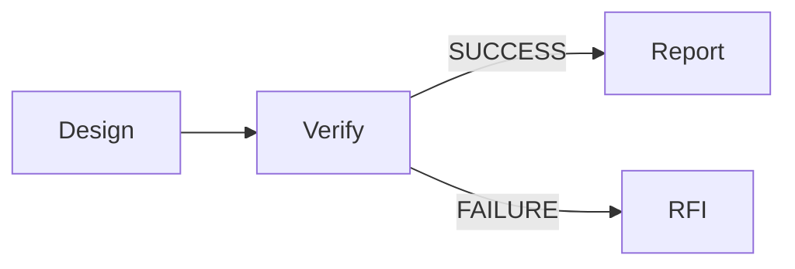

# Cognitive Architecture v2 — Integration Guide

The dispatcher now produces a validated directed acyclic graph (DAG), rather than treating a globally sorted skill list as a workflow. The existing keyword/ontology classifier remains the router for individual tasks. This implementation uses only the Python standard library.

## Planning

```powershell
python .agents/skills/Global_Dispatcher/scripts/pipeline_builder.py --prompt "Tính dầm B1 rồi song song vẽ mặt cắt và tính chi phí rồi lập phụ lục tính toán"
python .agents/skills/Global_Dispatcher/scripts/intent_classifier.py --prompt "Kiểm chứng chéo với ETABS; nếu đạt thì xuất phụ lục tính toán; ngược lại tạo RFI"
```

`IntentClassifier.classify()` retains its previous fields. `workflow` contains the DAG; an explicitly decomposed request also places the DAG in `pipeline`. Single-intent classification and explicit `@DE`/`@SDE` overrides retain their previous routing behavior.

`PipelineBuilder.build(skills)` now preserves the requested sequence, instead of reordering it by a global skill priority. Templates use their declared sequence. `build_dag(definitions)` accepts explicit dependencies when natural-language grammar is insufficient. Distinct occurrences of one skill remain distinct stage nodes.

A workflow contains `schema_version`, `graph_type`, `stages`, `edges`, `topological_order` and `execution_batches`. Each stage has a numeric `stage` identifier and `depends_on`. Parallel batches are derived from graph edges; independent tasks must write disjoint artifacts. Handoff schemas follow actual edges, including fan-out and joins. Existing review-gate and repair-limit metadata remains present.



Supported connectors include `rồi`, `sau đó`, `tiếp theo`, `then`, semicolons, and explicit `song song`/`đồng thời`/`in parallel`. Conditions use `nếu ... thì ...` or `if ... then ...`; `ngược lại`/`else` selects the complementary branch. Supported predicates are pass/failure statuses and numeric comparisons on `eta` or `confidence`. This is a bounded, deterministic grammar, not an LLM that understands arbitrary language. Nested/unknown conditions and unresolved clauses require clarification or explicit definitions. They are not silently converted into unconditional execution. The default planned-stage limit is 64.

Example explicit stage definition:

```python
plan = builder.build_dag([
    {"skill": "SKILL_VERIFY"},
    {"skill": "SKILL_RFI", "depends_on": [1],
     "condition": {"source_stage": 1, "field": "eta", "op": ">",
                   "value": 0.9, "negate": False}},
])
next_step = builder.ready_stages(plan, {
    "1": {"status": "SUCCESS", "outputs": {"eta": 0.95}}
})
assert next_step["ready"] == [2]
```

The scheduler returns `ready`, `skipped` and `blocked`. It does not call tools or execute source text. Missing/non-finite numeric outputs stay pending. Failed dependencies cannot trigger an unconditional export. A failure-handling condition may explicitly consume its failed source. Conditional joins wait for the selected branch and propagate the unselected branch as skipped. The host must enforce review/approval policy before invoking tools; readiness is a dependency decision, not user authorization.

## LoopBreaker and token admission

`LoopBreaker(max_hops=10, max_cycle_repeats=2, token_budget=None)` retains the existing API and adds budget/cycle metadata. `ABC A` reports the closed cycle path. `ABC ABC` trips at two full periods, matching legacy `AB AB` semantics. Set `max_cycle_repeats=1` to trip at the first closure. Once tripped, the breaker remains blocked until `reset()`. Calls by one actor alone are bounded by hop count rather than treated as multi-agent cycles.

`TokenBudget(limit)` atomically reserves caller-supplied token estimates. At 80% utilization, subsequent calls are capped to 10% of the configured limit, bounded by remaining tokens. Requests exceeding either cap are denied without spending budget. The hard cap is protected by a lock, including concurrent requests. A limit of zero blocks admission; `None` preserves unlimited legacy behavior.

```python
controller = SystemController()
session = controller.start_session(token_budget=20_000, max_hops=100)
try:
    result = controller.execute(
        "CODEX", "read_document", lambda: "document contents",
        session_id=session, estimated_tokens=500,
    )
finally:
    controller.end_session(session)
```

Every admitted attempt is charged, including failures. This is conservative reservation accounting, not a provider tokenizer or monetary billing meter. Callers must provide estimates and a configured session limit to obtain token enforcement. Existing three-argument `preflight_check(actor, tool, payload)` calls remain valid but use the legacy default session with no token cap. Do not preflight and then call `execute()` for the same attempt, because both perform admission.

Budget/cycle state is isolated by session. Service circuit breakers are intentionally shared, since they protect the same external service. Rejected requests preserve one-time approval tickets. `recommended_parallel_calls` is advisory; per-call token caps and total admission caps are enforced. Closing a session removes its state; it does not cancel an already running callable.

## CircuitBreaker and JSONL

Use `SystemController.execute()` for guard, loop, token, circuit and execution tracing in one path. Standalone `CircuitBreaker.call()` remains available. `call_traced(trace_id, callable, ...)` correlates circuit events with an existing workflow trace without consuming callable keyword arguments.

Trip/recovery events, denied circuit calls, budget/loop/guard blocks and execution spans are recorded. HALF_OPEN permits one concurrent probe. Generation checks prevent a successful call from an older CLOSED window from closing a circuit that tripped later. Exceptions retain their original traceback and are included in failure tracing.

BlackboxRecorder appends one JSON object per line under `log_dir/traces/trace_YYYYMMDD.jsonl`, flushes and fsyncs records. Writes are serialized across recorder instances in the same Python process. Independent processes need a shared IPC lock if they write the same file. I/O errors remain observable in `persistence_errors`; the application does not claim durable storage if the disk write failed. Logs contain tool/actor/event metadata rather than full raw payloads.

## Validation

```powershell
python .agents/tests/test_cognitive_architecture_v2.py
python .agents/tests/run_all_tests.py
```

The new module covers 47 tests: dependency ordering, fan-out/join, true/false branches, unresolved conditions, invalid graphs, sticky multi-agent cycles, throttle boundaries, concurrent reservations, session isolation, HALF_OPEN probes, stale successes, approval preservation, JSONL concurrency and observable persistence errors. It is registered as suite 22 in the official runner.

Measured result for this implementation: 47/47 new tests and 22/22 official suites PASS. This is a 100% pass rate for the executed test cases, not a proof over every future input or every external service failure.
