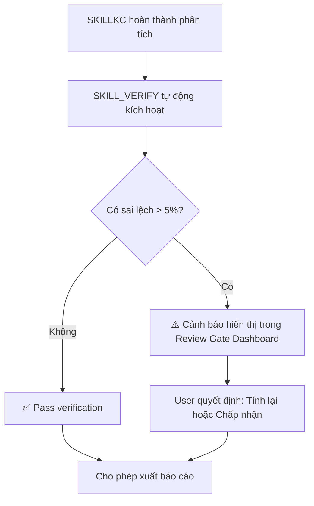

# SKILL_VERIFY — Module Kiểm chứng Chéo (Cross-Verification)

## Tổng quan

**SKILL_VERIFY** là module **Quality Assurance** tự động — kiểm tra tính nhất quán và chính xác giữa các kết quả tính toán từ nhiều nguồn khác nhau.

**Mục tiêu:**
- Phát hiện sai sót tính toán sớm (trước khi xuất báo cáo)
- Đảm bảo tính nhất quán giữa các phân tích
- Cảnh báo khi có mâu thuẫn về tiêu chuẩn/phương pháp

---

## Kích hoạt (Trigger)

### Tự động:
- Sau khi `Design_Evaluation` hoặc `Structural_Design_Engineer` hoàn thành phân tích
- Trước khi `SKILL_REPORT` xuất file Word/PDF

### Thủ công:
- User yêu cầu: **"kiểm chứng"**, **"verify"**, **"cross-check"**, **"so sánh kết quả"**

---

## 5 Loại Kiểm chứng

### 1. Inter-Module Verification (Kiểm chứng Liên-Module)

**So sánh kết quả giữa 2 skill:**

```python
# SKILLKC tính dầm B1
result_SKILLKC = {
    "M_Rd": 310.5,  # kN.m
    "eta_M": 0.805,
    "Standard": "TCVN 5574:2018"
}

# Structural_Design_Engineer tính lại cùng dầm B1
result_SDE = {
    "M_Rd": 298.2,  # kN.m
    "eta_M": 0.838,
    "Standard": "TCVN 5574:2018"
}

# SKILL_VERIFY so sánh
variance = abs(310.5 - 298.2) / 310.5 * 100  # = 3.96%

if variance > 5.0:
    alert = "⚠️ CRITICAL: Sai lệch M_Rd giữa 2 module = 3.96% (ngưỡng: 5%). Yêu cầu kiểm tra lại."
```

**Ngưỡng cảnh báo:**
- **< 5%:** Chấp nhận được (do làm tròn, giả định khác nhau)
- **5-10%:** Cảnh báo — cần kiểm tra
- **> 10%:** Nguy hiểm — dừng xuất báo cáo, yêu cầu User can thiệp

---

### 2. Standard Version Conflict Detection (Phát hiện Xung đột Tiêu chuẩn)

**Kịch bản:**
```json
// Module A sử dụng
{"Standard_Method": "TCVN 5575:2012"}

// Module B sử dụng
{"Standard_Method": "TCVN 5575:2024"}

// SKILL_VERIFY phát hiện
{
  "Conflict_Type": "STANDARD_VERSION_MISMATCH",
  "Issue": "Cùng 1 cấu kiện được tính bằng 2 phiên bản tiêu chuẩn khác nhau",
  "Modules": ["Design_Evaluation/steel_member_check.py", "Structural_Design_Engineer/calc_steel_beam.py"],
  "Severity": "HIGH",
  "Action": "Chỉ định rõ phiên bản nào là chuẩn (theo STANDARDS_LOCK.md) và tính lại module còn lại"
}
```

**Quy tắc:**
- **Cùng 1 đối tượng** (dầm B1, cột C2) → **PHẢI** dùng cùng 1 phiên bản tiêu chuẩn
- Nếu khác phiên bản → **BẮT BUỘC** cảnh báo

---

### 3. Calculation Logs Consistency Check (Kiểm tra Nhất quán Calculation_Logs)

**Mục tiêu:** Đảm bảo `Calculation_Logs` có đầy đủ thông tin và không mâu thuẫn

**Checklist:**
- [ ] Mọi bước tính phải có `Formula`
- [ ] Mọi bước tính phải có `Substitution` (thế số)
- [ ] Mọi bước tính phải có `Result`
- [ ] `Result` của bước N phải khớp với input của bước N+1
- [ ] `Citation` phải có đủ 6 trường (nếu có)

**Ví dụ phát hiện lỗi:**

```python
# Bước 2: Result = "M_Rd = 310.5 kN.m"
# Bước 3: Substitution = "M_Ed = 250 / M_Rd = 305.0"  ← SAI! 310.5 ≠ 305.0

{
  "Error_Type": "CALCULATION_INCONSISTENCY",
  "Step": 3,
  "Issue": "M_Rd trong Bước 3 (305.0) khác với Result Bước 2 (310.5)",
  "Severity": "MEDIUM",
  "Action": "Kiểm tra lại script tính toán hoặc làm tròn số"
}
```

---

### 4. External Software Comparison (So sánh với Phần mềm Thương mại)

**Mục tiêu:** So sánh kết quả AI với ETABS/SAP2000/SAFE

**Input:**
- File export từ ETABS (.xlsx, .txt)
- Kết quả AI tính toán

**So sánh:**

| Cấu kiện | ETABS M (kN.m) | AI M (kN.m) | Variance |
|----------|----------------|-------------|----------|
| Dầm B1 | 252.3 | 250.0 | 0.91% ✅ |
| Dầm B2 | 187.5 | 202.1 | 7.79% ⚠️ |
| Cột C1 | 1205.0 | 1198.5 | 0.54% ✅ |

**Output:**
```json
{
  "Comparison_Summary": {
    "Total_Elements": 3,
    "Match_Count": 2,
    "Warning_Count": 1,
    "Critical_Count": 0
  },
  "Warnings": [
    {
      "Element": "Dầm B2",
      "ETABS_Value": 187.5,
      "AI_Value": 202.1,
      "Variance": 7.79,
      "Possible_Reason": "Mô hình ETABS có thể dùng tổ hợp tải khác, hoặc AI sử dụng moment phong bì thay vì moment từ 1 tổ hợp"
    }
  ]
}
```

**Script:** `scripts/compare_with_etabs.py`

---

### 5. Report Consistency Check (Kiểm tra Nhất quán Báo cáo)

**Mục tiêu:** Đảm bảo số liệu trong báo cáo Word/PDF khớp với kết quả tính toán gốc

**Quy trình:**
1. AI xuất JSON handoff từ SKILLKC
2. SKILL_REPORT bơm JSON vào Word
3. SKILL_VERIFY đọc lại Word → parse số liệu → so sánh với JSON gốc

**Ví dụ phát hiện lỗi:**

```python
# JSON gốc
{"eta_M": 0.805}

# Word output (parse bằng docx library)
"η = 0.850"  ← SAI! 0.805 ≠ 0.850

{
  "Error_Type": "REPORT_DATA_MISMATCH",
  "Field": "eta_M",
  "JSON_Value": 0.805,
  "Report_Value": 0.850,
  "Severity": "CRITICAL",
  "Action": "Kiểm tra template Word hoặc script generate_report.py"
}
```

---

## Cấu trúc Thư mục

```
SKILL_VERIFY/
├── SKILL.md                        ← BẠN ĐANG Ở ĐÂY
├── scripts/
│   ├── inter_module_verify.py      ← Loại 1
│   ├── standard_conflict_checker.py← Loại 2
│   ├── calculation_logs_checker.py ← Loại 3
│   ├── compare_with_etabs.py       ← Loại 4
│   └── report_consistency_check.py ← Loại 5
├── schemas/
│   └── verification_report.schema.json
└── README.md
```

---

## Quy trình Tích hợp

### Tự động trong Review Gate



### Thủ công theo yêu cầu

**User:** *"Kiểm chứng kết quả dầm B1 với ETABS"*

**AI:**
1. Kích hoạt `SKILL_VERIFY`
2. Yêu cầu User upload file ETABS export
3. Chạy `compare_with_etabs.py`
4. Hiển thị bảng so sánh
5. Nếu có warning → giải thích nguyên nhân có thể

---

## Verification Report (Báo cáo Kiểm chứng)

**Format chuẩn:**

```json
{
  "Verification_ID": "VRF-20260804-001",
  "Timestamp": "2026-08-04T11:45:00",
  "Project": "Văn phòng ABC Tower",
  "Scope": "Dầm tầng 5",
  "Verification_Types": ["Inter-Module", "Standard-Version", "Calculation-Logs"],
  "Results": {
    "Total_Checks": 15,
    "Passed": 12,
    "Warnings": 2,
    "Critical": 1
  },
  "Issues": [
    {
      "Type": "INTER_MODULE_VARIANCE",
      "Severity": "WARNING",
      "Element": "Dầm B1",
      "Description": "Sai lệch M_Rd = 3.96% giữa SKILLKC và Structural_Design_Engineer",
      "Threshold": "5%",
      "Action": "Chấp nhận được - trong ngưỡng cho phép"
    },
    {
      "Type": "STANDARD_VERSION_CONFLICT",
      "Severity": "CRITICAL",
      "Element": "Dầm thép H400",
      "Description": "Module A dùng TCVN 5575:2012, Module B dùng TCVN 5575:2024",
      "Action": "BẮT BUỘC thống nhất phiên bản theo STANDARDS_LOCK.md"
    }
  ],
  "Overall_Status": "FAILED",
  "Recommendation": "Không xuất báo cáo cho đến khi xử lý xong 1 lỗi CRITICAL"
}
```

---

## Quy tắc Đặc biệt

### Rule 1: Zero-Tolerance cho CRITICAL
Nếu có **bất kỳ** lỗi `Severity: CRITICAL` → **KHÔNG** cho phép xuất báo cáo. Review Gate Dashboard phải block nút "Approve".

### Rule 2: Variance Threshold Tuning
Ngưỡng 5% có thể điều chỉnh theo loại tính toán:
- **Nội lực (M, V, N):** 5% (do làm tròn, tổ hợp tải khác nhau)
- **Utilization ratio η:** 3% (quan trọng hơn)
- **Diện tích cốt thép As:** 10% (do chọn thanh thực tế)

### Rule 3: Log All Verifications
Mọi lần chạy SKILL_VERIFY đều ghi log vào:
```
.agents/skills/Design_Evaluation/logs/verifications/
├── VRF-20260804-001.json
├── VRF-20260804-002.json
└── ...
```

Mục đích: Audit trail, truy xuất lại khi cần.

### Rule 4: User Can Override (with Warning)
User có thể bỏ qua warning (không phải critical) nếu họ hiểu rõ nguyên nhân. Nhưng phải ghi rõ lý do trong báo cáo:

> *"Sai lệch 7.8% giữa ETABS và AI do ETABS sử dụng tổ hợp 1.2D+1.6L, trong khi AI tính theo tổ hợp phong bì. Đã được kiểm tra và chấp nhận bởi Kỹ sư trưởng."*

---

## Ví dụ Workflow End-to-End

**Tình huống:** User yêu cầu review dầm B1, cả SKILLKC và Structural_Design_Engineer đều tính.

1. **SKILLKC** tính:
   ```json
   {"M_Rd": 310.5, "eta_M": 0.805, "Standard": "TCVN 5574:2018"}
   ```

2. **Structural_Design_Engineer** tính:
   ```json
   {"M_Rd": 298.2, "eta_M": 0.838, "Standard": "TCVN 5574:2018"}
   ```

3. **SKILL_VERIFY** tự động kích hoạt:
   ```bash
   python inter_module_verify.py \
     --result1 skillkc_output.json \
     --result2 sde_output.json \
     --threshold 5.0
   ```

4. **Output:**
   ```json
   {
     "Variance_M_Rd": 3.96,
     "Variance_eta": 4.10,
     "Status": "WARNING",
     "Message": "Sai lệch < 5% — chấp nhận được. Nguyên nhân có thể: làm tròn khác nhau hoặc giá trị W_pl khác nhau."
   }
   ```

5. **Review Gate Dashboard** hiển thị:
   ```
   ⚠️ Cảnh báo: Sai lệch 3.96% giữa 2 module
   [ ] Tôi đã kiểm tra và hiểu nguyên nhân
   ```

6. User tick checkbox → Approve → Xuất báo cáo

---

## Integration với Các Skill khác

```
┌─────────────────┐
│  SKILLKC        │
│  (Analysis)     │
└────────┬────────┘
         │ JSON output
         ↓
┌─────────────────┐
│ SKILL_VERIFY    │ ← So sánh với Structural_Design_Engineer
│ (Cross-Check)   │ ← Kiểm tra Standard Version
└────────┬────────┘ ← Validate Calculation_Logs
         │ Verification Report
         ↓
┌─────────────────┐
│ Review Gate     │ ← Hiển thị warnings
│ Dashboard       │ ← Block approve nếu CRITICAL
└────────┬────────┘
         │ User approve
         ↓
┌─────────────────┐
│ SKILL_REPORT    │
│ (Generate .docx)│
└─────────────────┘
```

---

## Version History

| Version | Date | Changes |
|---------|------|---------|
| 1.0.0 | 2026-08-04 | Initial release - 5 loại kiểm chứng |
